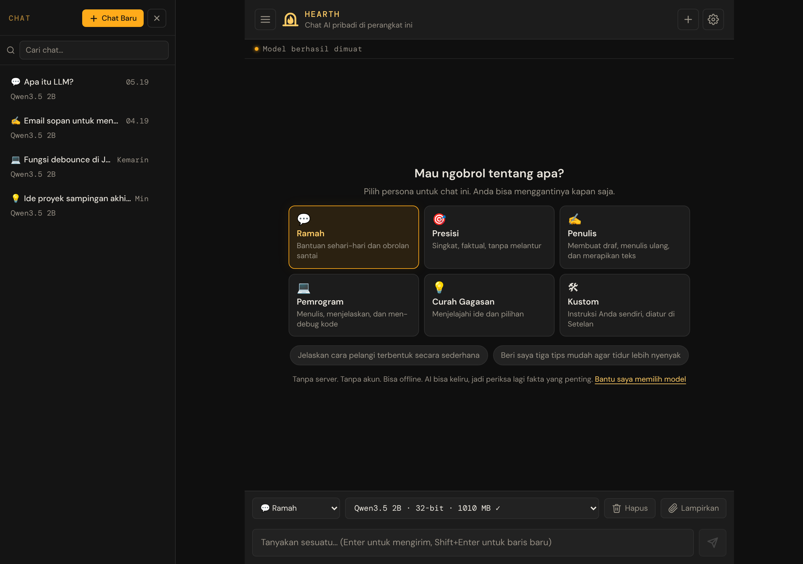
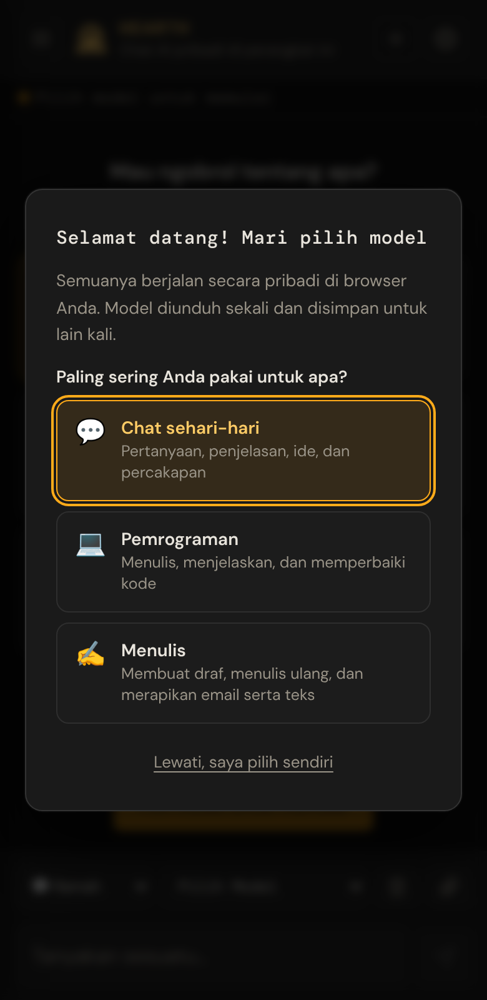

# Hearth

[English](README.md) · **Bahasa Indonesia**

**Chat AI pribadi yang tinggal di browser Anda.** Tanpa server. Tanpa akun. Bisa offline.

Model AI berjalan di perangkat Anda sendiri, jadi tidak ada yang Anda ketik yang meninggalkannya. Setelah sebuah model diunduh, model itu tetap berfungsi tanpa koneksi internet. Sumber terbuka, dan didukung oleh [WebLLM](https://github.com/mlc-ai/web-llm) serta WebGPU.

**[Coba sekarang → bowo-prasetyo.github.io/web-llm](https://bowo-prasetyo.github.io/web-llm/)**

> **Catatan:** Ini adalah terjemahan dari [README bahasa Inggris](README.md). Jika ada perbedaan, misalnya setelah pembaruan, versi bahasa Inggris yang berlaku.



## Fitur utama

* **Pribadi sejak awal.** Model AI berjalan di GPU Anda sendiri. Pesan, chat, dan dokumen Anda hanya disimpan di browser Anda dan tidak pernah dikirim ke mana pun.
* **Tanpa pengaturan.** Buka halamannya, jawab dua pertanyaan, dan aplikasi memilih model yang cocok untuk perangkat Anda. Tanpa instalasi, tanpa pendaftaran, tanpa kunci API.
* **Bisa offline.** Setelah kunjungan pertama, aplikasi dan model apa pun yang sudah Anda unduh berfungsi tanpa koneksi internet. Anda juga bisa memasangnya sebagai aplikasi di komputer dan ponsel.
* **Persona untuk berbagai keperluan.** Ramah, Presisi, Penulis, Pemrogram, dan Curah Gagasan, atau tulis instruksi Anda sendiri. Pilih satu untuk setiap chat.
* **Bertanya tentang dokumen Anda.** Lampirkan file PDF, teks, atau Markdown ke sebuah chat dan bertanyalah tentang isinya.
* **Jawaban yang mudah dibaca.** Balasan diformat dengan judul, daftar, tabel, dan kode yang disorot dengan tombol Salin.
* **Banyak model.** 55 model terbuka dari 100M sampai 9B parameter, termasuk Qwen3.5, Llama 3, Phi-4-mini, Gemma, dan Mistral. Aplikasi menunjukkan seberapa cepat setiap model menulis di perangkat Anda dan menyarankan model yang lebih kecil jika lambat.
* **Chat Anda tersimpan.** Banyak chat dengan pencarian, tersimpan otomatis, dengan ekspor dan impor untuk memindahkannya ke browser lain.
* **Dalam bahasa Anda.** Tampilan aplikasi tersedia dalam bahasa Inggris, bahasa Indonesia, dan bahasa Jepang (**Setelan → Bahasa**), dan AI membalas dalam bahasa yang Anda pakai saat menulis.



## Memulai

1. Buka **https://bowo-prasetyo.github.io/web-llm/** di Chrome atau Edge di komputer (disarankan), atau Safari terbaru (macOS 14+ / iOS 17+). Browser memerlukan [WebGPU](#persyaratan). Ponsel juga bisa, tetapi banyak ponsel hanya mampu menjalankan model terkecil (lihat [Keterbatasan yang diketahui](#keterbatasan-yang-diketahui)).
2. Pilih paling sering Anda pakai untuk apa (chat sehari-hari, pemrograman, atau menulis) dan ukurannya (Cepat, Seimbang, atau Pintar).
3. Tunggu unduhan sekali saja (dari sekitar 0,4 GB untuk pilihan terkecil sampai 4,8 GB untuk yang terbesar), lalu mulailah mengobrol. Lain kali model dimuat dari perangkat Anda.

Baru memakai aplikasi ini? **[Panduan Pengguna](docs/user-manual/id/README.md)** menjelaskan semuanya langkah demi langkah dengan bahasa sederhana: mengobrol, persona, dokumen, memilih model, setelan, pemakaian offline dan pencadangan, serta pemecahan masalah.

## Apa yang tetap di perangkat Anda, dan apa yang diunduh

* **Tetap di perangkat Anda:** pesan, chat, dokumen terlampir, dan setelan Anda (di penyimpanan browser), serta model AI itu sendiri, yang berjalan di GPU Anda.
* **Diunduh sekali:** file model (dari Hugging Face dan GitHub), pustaka kode aplikasi (dari CDN publik), dan, untuk dokumen besar, model pencarian kecil (~23 MB). Tidak ada yang Anda ketik yang menjadi bagian dari permintaan ini.
* Menghapus data situs di browser Anda menghapus semuanya, termasuk model yang sudah diunduh.

## Keterbatasan yang diketahui

* **Paling baik di komputer.** Ponsel hanya memberi sedikit memori untuk AI: di banyak ponsel, model berukuran 0,7 GB atau lebih menutup halaman, dan hanya model Sangat kecil yang muat, yang jawabannya sangat terbatas. Saat sebuah model menutup halaman, aplikasi menjelaskannya dan menyarankan model yang lebih kecil, turun satu ukuran setiap kali.
* **Belum diuji di Safari (iPhone, iPad, Mac) atau Firefox.** Versi 1.0.0 diuji di Chrome dan Edge pada laptop Windows serta Chrome di Android. Jika ada yang tidak berfungsi di perangkat Anda, gunakan **Setelan → Perangkat ini → Laporkan masalah**.
* **Memerlukan WebGPU.** Chrome dan Edge terbaru di desktop bekerja paling baik; Chrome Android dan Safari (macOS 14+ / iOS 17+) berfungsi di banyak perangkat. Dukungan WebGPU di Firefox lebih baru dan belum banyak diuji, dan browser lama tidak bisa menjalankannya.
* **Unduhan besar.** Sebuah model berukuran 0,2–4,9 GB untuk diunduh, disimpan oleh browser, dan memerlukan memori GPU lebih banyak dari itu saat berjalan (sekitar 0,6–7,5 GB). Menghapus data situs akan menghapusnya. **Jendela pribadi (penyamaran)** mengizinkan ruang penyimpanan yang jauh terlalu kecil untuk sebuah model; aplikasi memperingatkan sebelum mengunduh jika sebuah model kemungkinan tidak muat.
* **Kecepatan tergantung GPU Anda.** Pada GPU terintegrasi atau GPU lama, model 2B mungkin menulis sekitar 1 kata per detik; aplikasi menunjukkan kecepatannya dan menyarankan model yang lebih kecil.
* **Model kecil sering salah soal fakta.** Model kecil menulis dengan lancar bahkan saat salah. Periksa hal yang penting, dan pilih model yang lebih besar untuk pertanyaan faktual.
* **Bahasa selain Inggris.** Model kecil paling kuat dalam bahasa Inggris. Untuk percakapan dalam bahasa Indonesia, Qwen3.5 2B ke atas memberi hasil yang jauh lebih baik daripada model yang sangat kecil.
* **Tanpa akses internet.** Model hanya tahu apa yang dipelajarinya saat pelatihan (dan dokumen yang Anda lampirkan); model tidak bisa mencari informasi atau mengetahui peristiwa terbaru.
* **Satu perangkat dalam satu waktu.** Chat tetap di browser tempat Anda membuatnya; gunakan Ekspor / Impor untuk memindahkannya.

## Nama dan merek

Aplikasi ini bernama **Hearth** (perapian): tempat hangat di tengah rumah, tempat api dijaga. Seperti perapian, aplikasi ini tetap di rumah Anda (perangkat Anda) dan terus menyala tanpa bantuan dari luar. Nama lengkapnya *Hearth, chat AI pribadi yang tinggal di browser Anda*, dan janji singkatnya *Tanpa server. Tanpa akun. Bisa offline.* Lihat [docs/brand.md](docs/brand.md) (bahasa Inggris) untuk ikon, warna, dan cara menulis namanya.

Repositori dan alamat web tetap bernama `web-llm`, agar tautan, aplikasi yang sudah terpasang, dan chat yang tersimpan tetap berfungsi.

## Versi dan melaporkan masalah

Versi saat ini adalah **1.0.0** (lihat [CHANGELOG.md](CHANGELOG.md), bahasa Inggris); aplikasi menampilkan versinya di **Setelan → Perangkat ini**.

Menemukan masalah? Gunakan **Setelan → Perangkat ini → Laporkan masalah**: tombol ini membuka formulir issue GitHub dengan versi aplikasi, browser, GPU, dan model Anda sudah terisi, yang sangat membantu untuk bug khusus GPU. Tidak ada yang dikirim sampai Anda mengirimkan formulirnya, dan mohon jangan sertakan chat pribadi. Anda juga bisa [membuka issue](https://github.com/bowo-prasetyo/web-llm/issues/new?template=problem.yml) secara langsung; laporan dalam bahasa Indonesia diterima.

## Semua fitur

* Chat AI yang sepenuhnya berjalan di sisi klien — tanpa backend, tidak ada data yang meninggalkan browser
* Bisa offline setelah kunjungan pertama, dan bisa dipasang sebagai aplikasi (PWA) di komputer dan ponsel
* Banyak sesi chat dengan penyimpanan, pemulihan, dan penghapusan otomatis
* Pencarian teks lengkap di semua sesi chat (judul, pertanyaan, dan jawaban)
* Percakapan tetap tersimpan saat tab ditutup dan saat layar ponsel mati
* Pertanyaan yang belum terjawab dilanjutkan otomatis setelah tab ditangguhkan
* Mencegah pengiriman ganda saat mengirim ulang secara manual setelah tab aktif kembali
* 55 model LLM yang bisa dipilih dari 15 keluarga model (termasuk Qwen3.5, Phi-4-mini, Gemma 3, Ministral 3, dan OLMo 2), dikelompokkan menurut ukuran
* Berganti model di tengah percakapan tanpa menghapus riwayat chat
* Pemilih model saat pertama kali dibuka: pilih untuk apa (chat, pemrograman, menulis) dan ukuran (Cepat / Seimbang / Pintar); pilihan disesuaikan dengan perangkat dan menghindari model 16-bit jika tidak berfungsi
* Konfirmasi unduhan dengan perkiraan ukuran saat sebuah model pertama kali dipakai (dari bilah alat chat dan dari Setelan)
* Menghapus atau mengosongkan chat selalu bertanya dulu; tidak ada yang terhapus dengan sekali ketuk
* Ramah keyboard dan pembaca layar: dialog dan daftar chat menjaga fokus dan tertutup dengan Escape, setiap kontrol punya nama, dan perubahan status diumumkan
* Panel kemajuan unduhan: bilah kemajuan dengan persentase, jumlah yang sudah diunduh, perkiraan sisa waktu, dan tombol Batal (membatalkan kembali ke model sebelumnya)
* Model ditampilkan dengan nama yang mudah dibaca, presisi, dan ukuran unduhan ("Qwen3.5 2B · 16-bit · 1010 MB ✓"), dengan ✓ untuk yang sudah diunduh
* Menghentikan pembuatan balasan kapan saja selama balasan mengalir
* Cache model otomatis — model yang sudah dikonfirmasi langsung dimuat pada kunjungan berikutnya
* Setelan lokal yang tersimpan (model, temperatur, top-p, penalti, jendela konteks, persona), disimpan saat Anda mengubahnya
* Tema terang dan gelap: mengikuti perangkat secara bawaan, atau pilih Terang atau Gelap di Setelan → Tampilan
* Tampilan aplikasi dalam bahasa Inggris, bahasa Indonesia, dan bahasa Jepang: mengikuti bahasa browser secara bawaan, atau pilih di Setelan → Bahasa; terjemahan baru bisa ditambahkan (lihat [docs/translating.md](docs/translating.md))
* Ukuran unggahan file maksimum yang bisa diatur (1–200 MB, bawaan 50 MB)
* Ekspor setelan ke file JSON dan impor di browser lain
* Ekspor semua sesi chat ke file JSON dan impor (gabungkan) di browser lain — tanpa duplikat
* Balasan AI yang mengalir dengan penghitung kata langsung; gulir ke atas untuk membaca ulang selama balasan mengalir, dan **Ke pesan terbaru** membawa Anda kembali
* Balasan ditampilkan sebagai Markdown: judul, daftar, tabel, tautan, dan blok kode dengan penyorotan sintaksis dan tombol Salin
* Salin balasan mana pun, dan buat ulang (atau coba lagi) balasan terakhir
* Penalaran dari model yang berpikir (Qwen3, DeepSeek-R1) ditampilkan langsung, lalu dilipat menjadi "Proses berpikir" yang bisa dibuka
* Inferensi yang dipercepat GPU memakai WebGPU
* Layar kesalahan WebGPU yang ramah dengan langkah pemecahan masalah saat GPU tidak tersedia
* Pemeriksaan model singkat setelah model pertama kali dimuat di setiap perangkat: mendeteksi GPU yang salah menghitung matematika 16-bit (model q4f16 membalas dengan teks sampah seperti "outer outer outer…") dan menawarkan versi q4f32
* Balasan yang rusak menjadi kata berulang dihentikan, dijelaskan, dan tidak dimasukkan ke riwayat percakapan
* Panel "Perangkat ini" di Setelan: versi WebLLM, GPU, dukungan 16-bit, dan hasil pemeriksaan model
* Isolasi Web Worker agar antarmuka tetap responsif selama inferensi
* Lampirkan dokumen (PDF, TXT, Markdown) ke sebuah chat: dokumen kecil diberikan utuh kepada model, dokumen besar dicari bagian yang cocok dengan setiap pertanyaan
* Lampiran milik satu chat, disimpan bersamanya (IndexedDB), dan diekspor, diimpor, serta dihapus bersamanya
* Pemulihan otomatis dari GPU yang macet, kesalahan mesin, dan kegagalan WASM Tokenizer
* Model dilepas otomatis setelah tidak dipakai untuk mengosongkan memori GPU
* Ingatan riwayat percakapan dengan jendela konteks yang bisa diatur
* Halaman Setelan dengan setelan balasan sehari-hari di depan dan setelan sampling lanjutan terlipat; perubahan tersimpan otomatis
* Menunjukkan seberapa cepat model menulis di perangkat ini (misalnya "sekitar 1 kata/detik"), dan menyarankan model yang lebih kecil jika lambat, dengan catatan bahwa model yang lebih kecil lebih sering salah
* Jujur tentang model kecil: chat Ramah dan Presisi dengan model sekitar 1B parameter atau lebih kecil menampilkan petunjuk bahwa model itu sering salah soal fakta (bisa disembunyikan per model dengan ×), dan ukuran Cepat di pemilih model juga menyebutkannya
* Enam persona chat (Ramah, Presisi, Penulis, Pemrogram, Curah Gagasan, Kustom), dipilih per chat dan bisa diganti di tengah percakapan
* Layar pembuka untuk chat baru dengan kartu persona dan contoh pertanyaan
* Antarmuka responsif: di layar lebar (1024px ke atas) daftar chat berada di samping chat dan bisa disembunyikan; layar yang lebih sempit mendapat laci yang bergeser masuk; di ponsel, Enter membuat baris baru dan tombol Kirim yang mengirim, dan kotak pesan membesar saat Anda mengetik

## Model yang didukung

Tersedia 55 model, diurutkan dari yang paling ringan sampai paling berat.
Menu model di aplikasi mengelompokkannya menurut ukuran memakai label
`<optgroup>`. **Baru** menandai model yang ditambahkan setelah daftar awal;
semuanya didukung oleh versi WebLLM yang dipakai aplikasi (0.2.84).

### Sangat kecil: untuk pengujian; jawaban sangat terbatas

Model-model ini hampir tidak bisa bercakap-cakap: mengulang-ulang, salah pada sebagian besar fakta, dan kadang membacakan instruksinya sendiri sebagai jawaban. TinyLlama punya 1,1B parameter tetapi berasal dari 2023 dan menjawab seperti model yang sangat kecil, jadi juga dimasukkan di sini. Model-model ini disimpan untuk pengujian dan perangkat yang sangat lemah, ditampilkan paling akhir di menu model dengan label ini, dan tidak pernah disarankan oleh pemilih model.

| Model | Perkiraan ukuran |
|---|---|
| SmolLM2-135M-Instruct-q0f32-MLC | ~720 MB |
| SmolLM2-360M-Instruct-q4f32_1-MLC | ~580 MB |
| SmolLM2-360M-Instruct-q0f32-MLC | ~1,7 GB |
| TinyLlama-1.1B-Chat-v1.0-q4f32_1-MLC | ~840 MB |

### Mikro (0,5–0,8B)

| Model | Perkiraan ukuran |
|---|---|
| Qwen3.5-0.8B-q4f16_1-MLC (baru) | ~1,6 GB |
| Qwen3.5-0.8B-q4f32_1-MLC (baru) | ~1,8 GB |
| Qwen2.5-0.5B-Instruct-q4f16_1-MLC | ~945 MB |
| Qwen2.5-0.5B-Instruct-q4f32_1-MLC | ~1,0 GB |
| Qwen2.5-Coder-0.5B-Instruct-q4f16_1-MLC | ~945 MB |
| Qwen3-0.6B-q4f16_1-MLC | ~1,0 GB |

### Ringan (1–1,7B)

| Model | Perkiraan ukuran |
|---|---|
| gemma3-1b-it-q4f16_1-MLC (baru) | ~711 MB |
| OLMo-2-0425-1B-Instruct-q4f16_1-MLC (baru) | ~1,7 GB |
| OLMo-2-0425-1B-Instruct-q4f32_1-MLC (baru) | ~2,4 GB |
| Llama-3.2-1B-Instruct-q4f16_1-MLC | ~879 MB |
| Llama-3.2-1B-Instruct-q4f32_1-MLC | ~1,1 GB |
| SmolLM2-1.7B-Instruct-q4f16_1-MLC | ~1,7 GB |
| SmolLM2-1.7B-Instruct-q4f32_1-MLC | ~2,6 GB |
| Qwen3-1.7B-q4f16_1-MLC | ~1,7 GB |
| stablelm-2-zephyr-1_6b-q4f16_1-MLC | ~2,0 GB |

### Kecil (1,5B)

| Model | Perkiraan ukuran |
|---|---|
| Qwen2.5-1.5B-Instruct-q4f16_1-MLC | ~1,6 GB |
| Qwen2.5-1.5B-Instruct-q4f32_1-MLC | ~1,8 GB |
| Qwen2.5-Coder-1.5B-Instruct-q4f16_1-MLC | ~1,6 GB |
| Qwen2.5-Math-1.5B-Instruct-q4f16_1-MLC | ~1,6 GB |

### Menengah (2–4B)

| Model | Perkiraan ukuran |
|---|---|
| Qwen3.5-2B-q4f16_1-MLC (baru) | ~2,2 GB |
| Qwen3.5-2B-q4f32_1-MLC (baru) | ~2,5 GB |
| Ministral-3-3B-Instruct-2512-BF16-q4f16_1-MLC (baru) | ~2,8 GB |
| Ministral-3-3B-Instruct-2512-BF16-q4f32_1-MLC (baru) | ~3,4 GB |
| Qwen3.5-4B-q4f16_1-MLC (baru) | ~3,8 GB |
| Qwen3.5-4B-q4f32_1-MLC (baru) | ~4,6 GB |
| gemma-2-2b-it-q4f16_1-MLC | ~1,9 GB |
| gemma-2-2b-it-q4f32_1-MLC | ~2,5 GB |
| Llama-3.2-3B-Instruct-q4f16_1-MLC | ~2,2 GB |
| Llama-3.2-3B-Instruct-q4f32_1-MLC | ~2,9 GB |
| Hermes-3-Llama-3.2-3B-q4f16_1-MLC | ~2,2 GB |
| Qwen2.5-3B-Instruct-q4f16_1-MLC | ~2,4 GB |
| Qwen2.5-3B-Instruct-q4f32_1-MLC | ~2,8 GB |
| Qwen2.5-Coder-3B-Instruct-q4f16_1-MLC | ~2,4 GB |
| Qwen3-4B-q4f16_1-MLC | ~3,1 GB |

### Menengah atas (3,8B)

| Model | Perkiraan ukuran |
|---|---|
| Phi-4-mini-instruct-q4f16_1-MLC (baru) | ~3,4 GB |
| Phi-4-mini-instruct-q4f32_1-MLC (baru) | ~4,1 GB |
| Phi-3.5-mini-instruct-q4f16_1-MLC | ~3,6 GB |
| Phi-3.5-mini-instruct-q4f32_1-MLC | ~5,4 GB |

### Besar (7–9B) — memerlukan VRAM ≥6 GB

| Model | Perkiraan ukuran |
|---|---|
| Qwen3.5-9B-q4f16_1-MLC (baru) | ~6,3 GB |
| Qwen3.5-9B-q4f32_1-MLC (baru) | ~7,4 GB |
| Qwen2.5-7B-Instruct-q4f16_1-MLC | ~5,0 GB |
| Qwen2.5-7B-Instruct-q4f32_1-MLC | ~5,8 GB |
| Qwen2.5-Coder-7B-Instruct-q4f16_1-MLC | ~5,0 GB |
| Qwen3-8B-q4f16_1-MLC | ~5,4 GB |
| Llama-3.1-8B-Instruct-q4f16_1-MLC | ~4,9 GB |
| Llama-3.1-8B-Instruct-q4f32_1-MLC | ~6,0 GB |
| Hermes-3-Llama-3.1-8B-q4f16_1-MLC | ~4,8 GB |
| Mistral-7B-Instruct-v0.3-q4f32_1-MLC | ~5,5 GB |
| DeepSeek-R1-Distill-Qwen-7B-q4f16_1-MLC | ~5,0 GB |
| DeepSeek-R1-Distill-Llama-8B-q4f16_1-MLC | ~4,9 GB |
| gemma-2-9b-it-q4f16_1-MLC | ~6,3 GB |

Ukuran di tabel-tabel ini adalah memori GPU yang diperlukan setiap model (`MODEL_SIZES_MB` di `worker.js`, dari registri model WebLLM; 1 GB = 1024 MB). Unduhannya lebih kecil: aplikasi menampilkan ukuran unduhan sebenarnya (`DOWNLOAD_SIZES_MB`, file bobot model di Hugging Face), misalnya 404 MB untuk Qwen3.5 0.8B, yang memerlukan sekitar 1,6–1,9 GB memori GPU.

**q4f16 vs q4f32.** Model q4f16 lebih kecil dan lebih cepat tetapi memerlukan
matematika 16-bit dari GPU. Sebagian GPU dan browser salah menghitungnya, dan
model-model itu lalu membalas dengan teks sampah. Aplikasi memeriksa setiap model
sekali per perangkat; jika model 16-bit gagal (atau GPU tidak mendukungnya),
daftar model juga menampilkan versi q4f32 dari model yang tadinya hanya q4f16
(Qwen2.5-Coder, Qwen3, Hermes-3, DeepSeek-R1, gemma-2-9b, dan lainnya) dan
menandai model q4f16 dengan ⚠.
Model disimpan di cache lokal browser setelah unduhan pertama.

## Memilih model

Saat pertama kali dibuka, aplikasi mengajukan dua pertanyaan alih-alih langsung mengunduh apa pun:

1. **Paling sering Anda pakai untuk apa?** Chat sehari-hari, Pemrograman, atau Menulis (ini juga menentukan persona bawaan)
2. **Ukuran apa?**

| Kegunaan | Cepat | Seimbang | Pintar |
|---|---|---|---|
| Chat sehari-hari | Qwen3.5 0.8B | Qwen3.5 2B | Qwen3.5 4B |
| Pemrograman | Qwen3.5 2B | Qwen3.5 4B | Qwen3.5 9B |
| Menulis | Qwen3.5 2B | Qwen3.5 4B | Qwen3.5 9B |

* Qwen3.5 adalah generasi model terbaru yang didukung WebLLM 0.2.84; pemrograman dan menulis dimulai dari 2B, karena model yang lebih kecil sering mencampuradukkan kode dan kehilangan alur pada teks yang lebih panjang

* Cepat disarankan untuk ponsel dan perangkat yang melaporkan memori 4 GB atau kurang, Seimbang untuk yang lain; Pintar memerlukan GPU yang kuat. Di ponsel dan tablet, Cepat adalah **Llama 3.2 1B** untuk semua kegunaan (sekitar 1 GB memori GPU; Qwen3.5 0.8B memerlukan 1,6–1,9 GB, yang menutup halaman di banyak ponsel). Cepat paling kencang tetapi lebih sering salah soal fakta: model kecil menulis dengan lancar bahkan saat salah
* Perangkat yang tidak mendukung matematika GPU 16-bit, atau yang salah menghitungnya, otomatis mendapat versi q4f32 dari setiap pilihan
* Model yang sudah diunduh ditandai, dan model yang sedang dipakai diberi label
* **Lewati** menyerahkan pilihan kepada Anda (menu model); tidak ada yang diunduh sampai sebuah model dipilih, dan mengirim pesan lebih dulu akan membuka pemilih model
* Buka lagi kapan saja dari **Setelan → Bantu saya memilih model** atau layar pembuka
* Jika sebuah model sudah diunduh (misalnya setelah setelan dihapus), model itu dipakai tanpa bertanya

## Model yang disarankan

| Kegunaan | Model yang disarankan |
|---|---|
| Pemakaian sumber daya paling rendah | Gemma 3 1B (hanya q4f16) atau Qwen3.5-0.8B |
| Ponsel | Qwen3.5-0.8B atau Llama-3.2-1B |
| Chat umum | Qwen3.5-2B, atau Qwen3.5-4B dengan GPU yang lebih kuat |
| Pemrograman | Qwen3.5-4B atau Qwen3.5-9B (Qwen2.5-Coder masih tersedia) |
| Menulis | Qwen3.5-4B atau Ministral-3-3B-Instruct |
| Penalaran | Qwen3.5 dengan "Biarkan model penalaran berpikir dulu" aktif, atau DeepSeek-R1-Distill-Qwen-7B |
| Banyak bahasa, termasuk bahasa Indonesia | Qwen3.5-2B atau Qwen3.5-4B |
| Mengikuti instruksi | Phi-4-mini |
| Sepenuhnya terbuka (data dan kode) | OLMo-2-1B |
| Paling mampu (VRAM besar) | Qwen3.5-9B |

## Setelan pengguna

Bisa dibuka dari halaman ⚙ Setelan (ketuk ikon roda gigi di kepala halaman):

### Model

* **Pemilihan model** — pilih dari 55 model yang dikelompokkan menurut ukuran. Setiap model ditampilkan dengan nama, presisi, dan ukuran unduhan, misalnya "Qwen3.5 2B · 16-bit · 1010 MB ✓" (✓ = sudah diunduh); ID model lengkap ditampilkan di bawah menu. Berganti model tetap mempertahankan percakapan saat ini, dan model baru melanjutkannya dengan riwayat yang sama. Memilih model lain menerapkan setelan balasan yang disarankan untuk model itu.

### Balasan

* **Temperatur** — tingkat keacakan keluaran (0,0–2,0); rendah = fokus, tinggi = kreatif
* **Token Maksimum** — panjang maksimum satu balasan (16–2048, paling banyak separuh jendela konteks), ditampilkan dengan perkiraan jumlah kata. Nilai bawaan (`modelDefaults()` di `app.js`) adalah 256 untuk model 135M dan 360M; 512 untuk 0,5–0,8B, 1–1,1B, dan 1,7B; 768 untuk 1,5–1,6B dan 2B; dan 1024 untuk 3B ke atas (termasuk model Phi mini). Balasan yang mencapainya ditandai "Terpotong" dengan tombol **Lanjutkan**
* **Jendela Konteks** — berapa banyak token percakapan yang bisa dilihat model (512–8192). Hanya setelan ini yang membuat model perlu dimuat ulang: setelah diubah, Setelan menawarkan **Muat ulang model sekarang** (jika tidak, setelan ini berlaku saat aplikasi dibuka berikutnya). Jika sebuah chat melampauinya, giliran paling lama (lalu konteks dokumen) tidak lagi dilihat model
* **Biarkan model penalaran berpikir dulu** — nonaktif secara bawaan. Qwen3 dan Qwen3.5 bisa bernalar langkah demi langkah sebelum menjawab; kadang membantu untuk pertanyaan sulit tetapi lebih lambat dan menghabiskan panjang balasan, jadi nonaktif kecuali Anda mengaktifkannya (penalarannya lalu muncul sebagai "Proses berpikir" yang bisa dilipat). DeepSeek-R1 selalu bernalar
* **Sampling lanjutan** (terlipat secara bawaan):
  * **Top P** — ambang nucleus sampling (0,01–1,0); menyaring kandidat token menurut peluang kumulatif
  * **Penalti Frekuensi** — mengurangi pengulangan kata yang sudah muncul (−2 sampai 2)
  * **Penalti Kehadiran** — mendorong model membahas topik baru (−2 sampai 2)
  * **Penalti Pengulangan** — penalti perkalian bawaan MLC untuk token yang berulang (1,0–2,0)
* **Kembalikan ke setelan yang disarankan untuk model ini** — bertanya dulu; persona dan instruksi kustom tetap disimpan

### Dokumen

* **Ukuran Unggahan Maksimum** — ukuran file maksimum untuk unggahan dokumen (1–200 MB, bawaan 50 MB); teks yang diekstrak juga dibatasi 500.000 karakter (~200 halaman)

### Persona

Persona menentukan cara asisten berbicara. Setiap chat menyimpan personanya
sendiri: pilih satu di layar pembuka chat baru, atau ganti kapan saja dari menu
persona di bilah alat chat (berlaku mulai pesan berikutnya, dan percakapan
sejauh ini tetap disimpan).

| Persona | Paling cocok untuk |
|---|---|
| 💬 **Ramah** (bawaan) | Bantuan sehari-hari dan obrolan santai |
| 🎯 **Presisi** | Jawaban singkat dan faktual tanpa melantur; berkata "Saya tidak yakin" alih-alih menebak |
| ✍️ **Penulis** | Membuat draf, menulis ulang, dan merapikan email, pesan, esai, dan cerita |
| 💻 **Pemrogram** | Menulis, menjelaskan, dan men-debug kode |
| 💡 **Curah Gagasan** | Menjelajahi ide dan pilihan |
| 🛠 **Kustom** | Instruksi Anda sendiri, ditulis di Setelan |

* **Bawaan untuk chat baru** — pilih persona yang dipakai chat baru
* **Persona kustom** — instruksi yang sepenuhnya bisa diubah; perubahan berlaku pada pesan berikutnya tanpa memuat ulang model; **Kembalikan ke instruksi Ramah** memulihkan titik awal
* Persona hanya mengubah system prompt; temperatur dan setelan pembuatan balasan lainnya tetap seperti yang Anda atur
* Prompt persona sengaja dibuat singkat: model kecil di browser jauh lebih patuh pada instruksi singkat dan sederhana daripada daftar aturan yang panjang. Prompt ini ada di `personas.js` dan ditulis dalam bahasa Inggris, dengan permintaan agar model membalas dalam bahasa pengguna
* Setiap persona bawaan diminta tetap konsisten dengan apa yang dikatakannya sebelumnya, dan mengoreksi pengguna dengan lembut alih-alih menyetujui sesuatu yang tidak benar (model kecil cenderung mengikuti apa pun yang dikatakan pengguna)
* Setelan dari versi sebelumnya dimigrasikan otomatis: jika Anda pernah mengubah system prompt lama, prompt itu menjadi persona Kustom Anda dan tetap menjadi bawaan Anda; jika tidak, Anda pindah ke Ramah

### Tampilan

* **Sistem** (bawaan), **Terang**, atau **Gelap**. Sistem mengikuti setelan terang/gelap perangkat, juga saat setelan itu berubah ketika aplikasi terbuka; Terang dan Gelap selalu berlaku. Pilihan diingat di browser ini (`localStorage`, `webllm-theme`)
* Tema diterapkan oleh skrip kecil di bagian atas `index.html` sebelum halaman digambar, sehingga perangkat bertema terang tidak pernah melihat kilatan gelap. Skrip ini juga mengatur warna bilah alamat browser (`theme-color`) dan warna kontrol bawaan (`color-scheme`)
* Semua warna adalah token di bagian atas `style.css`; tema terang mendefinisikannya ulang di bawah `:root[data-theme="light"]`. Kuning amber menjadi warna isian (tombol, lencana) di kedua tema, dengan nuansa lebih gelap untuk teks dan garis tepi amber di latar terang

### Bahasa

* **Otomatis** (bawaan) atau salah satu bahasa yang tersedia: saat ini bahasa Inggris, bahasa Indonesia, dan bahasa Jepang. Otomatis memilih bahasa pertama di daftar bahasa browser yang dimiliki aplikasi, dan bahasa Inggris jika tidak ada. Setiap bahasa tercantum dengan namanya sendiri (dari `Intl.DisplayNames`)
* Pergantian langsung berlaku tanpa memuat ulang, termasuk `<html lang dir>` dan judul tab. Pilihan diingat di browser ini (`localStorage`, `webllm-language`) dan dibaca sebelum halaman pertama kali digambar
* Tanggal dan angka mengikuti bahasa yang dipilih, dengan gaya regional browser jika bahasanya sama (misalnya koma desimal dalam bahasa Indonesia)
* Kata dihitung dengan `Intl.Segmenter`, sehingga kecepatan menulis dan penghitung "~N kata" tepat untuk bahasa yang ditulis tanpa spasi (Jepang, Tionghoa, Thai)
* Teks antarmuka ada di `locales/<kode>.js`; [docs/translating.md](docs/translating.md) menjelaskan cara menambahkan bahasa

### Perangkat ini

* Menampilkan versi WebLLM, GPU, dan apakah GPU mendukung matematika 16-bit
* Menampilkan apakah model q4f16 berfungsi di sini, dan mencantumkan model yang gagal dalam pemeriksaan model (dengan contoh keluarannya)
* **Lupakan hasil pemeriksaan** menjalankan pemeriksaan lagi, misalnya setelah browser atau driver GPU diperbarui

### Ekspor / Impor

* **Ekspor Setelan** — unduh semua setelan sebagai file `hearth-settings-YYYY-MM-DD.json`
* **Impor Setelan** — muat setelan dari file hasil ekspor; pilihan model dipertahankan agar tidak memicu unduhan yang tidak diinginkan
* **Ekspor Chat** — unduh semua sesi tersimpan sebagai file `hearth-chats-YYYY-MM-DD.json`, termasuk isi pesan lengkap
* **Impor Chat** — gabungkan sesi dari file hasil ekspor ke browser saat ini; sesi duplikat dikenali dari ID dan sidik isi, lalu dilewati otomatis

Semua setelan disimpan otomatis di `localStorage` saat Anda mengubahnya dan tetap ada setelah halaman dimuat ulang; tidak ada tombol Terapkan. Setelan balasan dan persona berlaku pada pesan berikutnya, model baru dimuat saat Anda memilihnya, dan jendela konteks yang baru meminta model dimuat ulang. Tampilan dan bahasa tidak ikut diekspor.

### Chat saat ini

* **Hapus Percakapan** — menghapus chat yang sedang terbuka (bertanya dulu)

## Banyak sesi chat

* Di layar lebar (1024px ke atas), daftar chat ditampilkan di samping chat. **Tombol menu ☰** (atau **×** di daftar) menyembunyikan dan menampilkannya, dan aplikasi mengingat pilihan Anda
* Di layar yang lebih sempit, ketuk **tombol menu ☰** di kepala halaman untuk membuka daftar sebagai laci di atas chat
* Ketuk **+ Chat Baru** untuk memulai percakapan baru — sesi saat ini disimpan otomatis lebih dulu
* Chat yang tersimpan dicantumkan dengan judul otomatis, cuplikan, model, dan waktu
* Ketuk sesi mana pun untuk memulihkannya — pesan dan konteks model sama-sama kembali
* Ketuk **ikon tempat sampah 🗑** pada sesi mana pun untuk menghapusnya; aplikasi bertanya dulu (di layar sentuh ikonnya selalu terlihat)
* Tutup daftar dengan **×**, Escape, atau dengan mengetuk di sampingnya
* Chat disimpan di database browser (IndexedDB), tanpa batas jumlah chat atau pesan selain kuota penyimpanan browser; tidak ada yang dihapus otomatis
* Chat yang disimpan versi sebelumnya di `localStorage` dipindahkan ke IndexedDB saat pertama kali dibuka (salinan lama hanya dihapus setelah pemindahan berhasil)
* Jika IndexedDB tidak bisa dipakai (misalnya di beberapa mode penjelajahan pribadi), chat disimpan di `localStorage`, terbatas 50 chat berisi 40 pesan; **Setelan → Perangkat ini** menunjukkan tempat chat disimpan
* Sesi tetap ada setelah halaman dimuat ulang, tab ditutup, dan layar ponsel mati
* Pertanyaan yang belum terjawab (tab ditutup saat balasan sedang dibuat) dikirim ulang otomatis saat aplikasi dibuka berikutnya

## Balasan

* Balasan asisten ditampilkan sebagai Markdown dengan tabel, daftar, dan tautan gaya GitHub
* **Blok kode** menampilkan bahasanya dan tombol **Salin**; warna sintaksis diterapkan setelah balasan selesai mengalir
* **Salin** di bawah balasan menyalin sumber Markdown-nya; **Buat ulang** meminta balasan terakhir lagi (**Coba lagi** setelah terjadi kesalahan)
* **Model yang berpikir** (Qwen3, DeepSeek-R1): penalaran `<think>` ditampilkan langsung saat model bekerja, lalu dilipat ke bagian **Proses berpikir** yang bisa dibuka. Penalaran tidak ikut disalin, tidak masuk cuplikan chat, dan tidak masuk riwayat yang dikirim kembali ke model, sehingga menghemat konteks
* Keamanan: HTML mentah yang ditulis model ditampilkan sebagai teks, keluaran dibersihkan dengan DOMPurify, dan tautan terbuka di tab baru
* Pesan Anda sendiri ditampilkan persis seperti yang diketik
* Pustaka Markdown (marked, DOMPurify, highlight.js) dimuat dengan versi tetap dan hash integritas; jika gagal dimuat, balasan ditampilkan sebagai teks biasa

## Aksesibilitas

* **Dialog** (pemilih model, konfirmasi unduhan dan penghapusan, peringatan GPU) mengambil fokus keyboard, menjaga Tab tetap di dalamnya, tertutup dengan **Escape** (kecuali layar kesalahan WebGPU), dan mengembalikan fokus ke tempat semula. Dalam konfirmasi, pilihan yang aman (**Batal**) yang mendapat fokus
* **Daftar chat**: saat tertutup dilewati oleh Tab; saat dibuka, fokus berpindah ke dalamnya dan tetap di sana sampai ditutup (Escape, **×**, atau membuka sebuah chat), lalu kembali ke tombol menu. Setiap chat adalah tombol, dan chat yang terbuka ditandai sebagai yang aktif
* **Nama**: tombol yang hanya berupa ikon, kotak pesan, menu model dan persona, serta penggeser di Setelan semuanya punya nama yang bisa dibaca aplikasi bantu. Di ponsel, **Hapus** dan **Lampirkan** hanya menampilkan ikon, tetapi labelnya tetap menjadi nama tombol bagi pembaca layar
* **Pengumuman**: pesan status (memuat, siap, kesalahan) dibacakan oleh pembaca layar; kemajuan unduhan diumumkan sekali saat dimulai, tidak di setiap langkah
* **Ukuran teks**: tidak ada teks antarmuka yang lebih kecil dari 12px (token `--fs-meta` dan `--fs-small` di `style.css`); sebuah uji browser memeriksa setiap teks yang terlihat di layar chat, Setelan, dan pemilih model
* **Kontras**: setiap teks yang terlihat memenuhi kontras WCAG AA (4,5:1, 3:1 untuk teks besar) di kedua tema; sebuah uji browser memeriksa chat, daftar chat, pencarian, Setelan, dialog hapus, dan pemilih model terhadap latar belakang sebenarnya (yang tercampur) di balik setiap teks
* **Cincin fokus**: setiap kontrol menampilkan garis tepi amber yang terlihat saat dicapai dengan keyboard, termasuk **Lampirkan** dan tombol Impor (input file-nya disembunyikan secara visual, bukan dihapus)
* **Bahasa**: `<html lang>` mengikuti bahasa yang dipilih, dan setiap bahasa di daftar Setelan → Bahasa diberi atribut `lang`, sehingga pembaca layar mengucapkannya dengan benar
* **Konfirmasi** sebelum apa pun dihapus: **Hapus** (bilah alat), **Hapus Percakapan** (Setelan), dan ikon tempat sampah di daftar chat

## Pencarian sesi

* Ketik di **kotak pencarian** di bagian atas daftar chat untuk mencari di semua chat
* Pencarian mencakup judul, semua pertanyaan pengguna, dan semua jawaban asisten — isi lengkap, bukan hanya cuplikan
* Hasil diurutkan menurut jumlah kecocokan, dengan kutipan yang disorot untuk menunjukkan konteks di sekitar setiap kecocokan
* Sesi yang aktif selalu dicari lebih dulu; sesi lama menyusul, diurutkan menurut relevansi
* Pencarian ditunda sejenak saat mengetik (debounce) dan memberi jeda di antara sesi agar tetap responsif pada riwayat yang besar

## Kontrol berhenti dan batal

* **Hentikan balasan** — selama model mengalirkan balasan, tombol Kirim berubah menjadi tombol Hentikan merah yang berdenyut; ketuk untuk berhenti dan menyimpan balasan sebagian
* **Kemajuan unduhan** — selama model dimuat, sebuah panel di atas chat menunjukkan apa yang sedang terjadi (mengunduh, memuat dari perangkat ini, atau menyiapkan GPU), bilah kemajuan, persentase, berapa banyak yang sudah diunduh, dan, setelah bisa diperkirakan, sisa waktunya. Pembaca layar menerimanya sebagai bilah kemajuan
* **Batalkan unduhan** — tombol **Batal** di panel (ditampilkan selama mengunduh dari jaringan) menghentikan unduhan dan kembali ke model dan setelan yang Anda pakai sebelumnya; konfirmasi unduhan muncul lagi saat Anda memilih model itu berikutnya

## Menggulir dan kotak pesan

* Selama balasan mengalir, chat hanya mengikutinya selama Anda berada di bagian bawah. Gulir ke atas untuk membaca ulang dan layar tetap di tempatnya; **Ke pesan terbaru** (atau **Ikuti balasan**) membawa Anda kembali. Mengirim pesan, membuka chat, Buat ulang, dan Lanjutkan selalu menuju ke bagian bawah
* Dengan keyboard, **Enter** mengirim dan **Shift+Enter** membuat baris baru. Di layar sentuh, Enter membuat baris baru dan tombol **Kirim** yang mengirim. **Ctrl/Cmd+Enter** mengirim di mana saja
* Enter yang mengonfirmasi komposisi metode input (Tionghoa, Jepang, Korea…) tidak pernah mengirim
* Kotak pesan membesar mengikuti teksnya, dan memakai teks 16px di ponsel agar iOS tidak memperbesar tampilan

## Offline dan memasang aplikasi

Setelah satu kunjungan saat online, aplikasi berfungsi tanpa koneksi internet:

* Service worker (`sw.js`) menyimpan file aplikasi sendiri, terjemahan, dan pustaka dengan versi tetap (Vue, Vue Router, marked, DOMPurify, highlight.js, PDF.js, WebLLM, Transformers.js) di browser
* Bobot model disimpan oleh WebLLM sendiri, jadi **model apa pun yang sudah Anda unduh tetap berfungsi offline**
* Saat offline, bilah status menampilkan lencana **Offline**; memilih model yang belum diunduh akan menjelaskan bahwa model itu perlu koneksi, alih-alih gagal
* Mengunduh model baru, dan dokumen besar pertama yang dilampirkan (yang mengambil model pencarian kecil), memerlukan koneksi
* Pembaruan aplikasi tetap datang: saat online, file aplikasi selalu diambil baru lebih dulu (kembali ke salinan tersimpan setelah 4 detik atau saat offline)
* Tab yang dibiarkan terbuka saat ada pembaruan menampilkan **"Versi baru aplikasi tersedia."** dengan tombol **Muat ulang**: aplikasi memeriksa file-nya saat dimulai, setiap 30 menit, dan saat tab kembali terlihat
* **Setelan → Perangkat ini** menunjukkan apakah aplikasi tersimpan untuk dipakai offline, dan punya tombol **Pasang aplikasi** jika browser mendukungnya (Chrome, Edge, Android). Di iPhone/iPad gunakan **Bagikan → Tambah ke Layar Utama** di Safari

Service worker memerlukan `https` atau `localhost`, jadi mode offline berfungsi di GitHub Pages dan dengan server lokal di bawah.

## Persyaratan

Browser modern dengan dukungan WebGPU.

Browser yang disarankan:

* [Google Chrome](https://www.google.com/chrome/) 121+
* [Microsoft Edge](https://www.microsoft.com/edge) terbaru
* [Safari](https://www.apple.com/safari/) terbaru (macOS 14+ / iOS 17+)

Perangkat keras yang disarankan:

* Minimal GPU terintegrasi modern (untuk model sampai ~1,5B)
* GPU tersendiri disarankan untuk model 2B ke atas
* RAM minimal 4 GB untuk model kecil; 8 GB+ untuk model 3B ke atas
* Koneksi internet yang stabil untuk unduhan model pertama

### Pemecahan masalah WebGPU

Jika aplikasi menampilkan layar kesalahan "WebGPU Tidak Tersedia":

1. Aktifkan **Akselerasi Hardware** di setelan browser Anda
2. Di Chrome Android: buka `chrome://flags` dan aktifkan **WebGPU** atau **Unsafe WebGPU**
3. Gunakan **Chrome 113+** atau **Edge** di desktop untuk dukungan WebGPU yang paling andal
4. Periksa kompatibilitas GPU Anda di [webgpureport.org](https://webgpureport.org)

## Dibangun dengan

Seluruh aplikasi berjalan di browser; tidak ada backend dan tidak ada langkah build.

* [WebLLM](https://github.com/mlc-ai/web-llm) 0.2.84 di atas WebGPU, dalam Web Worker, untuk model bahasa
* [Vue 3](https://vuejs.org) dan Vue Router, dimuat dari CDN
* [Transformers.js](https://github.com/xenova/transformers.js) (all-MiniLM-L6-v2) untuk mencari dokumen besar yang dilampirkan, dan [PDF.js](https://mozilla.github.io/pdf.js/) untuk membaca PDF
* [marked](https://marked.js.org), [DOMPurify](https://github.com/cure53/DOMPurify), dan [highlight.js](https://highlightjs.org) untuk menampilkan balasan dengan aman
* IndexedDB untuk chat dan lampiran, dan service worker untuk pemakaian offline
* `i18n.js` dan `locales/` untuk terjemahan antarmuka (memakai API `Intl` browser, tanpa pustaka tambahan)
* Font [DM Sans](https://github.com/googlefonts/dm-fonts) dan [DM Mono](https://github.com/googlefonts/dm-mono), disajikan dari `fonts/` (SIL Open Font License)

## Menjalankan secara lokal

Karena WebGPU dan module Worker memerlukan origin HTTP,
jalankan aplikasi dengan server web lokal:

```bash
python -m http.server 8080
```

Lalu buka:

```
http://localhost:8080
```

Jika Node.js 20 atau lebih baru terpasang, `npm run serve` melakukan hal yang sama dengan server yang dipakai pengujian (`tests/support/server.js`), di http://localhost:4173. Perintah ini tidak memerlukan `npm ci` dan mengirim header no-cache, jadi memuat ulang selalu mengambil perubahan Anda.

## Pengujian

Aplikasi tidak punya langkah build; `package.json` hanya berisi perkakas pengujian ([Playwright](https://playwright.dev)).

```bash
npm ci
npx playwright install chromium
npm test              # everything (about a minute)
npm run test:unit     # pure modules only, no browser
npm run test:e2e      # the app in Chromium
```

* **Uji unit** (`tests/unit/`) mencakup `quality.js`, `context.js`, `markdown.js`, `picker.js` (termasuk nama model dan kemajuan pemuatan), `attachments.js`, `pace.js`, `crash.js`, `storage.js`, `personas.js`, `status.js`, `i18n.js` (termasuk pemeriksaan bahwa setiap terjemahan punya semua kunci, placeholder, dan bentuk jamak yang diperlukan), dan tautan di dokumentasi (`docs.spec.js`: setiap tautan dan jangkar di README dan panduan, termasuk terjemahannya, mengarah ke file dan judul yang ada)
* **Uji browser** (`tests/e2e/`) menjalankan aplikasi sungguhan di Chromium: tema terang dan gelap beserta kontrasnya, daftar chat yang menempel dan ukuran teks, setelan, kemajuan dan pembatalan unduhan, nama model yang mudah dibaca, menggulir selama balasan mengalir, kotak pesan di desktop dan ponsel, konfirmasi unduhan dan penghapusan, fokus keyboard dan nama yang bisa dibaca aplikasi bantu, penyimpanan chat (IndexedDB, migrasi, ekspor/impor, cadangan), dokumen yang dilampirkan ke chat, persona, tampilan dan keamanan balasan, kesehatan model pada GPU 16-bit yang rusak, Lanjutkan dan penjaga pengulangan (dengan `worker.js` sungguhan), batas waktu berbasis kemajuan dan catatan kecepatan menulis, pemilih model, mode offline, spanduk "versi baru tersedia", dan pilihan bahasa (termasuk bahasa Indonesia dan bahasa Jepang)
* Pengujian tidak memerlukan jaringan, GPU, atau unduhan model: pustaka CDN dengan versi tetap disajikan dari `node_modules`, dan WebLLM diganti dengan tiruan berskrip (`tests/support/mock-webllm.js`); sebagian uji antarmuka memakai worker palsu (`tests/support/fake-worker.js`) yang membaca daftar modelnya dari `worker.js`
* **Tangkapan layar dokumentasi** (`docs/screenshot.png`, `docs/screenshot-phone.png`, dan versi bahasa Indonesianya `docs/screenshot-id.png`, `docs/screenshot-phone-id.png`) digambar oleh `npm run screenshots` (`tests/screenshots/docs.spec.js`) dengan tiruan yang sama, jadi bisa digambar ulang setelah perubahan antarmuka apa pun tanpa GPU. Chat yang ditampilkan di tangkapan layar bahasa Inggris adalah percakapan sungguhan dengan Qwen3.5 2B yang disimpan sebagai chat, jadi balasannya adalah kata-kata model itu sendiri; tangkapan layar bahasa Indonesia menampilkan layar pembuka dan pemilih model, yang tidak berisi balasan model. `npm test` tidak menyentuh gambar-gambar ini
* GitHub Actions menjalankan semuanya pada setiap pull request dan setiap push ke `main` (`.github/workflows/tests.yml`)
* Saat Anda mengubah versi pustaka yang tetap, perbarui setiap tempat versi itu muncul sekaligus: `index.html` (Vue, Vue Router, marked, DOMPurify, highlight.js, PDF.js), `worker.js` (WebLLM dan konstanta `WEBLLM_VERSION`-nya, Transformers.js), `sw.js`, `package.json`, `tests/support/fixtures.js`, dan daftar pustaka di `tests/e2e/offline.spec.js`. `grep -rn "<old version>" --exclude-dir=node_modules .` menemukan semuanya

## Merilis versi baru

1. Perbarui `APP_VERSION` di `version.js` dan `version` di `package.json` (lalu `npm install --package-lock-only`)
2. Tambahkan perubahannya di bawah judul baru di `CHANGELOG.md`
3. Tulis catatan rilis di `docs/release-notes/vX.Y.Z.md` (ringkasan singkat untuk pengguna, bukan changelog lengkap)
4. Gabungkan ke `main` (GitHub Pages men-deploy-nya), lalu beri tag `vX.Y.Z` pada commit gabungan itu dan terbitkan GitHub Release dengan catatan tersebut

Pengujian memeriksa bahwa ketiga nomor versi itu sama.

## Deploy ke GitHub Pages

1. Buat repositori GitHub
2. Unggah semua file proyek (`index.html`, `app.js`, `worker.js`, `sw.js`, `manifest.webmanifest`, `personas.js`, `markdown.js`, `quality.js`, `context.js`, `picker.js`, `chatstore.js`, `attachments.js`, `pace.js`, `version.js`, `crash.js`, `storage.js`, `status.js`, `i18n.js`, `style.css`) serta folder `icons/`, `fonts/`, dan `locales/`
3. Push ke branch `main`
4. Buka **Settings → Pages**
5. Atur **Source** ke `Deploy from branch`, branch `main`, folder `/root`
6. Simpan

URL aktif Anda akan menjadi:

```
https://YOUR_USERNAME.github.io/YOUR_REPOSITORY/
```

## Melampirkan dokumen

Ketuk **Lampirkan** di bilah alat untuk menambahkan file PDF, TXT, atau Markdown ke chat yang sedang tampil. File itu muncul sebagai cip di atas kotak pesan (nama, ukuran, dan status saat sedang dibaca atau disiapkan); **×** menghapusnya dari chat.

* **Lampiran milik satu chat.** Chat lain tidak melihatnya. Lampiran disimpan bersama chat (IndexedDB), dan dihapus, diekspor, serta diimpor bersamanya. Chat yang sejauh ini hanya berisi dokumen tetap disimpan (berjudul 📎 dengan nama file)
* **Dokumen kecil diberikan utuh.** Jika semua yang dilampirkan muat dalam anggaran konteks model (sekitar tiga perempat dari sisa setelah balasan dan pertanyaan), teks lengkapnya diberikan kepada model bersama setiap pertanyaan. Tanpa unduhan tambahan, berfungsi offline
* **Dokumen besar dicari.** Dokumen di atas 2.000 karakter dipecah menjadi potongan yang saling tumpang tindih dan memperhatikan batas kalimat (~800 karakter), lalu di-embed di latar belakang saat dilampirkan (Transformers.js `all-MiniLM-L6-v2`, ~23 MB, diunduh sekali). Setiap pertanyaan lalu mendapat potongan yang cocok dengannya (kemiripan minimal 0,2 dan minimal separuh kecocokan terbaik), yang terbaik lebih dulu, sampai batas anggaran. Model pencarian ini paling kuat untuk teks bahasa Inggris
* **Permintaan umum** seperti "rangkum ini", yang tidak cocok dengan bagian tertentu, mendapat bagian awal setiap dokumen
* Teks dokumen hanya masuk ke permintaan saat ini; tidak pernah disimpan di riwayat percakapan atau diputar ulang pada giliran berikutnya
* Batas: ukuran file yang diatur di Setelan (bawaan 50 MB, sampai 200 MB) dan 500.000 karakter teks (~200 halaman). PDF hasil pindaian tanpa lapisan teks tidak bisa dibaca

Tidak ada file lampiran yang pernah meninggalkan browser.

**Versi sebelumnya** menyimpan satu indeks dokumen yang dipakai bersama oleh semua chat. Indeks itu tidak lagi digunakan: aplikasi menampilkan catatan yang mencantumkan file-file itu, dengan tombol untuk menghapus indeks lama. Sebagai gantinya, lampirkan file yang Anda perlukan ke sebuah chat.

## Penyimpanan

| Penyimpanan | Dipakai untuk |
|---|---|
| IndexedDB (`webllm-chats`) | Chat: daftar chat, pesan setiap chat, dan dokumen yang dilampirkan ke chat (teks, serta potongan beserta embedding untuk dokumen besar) |
| `localStorage` | Setelan, daftar model yang sudah di-cache, hasil pemeriksaan model, kecepatan menulis yang terukur per model, daftar chat ditampilkan/disembunyikan, tema dan bahasa (dan chat, hanya jika IndexedDB tidak tersedia) |
| OPFS | Penanda stabilitas GPU (dan indeks dokumen bersama yang tidak dipakai lagi dari versi sebelumnya, sampai dihapus) |
| Cache browser / IndexedDB | Bobot model WebLLM |
| Cache Storage (`webllm-shell-v1`, `webllm-libs-v1`) | File aplikasi dan pustaka dengan versi tetap, untuk pemakaian offline |

Data yang di-cache bisa mencakup bobot model AI (bisa beberapa GB), dokumen terlampir, setelan pengguna, dan riwayat chat.

## Arsitektur

| File | Tujuan |
|---|---|
| `app.js` | Antarmuka Vue 3 — routing, pengelolaan sesi, setelan, jembatan ke worker, pilihan bahasa |
| `worker.js` | Worker inferensi AI — mesin WebLLM, dokumen terlampir, streaming |
| `attachments.js` | Memecah dokumen terlampir menjadi potongan dan memilih apa yang diberikan kepada model |
| `index.html` | Titik masuk HTML, impor CDN |
| `chatstore.js` | Penyimpanan chat di IndexedDB, migrasi dari localStorage, dan cadangan localStorage |
| `picker.js` | Katalog pemilih model, rekomendasi berdasarkan perangkat, nama model yang mudah dibaca, dan penguraian kemajuan pemuatan |
| `quality.js` | Deteksi keluaran sampah untuk pemeriksaan model dan penjaga balasan yang rusak |
| `storage.js` | Pemeriksaan penyimpanan sebelum unduhan, pesan "penyimpanan penuh" dengan bahasa sederhana, dan meminta browser mempertahankan model yang sudah diunduh |
| `crash.js` | Mendeteksi halaman yang tertutup karena kehabisan memori, dan menyarankan model yang lebih ringan |
| `pace.js` | Batas waktu balasan berbasis kemajuan, pengukuran kecepatan menulis, dan model lebih kecil yang disarankan saat lambat |
| `context.js` | Menyesuaikan percakapan dengan jendela konteks model |
| `markdown.js` | Menampilkan balasan (Markdown, blok kode, penanganan `<think>`), dipakai bersama oleh antarmuka dan worker |
| `personas.js` | Persona chat bawaan (prompt, ikon, contoh pertanyaan), dipakai bersama oleh antarmuka dan worker |
| `status.js` | Kode status yang dikirim worker, dan teks yang ditampilkan halaman untuk masing-masing |
| `i18n.js` | Terjemahan: mencari pesan per kunci, bentuk jamak, format angka dan tanggal, dan memilih bahasa |
| `locales/` | Teks antarmuka per bahasa (`en.js`, `id.js`, `ja.js`); lihat [docs/translating.md](docs/translating.md) |
| `sw.js` | Service worker: salinan offline aplikasi dan pustakanya |
| `manifest.webmanifest`, `icons/` | Metadata dan ikon aplikasi yang bisa dipasang (PWA) |
| `style.css` | Gaya antarmuka (sistem desain amber, tema terang dan gelap) |

### Gambaran komponen

```
app.js
├── Home component      — chat view, sidebar, search, model select, toolbar
├── Settings component  — all generation sliders, personas, export/import
└── Shared state        — reactive refs shared between both pages

worker.js
├── initialize()        — device profile detection, model loading, model check
├── generate()          — attached documents, context fitting, streamed reply
├── continueReply()     — finishes a cut-off reply when the user presses Continue
├── streamReply()       — streaming with Stop, stall limit, junk and repeat guards, speed
├── setAttachments()    — the chat's documents; large ones chunked and embedded in the background
└── onmessage handler   — message routing (init, set-config, generate, set-attachments, …)
```

## Alur AI

```
Pertanyaan pengguna
    ↓
Dokumen terlampir (utuh jika muat · jika tidak, potongan yang cocok, kemiripan ≥ 0,2)
    ↓
Penyisipan konteks (hanya giliran saat ini — tidak disimpan di riwayat percakapan)
    ↓
System prompt persona + penyusunan riwayat (pesan sistem selalu dipertahankan)
    ↓
Pembuatan balasan WebLLM secara streaming (temperatur · top-p · penalti frekuensi/kehadiran/pengulangan)
    ↓
Penjaga: berhenti pada kata sampah, memotong kalimat yang berulang
    ↓
Balasan yang mengalir → antarmuka
```

## Fitur keamanan dan stabilitas

| Fitur | Penjelasan |
|---|---|
| WebGPU tidak tersedia | Menangkap kesalahan GPU yang tidak kompatibel, menampilkan layar pemecahan masalah yang ramah dengan tombol coba lagi |
| Pemulihan crash Tokenizer | Mendeteksi kesalahan WASM `Tokenizer*`, mengatur ulang mesin agar permintaan berikutnya bersih |
| Batas waktu pembuatan balasan | Balasan hanya dipotong jika berhenti membuat kemajuan: tidak ada kata pertama dalam 3 menit, atau tidak ada teks baru selama 1 menit (ditambah batas pengaman 20 menit). Balasan yang lambat tetapi terus berjalan selalu selesai. Balasan sebagian disimpan, atau dijelaskan mengapa tidak ada balasan |
| Pemeriksaan model | Setelah sebuah model pertama kali dimuat di sebuah perangkat, balasan singkat diperiksa apakah berisi sampah; model q4f16 yang gagal (atau yang memerlukan dukungan 16-bit yang tidak dimiliki GPU) mendapat tawaran pengganti q4f32 |
| Penjaga balasan yang rusak | Balasan yang berubah menjadi beberapa kata berulang dihentikan, diganti dengan penjelasan beserta Coba lagi, dan tidak dimasukkan ke ingatan model |
| Penyesuaian konteks | Sebelum setiap balasan, giliran paling lama lalu konteks dokumen dibuang agar prompt muat di jendela konteks |
| GPU macet | Saat WebLLM kehilangan GPU secara permanen (setelah satu kali muat ulang otomatis), model tidak pernah diganti diam-diam: apa yang sudah ditulis balasan disimpan dengan catatan "Terpotong: GPU berhenti bekerja", model ditandai seperti saat halaman macet, dan dialog yang sama menawarkan model yang lebih ringan, **Coba lagi**, atau **Pilih model lain**. GPU yang macet untuk kedua kalinya dalam kunjungan yang sama berhenti dengan layar pemecahan masalah |
| Halaman macet karena kehabisan memori | Ponsel yang kehabisan memori mematikan halaman, jadi tidak ada yang bisa ditangkap. Aplikasi mencatat di localStorage saat mulai memuat model atau menjawab, dan menghapus catatan itu saat selesai atau saat halaman disembunyikan atau ditutup. Catatan yang ditemukan saat halaman dibuka berarti halaman itu macet: model tersebut tidak dimuat lagi secara otomatis (tidak ada macet berulang); sebuah dialog menjelaskan dan menawarkan model yang memerlukan paling banyak 85% memorinya (yang terbaik dari Llama 3.2 1B, Gemma 3 1B, Qwen2.5 0.5B, dan SmolLM2 360M yang muat; presisi yang sama lebih dulu, lalu 32-bit), sehingga macet berulang turun satu ukuran setiap kali, **Coba lagi**, atau **Pilih model lain**; menu dan pemilih menandai model itu sampai model itu berhasil dimuat dan menjawab |
| Pemulihan GPU yang hilang | Saat browser mengambil GPU (ponsel melakukannya di latar belakang atau saat memori menipis), WebLLM membuang model; pesan berikutnya memuatnya lagi dari perangkat dan mencoba sekali lagi, dan kegagalan kedua menampilkan kesalahan yang jelas dengan Coba lagi |
| Deteksi streaming yang macet | Memperingatkan di bilah status jika tidak ada keluaran selama 45–90 detik; balasan yang macet selama satu menit dihentikan di mesin |
| Hentikan balasan | Pengguna bisa menghentikan aliran kapan saja di tengah balasan; jawaban sebagian dipertahankan dan disimpan |
| Batalkan unduhan | Pengguna bisa membatalkan pengambilan model; model sebelumnya dan setelannya kembali, dan daftar model yang di-cache dibersihkan agar konfirmasi muncul lagi |
| Balasan yang terpotong | Balasan yang mencapai Token Maksimum atau berhenti membuat kemajuan diakhiri dengan rapi dengan catatan dan tombol **Lanjutkan**; tidak ada yang disambung otomatis |
| Penjaga kalimat berulang | Balasan yang mulai mengulang kalimat yang sama dipotong sampai tepat sebelum pengulangan, dengan catatan |
| Perapian sambungan Lanjutkan | Teks yang diulang model dari akhir balasan dihapus, dan spasi ditambahkan di tempat kedua bagian bertemu |
| Penjaga pergantian model | Menunggu pembuatan balasan yang aktif selesai sebelum melepas mesin |
| Lepas otomatis | Melepas memori GPU setelah 30 menit tidak dipakai |
| Bawaan GPU yang hemat | Profil perangkat kelas bawah menerapkan anggaran token yang lebih kecil |
| Pesan sistem dipertahankan | Pesan sistem selalu dipertahankan saat riwayat dipangkas |
| Isolasi dokumen | Dokumen terlampir hanya masuk ke permintaan saat ini (tidak pernah disimpan di SESSION_HISTORY), dan hanya di chat-nya sendiri |
| Penjaga ukuran file | File di atas batas yang diatur ditolak sebelum diurai |
| Mengindeks sebelum menjawab | Pertanyaan menunggu dokumen besar yang baru dilampirkan selesai diindeks, agar dokumen itu dicari, bukan dipotong |
| Deteksi kesalahan worker | `worker.onerror` menampilkan kegagalan parse/impor di bilah status |
| Status tanpa teks | Worker mengirim kode status, bukan kalimat; halaman memilih kata-katanya, sehingga mengubah atau menerjemahkan teks tidak pernah merusak pemuatan model |

## Fitur sesi dan penyimpanan

| Fitur | Penjelasan |
|---|---|
| Banyak sesi | Percakapan tersimpan (IndexedDB, tanpa batas tetap) dengan judul otomatis, cuplikan, model, persona, dan waktu |
| Simpan otomatis | Setiap pesan pengguna dan balasan asisten langsung disimpan |
| Pemulihan saat tab aktif kembali | Saat halaman dimuat ulang atau ponsel aktif kembali, sesi terakhir dipulihkan otomatis |
| Melanjutkan pertanyaan yang belum terjawab | Jika tab ditutup saat balasan sedang dibuat, pertanyaannya dikirim ulang otomatis saat dibuka berikutnya |
| Pencegahan duplikat | Pengiriman ulang manual untuk pertanyaan yang sama tidak diduplikasi |
| Pencarian isi lengkap | Mencari judul, pertanyaan, dan jawaban di semua pesan tersimpan dengan kutipan yang disorot |
| Berganti model di tengah percakapan | Berganti model melanjutkan percakapan saat ini: riwayat chat diberikan kepada model baru |
| Dependensi dengan versi tetap | WebLLM (0.2.84; 0.2.86 menghasilkan keluaran sampah), Vue, Vue Router, marked, DOMPurify, highlight.js, PDF.js (4.4.168), dan Transformers.js (2.17.2) dimuat dengan versi tetap (pustaka Markdown dengan hash integritas), sehingga rilis dari hulu tidak bisa mengubah aplikasi secara tak terduga |
| Tampilan balasan yang aman | Keluaran model ditampilkan sebagai Markdown dengan HTML mentah di-escape dan hasilnya dibersihkan oleh DOMPurify |
| Migrasi data lama | Data sesi tunggal yang sudah ada dimigrasikan ke format banyak sesi saat pertama kali dijalankan |
| Ekspor / impor setelan | Memindahkan semua setelan ke browser lain lewat file JSON |
| Ekspor / impor sesi | Memindahkan semua sesi chat ke browser lain; digabungkan tanpa duplikasi |
| Deduplikasi saat impor | Sesi yang cocok berdasarkan ID atau sidik isi (pesan pengguna pertama dan terakhir) dilewati |
| Konfirmasi unduhan | Unduhan model pertama kali menampilkan perkiraan ukuran dan memerlukan konfirmasi |
| Konfirmasi ulang setelah batal | Model yang dibatalkan dihapus dari cache agar konfirmasi muncul lagi dengan benar |
| Pelacakan cache | Model yang berhasil dimuat tidak memerlukan konfirmasi pada pemakaian berikutnya |

## Catatan

* Pembukaan pertama bisa memakan beberapa menit, tergantung ukuran model dan kecepatan internet
* Pemakaian penyimpanan browser bisa menjadi besar — beberapa GB untuk model yang lebih besar
* Model besar mungkin gagal di perangkat dengan memori kecil atau GPU terintegrasi
* Model 3B ke atas bekerja paling baik di GPU tersendiri dengan VRAM 4 GB ke atas
* Model 7B ke atas memerlukan VRAM 6 GB ke atas dan mungkin tidak berjalan di kebanyakan perangkat seluler
* Dukungan WebGPU masih berkembang — Chrome dan Edge paling andal
* Berganti model di tengah percakapan didukung; model baru melanjutkan percakapan dan setelan pembuatan balasan bawaannya diterapkan
* Dukungan WebGPU di Safari tersedia sejak macOS 14 / iOS 17 tetapi mungkin kurang stabil
* Model pencarian untuk dokumen besar yang dilampirkan (~23 MB) diunduh saat pertama kali dipakai
* Sesi yang diimpor digabungkan tanpa merusak — sesi yang sudah ada tidak pernah ditimpa

## Lisensi

Aplikasi ini dirilis di bawah [Lisensi MIT](LICENSE). Font DM Sans dan DM Mono berada di bawah SIL Open Font License (`fonts/OFL-*.txt`). Pustaka dan model sumber terbuka tetap tunduk pada lisensinya masing-masing.

## Dibantu oleh

* [Claude AI](https://claude.ai)
* [ChatGPT](https://chatgpt.com)
