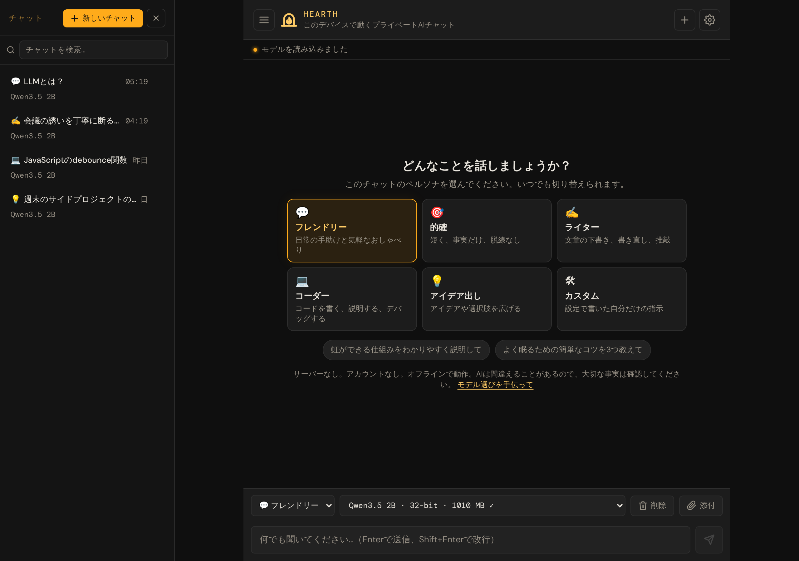
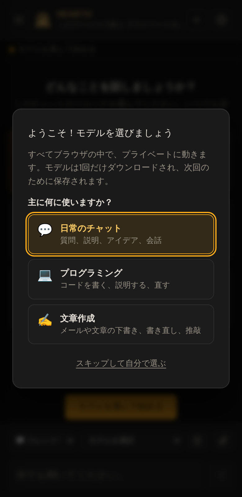

# Hearth

[English](README.md) · [Bahasa Indonesia](README.id.md) · **日本語**

**ブラウザの中で動くプライベートAIチャット。** サーバーなし。アカウントなし。オフラインで動作。

AIモデルはお使いのデバイスで動くので、入力した内容がデバイスの外に出ることはありません。モデルを一度ダウンロードすれば、インターネット接続なしで使い続けられます。オープンソースで、[WebLLM](https://github.com/mlc-ai/web-llm)とWebGPUで動いています。

**[試してみる → bowo-prasetyo.github.io/web-llm](https://bowo-prasetyo.github.io/web-llm/)**

> **メモ:** これは[英語版README](README.md)の翻訳です。更新直後など内容が異なる場合は、英語版が優先されます。



## できること

* **設計からプライベート。** AIモデルはお使いのGPUで動きます。メッセージ、チャット、ドキュメントはブラウザの中だけに保存され、どこにも送られません。
* **セットアップ不要。** ページを開いて2つの質問に答えるだけで、デバイスに合ったモデルが選ばれます。インストールも、登録も、APIキーも不要です。
* **オフラインで動作。** 初回の訪問後は、アプリとダウンロードしたモデルがインターネット接続なしで動きます。パソコンやスマートフォンにアプリとしてインストールすることもできます。
* **用途に合わせたペルソナ。** フレンドリー、的確、ライター、コーダー、アイデア出し、または自分だけの指示。チャットごとに1つ選べます。
* **ドキュメントについて質問。** PDF、テキスト、Markdownのファイルをチャットに添付して、内容について質問できます。
* **読みやすい回答。** 返信は見出し、リスト、表、コピーボタン付きのハイライトされたコードで整えられます。
* **多くのモデル。** Qwen3.5、Llama 3、Phi-4-mini、Gemma、Mistralなど、100Mから9Bパラメータまでの55のオープンなモデル。各モデルがお使いのデバイスでどのくらいの速さで書くかを表示し、遅い場合は小さいモデルを提案します。
* **チャットを保存。** 複数のチャットを検索でき、自動で保存され、エクスポートとインポートで別のブラウザに移せます。
* **あなたの言語で。** アプリは英語、インドネシア語、日本語で使えます（**設定 → 言語**）。AIはあなたが書いた言語で返信します。



## はじめに

1. **https://bowo-prasetyo.github.io/web-llm/** を、パソコンのChromeまたはEdge（おすすめ）、または最近のSafari（macOS 14以降 / iOS 17以降）で開きます。ブラウザには[WebGPU](#動作環境)が必要です。スマートフォンでも動きますが、多くの機種では最小のモデルしか動きません（[既知の制限](#既知の制限)を参照）。
2. 主な用途（日常のチャット、プログラミング、文章作成）とサイズ（高速、バランス、高性能）を選びます。
3. 1回だけのダウンロード（最小で約0.4 GB、最大で4.8 GB）を待ち、チャットを始めます。次回からはデバイスから読み込みます。

初めての方は、**[ユーザーマニュアル](docs/user-manual/ja/README.md)** で、チャット、ペルソナ、ドキュメント、モデルの選び方、設定、オフラインでの利用とバックアップ、トラブルシューティングまで、すべてをわかりやすく順を追って説明しています。

## デバイスに残るもの、ダウンロードされるもの

* **デバイスに残るもの:** メッセージ、チャット、添付したドキュメント、設定（ブラウザのストレージ内）と、GPUで動くAIモデル自体。
* **1回だけダウンロードされるもの:** モデルのファイル（Hugging FaceとGitHubから）、アプリのコードライブラリ（公開CDNから）、大きいドキュメント用の小さな検索モデル（約23 MB）。これらのリクエストに入力内容が含まれることはありません。
* ブラウザでサイトのデータを消去すると、ダウンロードしたモデルを含め、すべてが削除されます。

## 既知の制限

* **パソコンで最もよく動きます。** スマートフォンはAIに使えるメモリが少なく、多くの機種では0.7 GB以上のモデルでページが閉じ、回答がごく限定的な極小モデルしか収まりません。モデルでページが閉じた場合、アプリはその旨を説明し、1段階ずつ小さいモデルを提案します。
* **Safari（iPhone、iPad、Mac）とFirefoxではまだテストしていません。** バージョン1.0.0は、WindowsノートPCのChromeとEdge、AndroidのChromeでテストしました。お使いの環境で動かない場合は、**設定 → このデバイス → 問題を報告** を使ってください。
* **WebGPUが必要です。** パソコンの最近のChromeとEdgeが最もよく動きます。Android版ChromeとSafari（macOS 14以降 / iOS 17以降）も多くのデバイスで動きます。FirefoxのWebGPU対応は新しく、テストが少なく、古いブラウザでは動きません。
* **ダウンロードが大きい。** モデルは0.2〜4.9 GBのダウンロードでブラウザに保存され、動いている間はそれ以上のGPUメモリ（約0.6〜7.5 GB）を使います。サイトのデータを消去すると削除されます。**プライベート（シークレット）ウィンドウ**はモデルに対してストレージがはるかに足りません。モデルが収まりそうにない場合、アプリはダウンロード前に警告します。
* **速さはGPUで決まります。** 内蔵GPUや古いGPUでは、2Bモデルが1秒に約1語しか書かないこともあります。アプリは速さを表示し、小さいモデルを提案します。
* **小さいモデルは事実を間違えます。** 間違っていても流暢に書きます。大切なことは確認し、事実についての質問には大きいモデルを選んでください。
* **英語以外の言語。** 小さいモデルは英語が最も得意です。日本語の会話には、極小モデルよりQwen3.5 2B以上のほうがずっと良い結果になります。
* **インターネットにはアクセスしません。** モデルが知っているのは学習した内容（と添付したドキュメント）だけで、調べものをしたり最近の出来事を知ったりはできません。
* **一度に1つのデバイス。** チャットは作成したブラウザに残ります。移すにはエクスポート / インポートを使ってください。

## 名前とブランド

アプリの名前は **Hearth**（炉）です。家の中心にある、火を守る暖かい場所のことです。炉のように、このアプリはあなたの家（デバイス）にとどまり、外からの助けなしに動き続けます。正式には *Hearth、ブラウザの中で動くプライベートAIチャット*、短い約束は *サーバーなし。アカウントなし。オフラインで動作。* です。アイコン、色、名前の書き方は[docs/brand.md](docs/brand.md)（英語）をご覧ください。

リポジトリとWebアドレスは `web-llm` という名前のままにしています。リンク、インストール済みのアプリ、保存されたチャットが引き続き動くようにするためです。

## バージョンと問題の報告

現在のバージョンは **1.0.0** です（[CHANGELOG.md](CHANGELOG.md)、英語）。アプリでは **設定 → このデバイス** にバージョンが表示されます。

問題を見つけたら、**設定 → このデバイス → 問題を報告** を使ってください。アプリのバージョン、ブラウザ、GPU、モデルが入力済みのGitHubのissueフォームが開くので、GPU固有の不具合の調査にとても役立ちます。フォームを送信するまで何も送られません。プライベートなチャットは含めないでください。[issueを直接作成](https://github.com/bowo-prasetyo/web-llm/issues/new?template=problem.yml)することもできます。日本語での報告も歓迎します。

## すべての機能

* 完全にクライアント側で動くAIチャット — バックエンドなし、データはブラウザの外に出ません
* 初回の訪問後はオフラインで動作し、パソコンやスマートフォンにアプリ（PWA）としてインストール可能
* 自動保存、復元、削除に対応した複数のチャットセッション
* すべてのチャットセッション（タイトル、質問、回答）の全文検索
* タブを閉じたり、スマートフォンの画面が消えたりしても会話を保持
* タブが中断された後、答えのなかった質問を自動で再開
* タブ再開後に手動で再送したときの重複送信を防止
* 15のモデルファミリー（Qwen3.5、Phi-4-mini、Gemma 3、Ministral 3、OLMo 2など）から選べる55のLLMモデルを、サイズ別に分類
* チャット履歴を消さずに、会話の途中でモデルを切り替え
* 初回起動時のモデル選択: 用途（チャット、プログラミング、文章作成）とサイズ（高速 / バランス / 高性能）を選ぶと、デバイスに合ったモデルが選ばれ、動かない環境では16ビットモデルを避けます
* モデルの初回使用時（チャットのツールバーと設定から）に、サイズの目安付きでダウンロードを確認
* チャットの削除は必ず確認あり。1回のタップで消えるものはありません
* キーボードとスクリーンリーダーに対応: ダイアログとチャット一覧はフォーカスを保ちEscapeで閉じ、すべての操作部品に名前があり、状態の変化が読み上げられます
* ダウンロードの進行状況パネル: パーセンテージ付きの進行状況バー、ダウンロード量、推定残り時間、キャンセルボタン（キャンセルすると前のモデルに戻ります）
* モデルを読みやすい名前、精度、ダウンロードサイズで表示（「Qwen3.5 2B · 16-bit · 1010 MB ✓」）、ダウンロード済みには ✓
* 返信のストリーミング中いつでも生成を停止
* モデルの自動キャッシュ — 確認済みのモデルは次回から即座に読み込み
* ローカル設定（モデル、温度、top-p、ペナルティ、コンテキストウィンドウ、ペルソナ）を編集と同時に保存
* ライトとダークのテーマ: 既定ではデバイスに合わせ、設定 → 外観 でライトかダークを選択可能
* 英語、インドネシア語、日本語の画面表示: 既定ではブラウザの言語に合わせ、設定 → 言語 で選択可能。新しい翻訳も追加できます（[docs/translating.md](docs/translating.md)を参照）
* ファイルのアップロード上限を設定可能（1〜200 MB、既定50 MB）
* 設定をJSONファイルにエクスポートし、別のブラウザでインポート
* すべてのチャットセッションをJSONファイルにエクスポートし、別のブラウザでインポート（統合） — 重複なし
* ライブの語数カウント付きでAIの返信をストリーミング。ストリーミング中に上にスクロールして読み返せ、**最新へ移動** で戻れます
* 返信をMarkdownで表示: 見出し、リスト、表、リンク、シンタックスハイライトとコピーボタン付きのコードブロック
* どの返信もコピーでき、最後の返信は再生成（または再試行）可能
* 考えるモデル（Qwen3、DeepSeek-R1）の推論をリアルタイムで表示し、その後折りたたみ式の「思考過程」にまとめます
* WebGPUによるGPUアクセラレーション推論
* GPUが使えないときの、トラブルシューティング手順付きのわかりやすいWebGPUエラー画面
* 各デバイスでモデルを初めて読み込んだ後の簡単なチェック: 16ビット演算が壊れているGPU（q4f16モデルが「outer outer outer…」のような意味不明な文字列を返す）を検出し、q4f32版を提案
* 同じ言葉の繰り返しになった返信は止め、説明し、会話の履歴から除外
* 設定の「このデバイス」パネル: WebLLMのバージョン、GPU、16ビット対応、モデルのチェック結果
* Web Workerで分離し、推論中も画面が快適に反応
* チャットにドキュメント（PDF、TXT、Markdown）を添付: 小さいものはそのままモデルに渡し、大きいものは質問ごとに合う部分を検索
* 添付ファイルは1つのチャット専用で、チャットと一緒に保存（IndexedDB）、エクスポート、インポート、削除されます
* GPUの停止、エンジンのエラー、WASM Tokenizerの障害から自動で回復
* 使われていないときはモデルを自動で解放してGPUメモリを空けます
* コンテキストウィンドウを設定できる会話履歴の記憶
* よく使う返信の設定を前面に、詳細なサンプリング設定を折りたたんだ設定ページ。変更は自動で保存
* モデルがこのデバイスで書く速さ（例: 「約1語/秒」）を表示し、遅い場合は小さいモデルを提案（小さいモデルは間違いが増えることも明記）。単語のカウントは `Intl.Segmenter` を使うので、日本語のようにスペースのない言語でも正確です
* 小さいモデルについて正直に: 約1Bパラメータ以下のモデルでのフレンドリーと的確のチャットには、事実を間違えやすいというヒントを表示（モデルごとに×で非表示）。モデル選択の高速サイズにも明記
* 6つのチャットペルソナ（フレンドリー、的確、ライター、コーダー、アイデア出し、カスタム）。チャットごとに選び、会話の途中で切り替え可能
* ペルソナカードと質問の例のある、新しいチャットのウェルカム画面
* レスポンシブなUI: 広い画面（1100px以上）ではチャット一覧をチャットの横に表示して隠すこともでき、狭い画面ではスライドして開く引き出し式に。スマートフォンではEnterで改行し送信ボタンで送信、メッセージ欄は入力に合わせて広がります
## 対応モデル

55のモデルを、軽いものから重いものの順に並べています。アプリのモデルメニューでは、
`<optgroup>` のラベルでサイズ別に分類しています。**新規** は元の一覧の後に追加された
モデルで、すべてアプリが使うWebLLMのバージョン（0.2.84）で動作します。

### 極小: テスト用。回答はごく限定的

これらのモデルはほとんど会話になりません。同じことを繰り返し、事実の大半を間違え、自分への指示を答えとして読み上げることもあります。TinyLlamaは1.1Bパラメータですが2023年のモデルで、極小モデルと同じような答え方をするため、ここに含めています。テストと非常に非力なデバイスのために残しており、モデルメニューではこのラベルで最後に表示され、モデル選択で提案されることはありません。

| モデル | おおよそのサイズ |
|---|---|
| SmolLM2-135M-Instruct-q0f32-MLC | ~720 MB |
| SmolLM2-360M-Instruct-q4f32_1-MLC | ~580 MB |
| SmolLM2-360M-Instruct-q0f32-MLC | ~1.7 GB |
| TinyLlama-1.1B-Chat-v1.0-q4f32_1-MLC | ~840 MB |

### マイクロ (0.5–0.8B)

| モデル | おおよそのサイズ |
|---|---|
| Qwen3.5-0.8B-q4f16_1-MLC (新規) | ~1.6 GB |
| Qwen3.5-0.8B-q4f32_1-MLC (新規) | ~1.8 GB |
| Qwen2.5-0.5B-Instruct-q4f16_1-MLC | ~945 MB |
| Qwen2.5-0.5B-Instruct-q4f32_1-MLC | ~1.0 GB |
| Qwen2.5-Coder-0.5B-Instruct-q4f16_1-MLC | ~945 MB |
| Qwen3-0.6B-q4f16_1-MLC | ~1.0 GB |

### 軽量 (1–1.7B)

| モデル | おおよそのサイズ |
|---|---|
| gemma3-1b-it-q4f16_1-MLC (新規) | ~711 MB |
| OLMo-2-0425-1B-Instruct-q4f16_1-MLC (新規) | ~1.7 GB |
| OLMo-2-0425-1B-Instruct-q4f32_1-MLC (新規) | ~2.4 GB |
| Llama-3.2-1B-Instruct-q4f16_1-MLC | ~879 MB |
| Llama-3.2-1B-Instruct-q4f32_1-MLC | ~1.1 GB |
| SmolLM2-1.7B-Instruct-q4f16_1-MLC | ~1.7 GB |
| SmolLM2-1.7B-Instruct-q4f32_1-MLC | ~2.6 GB |
| Qwen3-1.7B-q4f16_1-MLC | ~1.7 GB |
| stablelm-2-zephyr-1_6b-q4f16_1-MLC | ~2.0 GB |

### 小 (1.5B)

| モデル | おおよそのサイズ |
|---|---|
| Qwen2.5-1.5B-Instruct-q4f16_1-MLC | ~1.6 GB |
| Qwen2.5-1.5B-Instruct-q4f32_1-MLC | ~1.8 GB |
| Qwen2.5-Coder-1.5B-Instruct-q4f16_1-MLC | ~1.6 GB |
| Qwen2.5-Math-1.5B-Instruct-q4f16_1-MLC | ~1.6 GB |

### 中 (2–4B)

| モデル | おおよそのサイズ |
|---|---|
| Qwen3.5-2B-q4f16_1-MLC (新規) | ~2.2 GB |
| Qwen3.5-2B-q4f32_1-MLC (新規) | ~2.5 GB |
| Ministral-3-3B-Instruct-2512-BF16-q4f16_1-MLC (新規) | ~2.8 GB |
| Ministral-3-3B-Instruct-2512-BF16-q4f32_1-MLC (新規) | ~3.4 GB |
| Qwen3.5-4B-q4f16_1-MLC (新規) | ~3.8 GB |
| Qwen3.5-4B-q4f32_1-MLC (新規) | ~4.6 GB |
| gemma-2-2b-it-q4f16_1-MLC | ~1.9 GB |
| gemma-2-2b-it-q4f32_1-MLC | ~2.5 GB |
| Llama-3.2-3B-Instruct-q4f16_1-MLC | ~2.2 GB |
| Llama-3.2-3B-Instruct-q4f32_1-MLC | ~2.9 GB |
| Hermes-3-Llama-3.2-3B-q4f16_1-MLC | ~2.2 GB |
| Qwen2.5-3B-Instruct-q4f16_1-MLC | ~2.4 GB |
| Qwen2.5-3B-Instruct-q4f32_1-MLC | ~2.8 GB |
| Qwen2.5-Coder-3B-Instruct-q4f16_1-MLC | ~2.4 GB |
| Qwen3-4B-q4f16_1-MLC | ~3.1 GB |

### 中上 (3.8B)

| モデル | おおよそのサイズ |
|---|---|
| Phi-4-mini-instruct-q4f16_1-MLC (新規) | ~3.4 GB |
| Phi-4-mini-instruct-q4f32_1-MLC (新規) | ~4.1 GB |
| Phi-3.5-mini-instruct-q4f16_1-MLC | ~3.6 GB |
| Phi-3.5-mini-instruct-q4f32_1-MLC | ~5.4 GB |

### 大 (7–9B) — VRAM 6 GB以上が必要

| モデル | おおよそのサイズ |
|---|---|
| Qwen3.5-9B-q4f16_1-MLC (新規) | ~6.3 GB |
| Qwen3.5-9B-q4f32_1-MLC (新規) | ~7.4 GB |
| Qwen2.5-7B-Instruct-q4f16_1-MLC | ~5.0 GB |
| Qwen2.5-7B-Instruct-q4f32_1-MLC | ~5.8 GB |
| Qwen2.5-Coder-7B-Instruct-q4f16_1-MLC | ~5.0 GB |
| Qwen3-8B-q4f16_1-MLC | ~5.4 GB |
| Llama-3.1-8B-Instruct-q4f16_1-MLC | ~4.9 GB |
| Llama-3.1-8B-Instruct-q4f32_1-MLC | ~6.0 GB |
| Hermes-3-Llama-3.1-8B-q4f16_1-MLC | ~4.8 GB |
| Mistral-7B-Instruct-v0.3-q4f32_1-MLC | ~5.5 GB |
| DeepSeek-R1-Distill-Qwen-7B-q4f16_1-MLC | ~5.0 GB |
| DeepSeek-R1-Distill-Llama-8B-q4f16_1-MLC | ~4.9 GB |
| gemma-2-9b-it-q4f16_1-MLC | ~6.3 GB |

表のサイズは、各モデルが必要とするGPUメモリです（`worker.js` の `MODEL_SIZES_MB`。WebLLMのモデル登録情報より。1 GB = 1024 MB）。ダウンロードはこれより小さく、アプリは実際のダウンロードサイズ（`DOWNLOAD_SIZES_MB`。Hugging Face上のモデルの重みファイル）を表示します。例えばQwen3.5 0.8Bは404 MBのダウンロードで、約1.6〜1.9 GBのGPUメモリが必要です。

**q4f16とq4f32。** q4f16モデルは小さくて速いですが、GPUの16ビット演算が必要です。
一部のGPUやブラウザはこの演算を正しく行えず、その場合モデルは意味不明な文字列を
返します。アプリは各モデルをデバイスごとに1回チェックし、16ビットモデルが失敗した
（またはGPUが対応していない）場合は、q4f16しかなかったモデル（Qwen2.5-Coder、Qwen3、
Hermes-3、DeepSeek-R1、gemma-2-9bなど）のq4f32版もモデル一覧に表示し、q4f16モデルに
⚠ を付けます。
モデルは初回のダウンロード後、ブラウザにキャッシュされます。

## モデルを選ぶ

初回起動時、アプリは何かをダウンロードする代わりに2つの質問をします。

1. **主に何に使いますか？** 日常のチャット、プログラミング、文章作成（既定のペルソナもこれで決まります）
2. **どのサイズにしますか？**

| 用途 | 高速 | バランス | 高性能 |
|---|---|---|---|
| 日常のチャット | Qwen3.5 0.8B | Qwen3.5 2B | Qwen3.5 4B |
| プログラミング | Qwen3.5 2B | Qwen3.5 4B | Qwen3.5 9B |
| 文章作成 | Qwen3.5 2B | Qwen3.5 4B | Qwen3.5 9B |

* Qwen3.5はWebLLM 0.2.84が対応する最新世代のモデルです。プログラミングと文章作成は2Bから始まります。それより小さいモデルはコードを混同し、長い文章では話の筋を見失うためです

* スマートフォンと、メモリが4 GB以下と報告するデバイスでは高速を、それ以外ではバランスをおすすめします。高性能には強力なGPUが必要です。スマートフォンとタブレットでは、高速はどの用途でも **Llama 3.2 1B** です（GPUメモリ約1 GB。Qwen3.5 0.8Bは1.6〜1.9 GB必要で、多くのスマートフォンでページが閉じます）。高速は最も速いですが、事実を間違えやすくなります。小さいモデルは間違っていても流暢に書きます
* 16ビットGPU演算に対応していない、または正しく動かないデバイスでは、各選択肢のq4f32版が自動で選ばれます
* ダウンロード済みのモデルには印が付き、使用中のモデルにはラベルが表示されます
* **スキップ** すると選択はあなたに任されます（モデルメニュー）。モデルを選ぶまで何もダウンロードされず、先にメッセージを送るとモデル選択が開きます
* **設定 → モデル選びを手伝って** またはウェルカム画面から、いつでも再び開けます
* モデルが既にダウンロード済みの場合（設定を消去した後など）は、確認なしでそのモデルを使います

## おすすめのモデル

| 用途 | おすすめのモデル |
|---|---|
| 最小のリソース使用量 | Gemma 3 1B（q4f16のみ）または Qwen3.5-0.8B |
| スマートフォン | Qwen3.5-0.8B または Llama-3.2-1B |
| 一般的なチャット | Qwen3.5-2B、より強力なGPUならQwen3.5-4B |
| プログラミング | Qwen3.5-4B または Qwen3.5-9B（Qwen2.5-Coderも利用可能） |
| 文章作成 | Qwen3.5-4B または Ministral-3-3B-Instruct |
| 推論 | 「推論モデルに先に考えさせる」をオンにしたQwen3.5、または DeepSeek-R1-Distill-Qwen-7B |
| 多言語（日本語を含む） | Qwen3.5-2B または Qwen3.5-4B |
| 指示への忠実さ | Phi-4-mini |
| 完全にオープン（データとコード） | OLMo-2-1B |
| 最も高性能（VRAMが多い場合） | Qwen3.5-9B |

## ユーザー設定

⚙ 設定ページ（ヘッダーの歯車アイコンをタップ）から開きます。

### モデル

* **モデルの選択** — サイズ別に分類された55のモデルから選びます。各モデルは名前、精度、ダウンロードサイズで表示されます（例: 「Qwen3.5 2B · 16-bit · 1010 MB ✓」、✓ = ダウンロード済み）。メニューの下にモデルの完全なIDが表示されます。モデルを切り替えても現在の会話は保たれ、新しいモデルが同じ履歴で続けます。別のモデルを選ぶと、そのモデルのおすすめ返信設定が適用されます。

### 返信

* **温度** — 出力のランダムさ（0.0〜2.0）。低い = 焦点が定まる、高い = 創造的
* **最大トークン数** — 1回の返信の最大の長さ（16〜2048、コンテキストウィンドウの半分まで）。おおよその語数と一緒に表示されます。既定値（`app.js` の `modelDefaults()`）は、135Mと360Mのモデルで256、0.5〜0.8B・1〜1.1B・1.7Bで512、1.5〜1.6Bと2Bで768、3B以上（Phi miniモデルを含む）で1024です。この長さに達した返信は「打ち切りました」と表示され、**続ける** ボタンが付きます
* **コンテキストウィンドウ** — モデルが見ることのできる会話のトークン数（512〜8192）。モデルの再読み込みが必要なのはこの設定だけです。変更すると設定に **今すぐモデルを再読み込み** が表示されます（再読み込みしない場合は次にアプリを開いたときに適用）。チャットがこれを超えると、最も古いやり取り（次にドキュメントの文脈）がモデルの見る範囲から外れます
* **推論モデルに先に考えさせる** — 既定はオフ。Qwen3とQwen3.5は答える前に段階的に推論できます。難しい質問に役立つことがありますが、遅くなり返信の長さも使うため、オンにしない限りオフです（オンにすると推論は折りたたみ式の「思考過程」として表示されます）。DeepSeek-R1は常に推論します
* **詳細なサンプリング**（既定では折りたたみ）:
  * **Top P** — Nucleusサンプリングのしきい値（0.01〜1.0）。累積確率でトークンの候補を絞ります
  * **頻度ペナルティ** — 既に出た語の繰り返しを減らします（−2〜2）
  * **存在ペナルティ** — 新しい話題を出すよう促します（−2〜2）
  * **繰り返しペナルティ** — 繰り返されたトークンに対するMLC独自の乗算ペナルティ（1.0〜2.0）
* **このモデルのおすすめ設定に戻す** — 実行前に確認します。ペルソナとカスタムの指示はそのまま残ります

### ドキュメント

* **アップロードの最大サイズ** — ドキュメントのアップロードの最大ファイルサイズ（1〜200 MB、既定50 MB）。抽出されるテキストも500,000文字（約200ページ）までです

### ペルソナ

ペルソナはアシスタントの話し方を決めます。各チャットは自分のペルソナを保ちます。
新しいチャットのウェルカム画面で選ぶか、チャットのツールバーのペルソナメニューから
いつでも切り替えられます（次のメッセージから適用され、それまでの会話は残ります）。

| ペルソナ | 向いている用途 |
|---|---|
| 💬 **フレンドリー**（既定） | 日常の手助けと気軽なおしゃべり |
| 🎯 **的確** | 脱線しない、短く事実に基づいた回答。推測するより「わかりません」と答えます |
| ✍️ **ライター** | メール、メッセージ、エッセイ、物語の下書き、書き直し、推敲 |
| 💻 **コーダー** | コードを書く、説明する、デバッグする |
| 💡 **アイデア出し** | アイデアや選択肢を広げる |
| 🛠 **カスタム** | 設定で書いた自分だけの指示 |

* **新しいチャットの既定** — 新しいチャットで最初に使うペルソナを選びます
* **カスタムペルソナ** — 自由に編集できる指示。変更はモデルを再読み込みせずに次のメッセージから反映されます。**「フレンドリー」の指示に戻す** で出発点に戻せます
* ペルソナが変えるのはシステムプロンプトだけです。温度など他の生成設定は、あなたが設定したとおりのままです
* ペルソナのプロンプトは意図的に短くしています。ブラウザで動く小さいモデルは、長いルールの一覧より、短く平易な指示のほうがずっとよく従うためです。プロンプトは `personas.js` にあり、英語で書かれ、ユーザーの言語で返信するよう指示しています
* 組み込みのペルソナはどれも、前に言ったことと矛盾しないように、また正しくないことに同意するのではなく丁寧に訂正するように指示されています（小さいモデルはユーザーの言うことに何でも合わせがちなため）
* 以前のバージョンの設定は自動で移行されます。古いシステムプロンプトを編集していた場合はそれがカスタムペルソナになり、既定のままになります。そうでない場合はフレンドリーに移ります

### 外観

* **システム**（既定）、**ライト**、**ダーク**。システムはデバイスのライト・ダークの設定に合わせ、アプリを開いている間に設定が変わっても追従します。ライトとダークは常にそのテーマです。選択はこのブラウザに記憶されます（`localStorage`、`webllm-theme`）
* テーマはページが描画される前に `index.html` の先頭の小さなスクリプトで適用されるので、ライト設定のデバイスで暗い画面が一瞬表示されることはありません。ブラウザのアドレスバーの色（`theme-color`）と標準の操作部品の色（`color-scheme`）も設定します
* すべての色は `style.css` の先頭のトークンで、ライトテーマは `:root[data-theme="light"]` で再定義しています。琥珀色はどちらのテーマでも塗り（ボタン、バッジ）に使い、明るい背景の琥珀色の文字と枠線にはより濃い色を使います

### 言語

* **自動**（既定）または同梱の言語のいずれか（現在は英語、インドネシア語、日本語）。自動は、ブラウザの言語リストのうちアプリが持つ最初の言語を選び、一致しなければ英語にします。各言語は、その言語自身の表記で表示されます（`Intl.DisplayNames` より）
* 切り替えは再読み込みなしですぐに反映され、`<html lang dir>` とタブのタイトルも変わります。選択はこのブラウザに記憶され（`localStorage`、`webllm-language`）、ページが最初に描画される前に読み込まれます
* 日付と数値は選んだ言語に従い、同じ言語ならブラウザの地域の書式を使います（例: インドネシア語の小数点はコンマ）
* 単語は `Intl.Segmenter` で数えるので、書く速さと「約N語」の表示は、スペースを使わない言語（日本語、中国語、タイ語）でも正確です
* 画面のテキストは `locales/<コード>.js` にあります。言語を追加する方法は[docs/translating.md](docs/translating.md)で説明しています

### このデバイス

* WebLLMのバージョン、GPU、16ビット演算への対応を表示します
* q4f16モデルがここで動くかを表示し、モデルのチェックに失敗したモデルを（出力の例と一緒に）一覧表示します
* **チェック結果を消去** でチェックをやり直します。ブラウザやGPUドライバーを更新した後などに使います

### エクスポート / インポート

* **設定をエクスポート** — すべての設定を `hearth-settings-YYYY-MM-DD.json` ファイルとしてダウンロード
* **設定をインポート** — 以前エクスポートしたファイルから設定を読み込みます。不要なダウンロードを避けるため、モデルの選択は保たれます
* **チャットをエクスポート** — 保存されたすべてのセッションを、メッセージの全文を含めて `hearth-chats-YYYY-MM-DD.json` ファイルとしてダウンロード
* **チャットをインポート** — エクスポートしたファイルのセッションを現在のブラウザに統合します。重複するセッションはIDと内容の指紋で検出され、自動でスキップされます

すべての設定は変更と同時に `localStorage` に自動保存され、ページを再読み込みしても残ります。適用ボタンはありません。返信の設定とペルソナは次のメッセージから適用され、新しいモデルは選んだときに読み込まれ、新しいコンテキストウィンドウはモデルの再読み込みを確認します。外観と言語はエクスポートに含まれません。

### 現在のチャット

* **会話を削除** — 開いているチャットを削除します（確認あり）

## 複数のチャットセッション

* 広い画面（1100px以上）では、チャット一覧がチャットの横に表示されます。**☰ メニューボタン**（または一覧の **×**）で隠したり表示したりでき、選択は記憶されます
* 狭い画面では、ヘッダーの **☰ メニューボタン** をタップすると、一覧がチャットの上に引き出し式で開きます
* **+ 新しいチャット** で新しい会話を始めます — 現在のセッションは先に自動保存されます
* 保存されたチャットは、自動生成されたタイトル、プレビュー、モデル、日時とともに一覧表示されます
* セッションをタップすると復元されます — メッセージとモデルの文脈の両方が戻ります
* セッションの **🗑 ゴミ箱アイコン** で削除できます。削除前に確認します（タッチ画面ではアイコンが常に表示されます）
* 一覧は **×**、Escape、または一覧の外側をタップして閉じます
* チャットはブラウザのデータベース（IndexedDB）に保存され、ブラウザのストレージ割り当て以外にチャット数やメッセージ数の上限はありません。自動で削除されるものはありません
* 以前のバージョンが `localStorage` に保存したチャットは、初回起動時にIndexedDBに移されます（古いコピーは移行が成功してから削除されます）
* IndexedDBが使えない場合（一部のプライベートブラウズなど）、チャットは `localStorage` に保存され、40メッセージのチャット50件までに制限されます。**設定 → このデバイス** で保存先を確認できます
* セッションは、ページの再読み込み、タブを閉じる操作、スマートフォンの画面オフの後も残ります
* 答えのなかった質問（生成中にタブを閉じた場合）は、次に開いたときに自動で再送されます

## 返信

* アシスタントの返信は、GitHubスタイルの表、リスト、リンク付きのMarkdownとして表示されます
* **コードブロック**には言語名と **コピー** ボタンが表示されます。シンタックスの色付けは返信のストリーミングが終わってから適用されます
* 返信の下の **コピー** はMarkdownのソースをコピーします。**再生成** は最後の返信をもう一度依頼します（エラーの後は **再試行**）
* **考えるモデル**（Qwen3、DeepSeek-R1）: `<think>` の推論は、モデルが作業している間リアルタイムで表示され、その後折りたたみ式の **思考過程** にまとめられます。推論はコピー、チャットのプレビュー、モデルに送り返す履歴から除かれるので、コンテキストを節約できます
* 安全性: モデルが書いた生のHTMLはテキストとして表示され、出力はDOMPurifyで無害化され、リンクは新しいタブで開きます
* あなた自身のメッセージは、入力したとおりに表示されます
* Markdownのライブラリ（marked、DOMPurify、highlight.js）は、固定バージョンとインテグリティハッシュで読み込まれます。読み込めない場合、返信はプレーンテキストで表示されます

## アクセシビリティ

* **ダイアログ**（モデル選択、ダウンロードと削除の確認、GPUの警告）は、キーボードのフォーカスを受け取り、Tabをダイアログ内にとどめ、**Escape** で閉じ（WebGPUのエラー画面を除く）、フォーカスを元の場所に戻します。確認ダイアログでは、安全な選択肢（**キャンセル**）にフォーカスがあります
* **チャット一覧**: 閉じている間はTabで飛ばされ、開くとフォーカスが一覧に移り、閉じるまで（Escape、**×**、チャットを開く）一覧にとどまり、その後メニューボタンに戻ります。各チャットはボタンで、開いているものは現在のものとして示されます
* **名前**: アイコンだけのボタン、メッセージ欄、モデルとペルソナのメニュー、設定のスライダーには、すべてアクセシブルな名前があります。スマートフォンでは **削除** と **添付** はアイコンだけになりますが、ラベルはスクリーンリーダー向けのボタン名として残ります
* **読み上げ**: 状態のメッセージ（読み込み中、準備完了、エラー）はスクリーンリーダーで読み上げられます。ダウンロードの進行状況は、毎回ではなく開始時に1回だけ読み上げられます
* **文字の大きさ**: 画面のどの文字も12pxより小さくありません（`style.css` の `--fs-meta` と `--fs-small` トークン）。ブラウザのテストで、チャット、設定、モデル選択の画面に表示されるすべての文字を確認しています
* **コントラスト**: 表示されるすべての文字が、両方のテーマでWCAG AAのコントラスト（4.5:1、大きい文字は3:1）を満たします。ブラウザのテストで、チャット、チャット一覧、検索、設定、削除のダイアログ、モデル選択を、各文字の背後の実際の（合成された）背景に対して確認しています
* **フォーカスリング**: **添付** やインポートボタンを含め、すべての操作部品はキーボードで移動したときに琥珀色の枠線が表示されます（ファイル入力は削除せず、見た目だけ隠しています）
* **言語**: `<html lang>` は選んだ言語に従い、設定 → 言語 の各言語には `lang` 属性が付くので、スクリーンリーダーが正しく読み上げます
* **確認**: 何かを削除する前には必ず確認します: **削除**（ツールバー）、**会話を削除**（設定）、チャット一覧のゴミ箱アイコン

## セッションの検索

* サイドバー上部の **検索欄** に入力すると、すべてのチャットを検索します
* 検索の対象は、タイトル、すべてのユーザーの質問、すべてのアシスタントの回答です — プレビューだけでなく全文です
* 結果は一致数で並べ替えられ、一致した箇所の前後を含む抜粋が強調表示されます
* 現在のセッションは常に最初に検索され、過去のセッションが関連度順に続きます
* 検索は入力が落ち着いてから実行され（デバウンス）、セッションの間でイベントループに処理を譲るので、履歴が大きくても快適に反応します

## 停止とキャンセル

* **生成を停止** — モデルがストリーミングしている間、送信ボタンは赤く点滅する停止ボタンになります。タップすると止まり、途中までの返信は残ります
* **ダウンロードの進行状況** — モデルを読み込んでいる間、チャットの上のパネルに、処理の内容（ダウンロード中、このデバイスから読み込み中、GPU用に準備中）、進行状況バー、パーセンテージ、ダウンロード量、推定できるようになったら残り時間が表示されます。スクリーンリーダーには進行状況バーとして伝わります
* **ダウンロードのキャンセル** — パネルの **キャンセル** ボタン（ネットワークからダウンロードしている間に表示）でダウンロードを止め、前のモデルと設定に戻ります。次にそのモデルを選ぶと、ダウンロードの確認がもう一度表示されます

## スクロールとメッセージ欄

* 返信のストリーミング中、チャットはいちばん下にいるときだけ返信を追いかけます。読み返すために上にスクロールすると、その位置にとどまります。**最新へ移動**（または **返信を追う**）で戻れます。メッセージの送信、チャットを開く、再生成、続けるは、常にいちばん下に移動します
* キーボードでは **Enter** で送信、**Shift+Enter** で改行します。タッチ画面ではEnterで改行し、**送信** ボタンで送信します。**Ctrl/Cmd+Enter** はどこでも送信します
* 日本語・中国語・韓国語などの入力（IME）で変換を確定するEnterで送信されることはありません
* メッセージ欄はテキストに合わせて広がり、iOSで拡大表示されないよう、スマートフォンでは16pxの文字を使います

## オフラインとインストール

オンラインのときに一度訪問すれば、アプリはインターネット接続なしで動きます。

* サービスワーカー（`sw.js`）が、アプリ自身のファイル、翻訳、固定バージョンのライブラリ（Vue、Vue Router、marked、DOMPurify、highlight.js、PDF.js、WebLLM、Transformers.js）をブラウザに保存します
* モデルの重みはWebLLM自身が保持するので、**ダウンロードしたモデルはオフラインでも動き続けます**
* オフラインのとき、ステータスバーに **オフライン** と表示されます。まだダウンロードしていないモデルを選ぶと、失敗する代わりに接続が必要だと説明します
* 新しいモデルのダウンロードと、初めて添付する大きいドキュメント（小さな検索モデルを取得します）には接続が必要です
* アプリの更新も届きます。オンラインのときは、アプリ自身のファイルを常に最新のものから取得します（4秒後またはオフラインのときは、保存したコピーを使います）
* 更新の間タブを開いたままにしていると、**「アプリの新しいバージョンがあります。」** と **再読み込み** ボタンが表示されます。アプリは起動時、30分ごと、タブが再び表示されたときにファイルを確認します
* **設定 → このデバイス** で、アプリがオフライン用に保存されているかを確認でき、ブラウザが対応していれば（Chrome、Edge、Android）**アプリをインストール** ボタンがあります。iPhone/iPadでは、Safariの **共有 → ホーム画面に追加** を使います

サービスワーカーには `https` か `localhost` が必要なので、オフラインモードはGitHub Pagesと下記のローカルサーバーで動きます。

## 動作環境

WebGPUに対応した最新のブラウザ。

おすすめのブラウザ:

* [Google Chrome](https://www.google.com/chrome/) 121以降
* [Microsoft Edge](https://www.microsoft.com/edge) 最新版
* [Safari](https://www.apple.com/safari/) 最新版（macOS 14以降 / iOS 17以降）

おすすめのハードウェア:

* 最低でも最近の内蔵GPU（約1.5Bまでのモデル）
* 2B以上のモデルには専用GPUをおすすめします
* 小さいモデルにはRAM 4 GB以上、3B以上のモデルには8 GB以上
* 最初のモデルのダウンロードには安定したインターネット接続

### WebGPUのトラブルシューティング

アプリに「WebGPUを利用できません」というエラー画面が表示された場合:

1. ブラウザの設定で **ハードウェアアクセラレーション** を有効にします
2. Android版Chromeでは、`chrome://flags` を開き、**WebGPU** または **Unsafe WebGPU** を有効にします
3. 最も安定したWebGPU対応のため、パソコンでは **Chrome 113以降** または **Edge** を使います
4. [webgpureport.org](https://webgpureport.org) でGPUの対応状況を確認します

## 使用技術

アプリ全体がブラウザで動きます。バックエンドもビルド手順もありません。

* 言語モデルには、Web Workerの中で動くWebGPU上の[WebLLM](https://github.com/mlc-ai/web-llm) 0.2.84
* CDNから読み込む[Vue 3](https://vuejs.org)とVue Router
* 添付した大きいドキュメントの検索に[Transformers.js](https://github.com/xenova/transformers.js)（all-MiniLM-L6-v2）、PDFの読み込みに[PDF.js](https://mozilla.github.io/pdf.js/)
* 返信を安全に表示するための[marked](https://marked.js.org)、[DOMPurify](https://github.com/cure53/DOMPurify)、[highlight.js](https://highlightjs.org)
* チャットと添付ファイルにIndexedDB、オフライン用にサービスワーカー
* 画面の翻訳に `i18n.js` と `locales/`（ブラウザの `Intl` API を使い、追加のライブラリなし）
* `fonts/` から配信する[DM Sans](https://github.com/googlefonts/dm-fonts)と[DM Mono](https://github.com/googlefonts/dm-mono)フォント（SIL Open Font License）。日本語の文字はシステムのフォントで表示されます

## ローカルで実行する

WebGPUとモジュールWorkerにはHTTPのオリジンが必要なので、
ローカルのWebサーバーでアプリケーションを実行します。

```bash
python -m http.server 8080
```

そして次を開きます。

```
http://localhost:8080
```

Node.js 20以降がインストールされていれば、`npm run serve` で、テストが使うサーバー（`tests/support/server.js`）を使って同じことが http://localhost:4173 でできます。`npm ci` は不要で、no-cacheヘッダーを送るので、再読み込みすると常に変更が反映されます。

## テスト

アプリにはビルド手順がありません。`package.json` にはテストのツール（[Playwright](https://playwright.dev)）だけが入っています。

```bash
npm ci
npx playwright install chromium
npm test              # everything (about a minute)
npm run test:unit     # pure modules only, no browser
npm run test:e2e      # the app in Chromium
```

* **ユニットテスト**（`tests/unit/`）は、`quality.js`、`context.js`、`markdown.js`、`picker.js`（モデル名と読み込みの進行状況を含む）、`attachments.js`、`pace.js`、`crash.js`、`storage.js`、`personas.js`、`status.js`、`i18n.js`（各翻訳に必要なキー、プレースホルダー、複数形がすべてそろっているかの確認を含む）、そしてドキュメントのリンク（`docs.spec.js`: 翻訳を含むREADMEとマニュアルのすべてのリンクと見出しのアンカーが、実在するファイルと見出しを指しているか）を対象にしています
* **ブラウザのテスト**（`tests/e2e/`）は、Chromiumで実際のアプリを動かします: ライトとダークのテーマとそのコントラスト、横に並ぶチャット一覧と文字の大きさ、設定、ダウンロードの進行状況とキャンセル、読みやすいモデル名、返信のストリーミング中のスクロール、パソコンとスマートフォンでのメッセージ欄、ダウンロードと削除の確認、キーボードのフォーカスとアクセシブルな名前、チャットの保存（IndexedDB、移行、エクスポート/インポート、代替手段）、チャットに添付したドキュメント、ペルソナ、返信の表示と安全性、16ビットが壊れたGPUでのモデルの健全性、続けると繰り返し防止（実際の `worker.js` で）、進み具合に基づく時間制限と書く速さの表示、モデル選択、オフラインモード、「新しいバージョンがあります」のバナー、言語の選択（インドネシア語と日本語を含む）
* テストにはネットワーク、GPU、モデルのダウンロードは不要です。固定バージョンのCDNライブラリは `node_modules` から配信され、WebLLMはスクリプト化したモック（`tests/support/mock-webllm.js`）に置き換えます。一部のUIテストは、`worker.js` からモデル一覧を読み込む偽のworker（`tests/support/fake-worker.js`）を使います
* **ドキュメントのスクリーンショット**（`docs/screenshot.png`、`docs/screenshot-phone.png`、そのインドネシア語版 `docs/screenshot-id.png`、`docs/screenshot-phone-id.png`、日本語版 `docs/screenshot-ja.png`、`docs/screenshot-phone-ja.png`）は、同じモックを使って `npm run screenshots`（`tests/screenshots/docs.spec.js`）で描画するので、UIを変更した後もGPUなしで描き直せます。英語のスクリーンショットのチャットは、保存されたチャットとして記録したQwen3.5 2Bとの実際の会話なので、返信はモデル自身の言葉です。インドネシア語版と日本語版はウェルカム画面とモデル選択を表示しており、モデルの返信は含みません。`npm test` は画像を変更しません
* GitHub Actionsが、すべてのプルリクエストと `main` へのpushで全テストを実行します（`.github/workflows/tests.yml`）
* 固定バージョンのライブラリのバージョンを変えるときは、出てくる場所をすべて一緒に更新します: `index.html`（Vue、Vue Router、marked、DOMPurify、highlight.js、PDF.js）、`worker.js`（WebLLMとその定数 `WEBLLM_VERSION`、Transformers.js）、`sw.js`、`package.json`、`tests/support/fixtures.js`、`tests/e2e/offline.spec.js` のライブラリ一覧。`grep -rn "<old version>" --exclude-dir=node_modules .` ですべて見つかります

## 新しいバージョンのリリース

1. `version.js` の `APP_VERSION` と `package.json` の `version` を更新します（その後 `npm install --package-lock-only`）
2. `CHANGELOG.md` に新しい見出しを付けて変更点を追加します
3. `docs/release-notes/vX.Y.Z.md` にリリースノートを書きます（変更履歴の全文ではなく、利用者向けの短い要約）
4. `main` にマージし（GitHub Pagesがデプロイします）、マージコミットに `vX.Y.Z` のタグを付けて、そのノートでGitHub Releaseを公開します

テストで3つのバージョン番号が一致しているかを確認します。

## GitHub Pagesへのデプロイ

1. GitHubリポジトリを作成します
2. プロジェクトのすべてのファイル（`index.html`、`app.js`、`worker.js`、`sw.js`、`manifest.webmanifest`、`personas.js`、`markdown.js`、`quality.js`、`context.js`、`picker.js`、`chatstore.js`、`attachments.js`、`pace.js`、`version.js`、`crash.js`、`storage.js`、`status.js`、`i18n.js`、`style.css`）と、`icons/`、`fonts/`、`locales/` フォルダーをアップロードします
3. `main` ブランチにpushします
4. **Settings → Pages** を開きます
5. **Source** を `Deploy from branch`、ブランチ `main`、フォルダー `/root` にします
6. 保存します

公開URLは次のようになります。

```
https://YOUR_USERNAME.github.io/YOUR_REPOSITORY/
```

## ドキュメントの添付

ツールバーの **添付** をタップすると、表示中のチャットにPDF、TXT、Markdownファイルを追加できます。メッセージ欄の上にチップとして表示され（名前、サイズ、読み込み・準備中の状態）、**×** でチャットから外せます。

* **添付ファイルは1つのチャット専用です。** 他のチャットからは見えません。チャットと一緒に保存（IndexedDB）され、一緒に削除、エクスポート、インポートされます。今のところドキュメントしかないチャットも残ります（📎 とファイル名のタイトル）
* **小さいドキュメントは全文を渡します。** 添付したものすべてがモデルのコンテキストの予算（返信と質問を除いた残りの約4分の3）に収まる場合、質問のたびに全文がモデルに渡されます。追加のダウンロードは不要で、オフラインでも動きます
* **大きいドキュメントは検索します。** 2,000文字を超えるドキュメントは、文の区切りを考慮した重なりのある部分（約800文字）に分けられ、添付時にバックグラウンドで埋め込みを作ります（Transformers.js `all-MiniLM-L6-v2`、約23 MB、1回だけダウンロード）。その後、各質問には一致する部分（類似度0.2以上かつ最も良い一致の半分以上）が、良いものから順に予算の範囲で渡されます。この検索モデルは英語のテキストで最もよく機能します
* 「要約して」のような**全体的な依頼**は特定の部分に一致しないため、各ドキュメントの冒頭部分が渡されます
* ドキュメントのテキストは現在のリクエストにだけ入り、会話の履歴に保存されたり、後のやり取りで再送されたりすることはありません
* 上限: 設定のファイルサイズ（既定50 MB、最大200 MB）と、500,000文字のテキスト（約200ページ）。テキストレイヤーのないスキャンPDFは読めません

添付したファイルがブラウザの外に出ることはありません。

**以前のバージョン**では、すべてのチャットで共有する1つのドキュメントインデックスを使っていました。現在は使われていません。アプリはそれらのファイルを一覧にしたメモと、古いインデックスを削除するボタンを表示します。必要なファイルはチャットごとに添付し直してください。

## ストレージ

| ストレージ | 用途 |
|---|---|
| IndexedDB（`webllm-chats`） | チャット: チャット一覧、各チャットのメッセージ、チャットに添付したドキュメント（テキストと、大きいものは埋め込み付きの部分） |
| `localStorage` | 設定、キャッシュ済みモデルの一覧、モデルのチェック結果、モデルごとに測った書く速さ、チャット一覧の表示・非表示、テーマと言語（IndexedDBが使えない場合のみチャットも） |
| OPFS | GPUの安定性のフラグ（と、削除されるまでは以前のバージョンの使われていない共有ドキュメントインデックス） |
| ブラウザのキャッシュ / IndexedDB | WebLLMのモデルの重み |
| Cache Storage（`webllm-shell-v1`、`webllm-libs-v1`） | オフライン用のアプリのファイルと固定バージョンのライブラリ |

キャッシュされるデータには、AIモデルの重み（数GBになることもあります）、添付したドキュメント、ユーザー設定、チャット履歴が含まれる場合があります。

## アーキテクチャ

| ファイル | 役割 |
|---|---|
| `app.js` | Vue 3のUI — ルーティング、セッション管理、設定、workerとの橋渡し、言語の選択 |
| `worker.js` | AI推論のworker — WebLLMエンジン、添付したドキュメント、ストリーミング |
| `attachments.js` | 添付したドキュメントを部分に分け、モデルに渡すものを選ぶ |
| `index.html` | HTMLのエントリーポイント、CDNの読み込み |
| `chatstore.js` | IndexedDBへのチャットの保存、localStorageからの移行、localStorageへの代替 |
| `picker.js` | モデル選択のカタログ、デバイスに基づくおすすめ、読みやすいモデル名、読み込みの進行状況の解析 |
| `quality.js` | モデルのチェックと崩れた返信の防止のための、意味不明な出力の検出。言語を問わない単語のカウント |
| `storage.js` | ダウンロード前のストレージの確認、わかりやすい「容量不足」のメッセージ、ダウンロードしたモデルを保持するようブラウザに依頼 |
| `crash.js` | メモリ不足で閉じたページを検出し、より軽いモデルを提案 |
| `pace.js` | 進み具合に基づく返信の時間制限、書く速さの測定、遅いときに提案する小さいモデル |
| `context.js` | 会話をモデルのコンテキストウィンドウに収める |
| `markdown.js` | 返信の表示（Markdown、コードブロック、`<think>` の処理）。UIとworkerで共有 |
| `personas.js` | 組み込みのチャットペルソナ（プロンプト、アイコン、質問の例）。UIとworkerで共有 |
| `status.js` | workerが送る状態のコードと、ページが表示するそれぞれのテキスト |
| `i18n.js` | 翻訳: キーによるメッセージの検索、複数形、数値と日付の書式、言語の選択 |
| `locales/` | 言語ごとの画面のテキスト（`en.js`、`id.js`、`ja.js`）。[docs/translating.md](docs/translating.md)を参照 |
| `sw.js` | サービスワーカー: アプリとライブラリのオフライン用コピー |
| `manifest.webmanifest`、`icons/` | インストール可能なアプリ（PWA）のメタデータとアイコン |
| `style.css` | UIのスタイル（琥珀色のデザインシステム、ライトとダークのテーマ） |

### コンポーネントの概要

```
app.js
├── Home component      — chat view, sidebar, search, model select, toolbar
├── Settings component  — all generation sliders, personas, export/import
└── Shared state        — reactive refs shared between both pages

worker.js
├── initialize()        — device profile detection, model loading, model check
├── generate()          — attached documents, context fitting, streamed reply
├── continueReply()     — finishes a cut-off reply when the user presses Continue
├── streamReply()       — streaming with Stop, stall limit, junk and repeat guards, speed
├── setAttachments()    — the chat's documents; large ones chunked and embedded in the background
└── onmessage handler   — message routing (init, set-config, generate, set-attachments, …)
```

## AIの処理の流れ

```
ユーザーの質問
    ↓
添付したドキュメント（収まれば全文 · そうでなければ一致する部分、類似度 ≥ 0.2）
    ↓
コンテキストの挿入（現在のやり取りのみ — 会話の履歴には保存しない）
    ↓
ペルソナのシステムプロンプト + 履歴の組み立て（システムメッセージは常に固定）
    ↓
WebLLMのストリーミング生成（温度 · top-p · 頻度/存在/繰り返しペナルティ）
    ↓
防止機能: 意味不明な語で停止、繰り返された文を削除
    ↓
ストリーミングの返信 → UI
```

## 安全性と安定性の機能

| 機能 | 説明 |
|---|---|
| WebGPUが使えない | 非対応のGPUのエラーを捕捉し、再試行付きのわかりやすいトラブルシューティング画面を表示 |
| Tokenizerの停止からの回復 | WASMの `Tokenizer*` のエラーを検出し、次のリクエストのためにエンジンをリセット |
| 生成のタイムアウト | 返信を打ち切るのは進まなくなったときだけ: 3分以内に最初の言葉が出ない、または1分間新しいテキストが出ない（加えて20分の安全上限）。遅くても着実に進む返信は必ず最後まで書きます。途中までの返信は残し、返信がない場合はその理由を説明します |
| モデルのチェック | デバイスでモデルを初めて読み込んだ後、短い返信が意味不明でないかを確認。失敗した（またはGPUにない16ビット対応が必要な）q4f16モデルには、q4f32の代わりを提案 |
| 崩れた返信の防止 | いくつかの語の繰り返しになった返信は止め、再試行付きの説明に置き換え、モデルの記憶から除外 |
| コンテキストの調整 | 各返信の前に、プロンプトがコンテキストウィンドウに収まるよう、最も古いやり取り、次にドキュメントの文脈を除く |
| GPUの停止 | WebLLMが（1回の自動再読み込みの後で）GPUを完全に失った場合でも、モデルを黙って切り替えることはありません: 返信が書いた部分は「中断: GPUが停止しました」とともに残し、モデルはページの停止と同じように印を付け、同じダイアログでより軽いモデル、**もう一度試す**、**別のモデルを選ぶ** を提案します。同じ訪問で2回目のGPU停止が起きると、トラブルシューティング画面で止まります |
| メモリ不足によるページの停止 | メモリが足りなくなったスマートフォンはページを強制終了するため、何も捕捉できません。アプリはモデルの読み込みや返信を始めるときにlocalStorageにメモを残し、終わったとき、またはページが隠れたり閉じたりしたときに消します。ページを開いたときにメモが残っていれば停止したということです: そのモデルは自動では再度読み込まず（停止の繰り返しなし）、ダイアログで説明し、メモリが85%以下で済むモデル（Llama 3.2 1B、Gemma 3 1B、Qwen2.5 0.5B、SmolLM2 360Mのうち収まる最良のもの。同じ精度を優先し、次に32ビット）を提案するので、停止が繰り返されても1段階ずつ下がります。**もう一度試す** か **別のモデルを選ぶ** も選べます。メニューとモデル選択は、正常に読み込んで返信するまでそのモデルに印を付けます |
| 失われたGPUの回復 | ブラウザがGPUを取り上げると（スマートフォンではバックグラウンドやメモリ不足時に起こります）、WebLLMはモデルを破棄します。次のメッセージでデバイスから再読み込みして1回やり直し、2回目も失敗した場合は再試行付きのわかりやすいエラーを表示します |
| ストリーミングの停滞の検出 | 45〜90秒間出力がないとステータスバーで警告し、1分間止まった返信はエンジン内で中断 |
| 生成を停止 | 返信の途中でいつでも止められ、途中までの答えは残って保存されます |
| ダウンロードのキャンセル | モデルの取得を中止でき、前のモデルと設定に戻ります。キャッシュ済みモデルの一覧も整理されるので、確認がもう一度表示されます |
| 途中で切れた返信 | 最大トークン数に達した、または進まなくなった返信は、メモと **続ける** ボタンとともにきれいに終わります。自動でつなぎ合わせることはありません |
| 繰り返された文の防止 | 同じ文を繰り返し始めた返信は、繰り返しの直前まで削り、メモを付けます |
| 続けるときのつなぎ目の整理 | モデルが返信の終わりから繰り返したテキストを削除し、2つの部分の間に空白を入れます |
| モデル切り替えの保護 | 進行中の生成が終わるのを待ってからエンジンを解放 |
| 自動解放 | 30分使わないとGPUメモリを解放 |
| GPUに優しい既定値 | 低性能のデバイスのプロファイルでは、より小さいトークンの予算を使用 |
| システムプロンプトの固定 | 履歴を削るときも、システムメッセージは常に残す |
| ドキュメントの分離 | 添付したドキュメントは現在のリクエストにだけ入り（SESSION_HISTORYには保存しない）、そのチャットだけで使われます |
| ファイルサイズの保護 | 設定した上限を超えるファイルは、解析の前に拒否 |
| 回答の前にインデックスを作成 | 添付したばかりの大きいドキュメントは、インデックス作成が終わるまで質問を待つので、切り捨てではなく検索されます |
| workerのエラーの検出 | `worker.onerror` が解析・読み込みの失敗をステータスバーに表示 |
| テキストのない状態通知 | workerは文ではなく状態のコードを送り、言葉はページが選びます。そのため、テキストの変更や翻訳でモデルの読み込みが壊れることはありません |

## セッションと保存の機能

| 機能 | 説明 |
|---|---|
| 複数のセッション | 自動生成のタイトル、プレビュー、モデル、ペルソナ、日時付きの保存された会話（IndexedDB、固定の上限なし） |
| 自動保存 | ユーザーのメッセージとアシスタントの返信はすべてすぐに保存 |
| タブ再開時の復元 | ページの再読み込みやスマートフォンの復帰時に、最後のセッションを自動で復元 |
| 答えのなかった質問の再開 | 生成中にタブを閉じた場合、次に開いたときに質問を自動で再送 |
| 重複の防止 | 同じ質問を手動で再送しても重複しません |
| 全文検索 | 保存されたすべてのメッセージのタイトル、質問、回答を、強調表示された抜粋付きで検索 |
| 会話の途中でのモデル切り替え | モデルを切り替えても現在の会話が続きます: チャットの履歴を新しいモデルに渡します |
| 固定された依存関係 | WebLLM（0.2.84。0.2.86は意味不明な出力を生成）、Vue、Vue Router、marked、DOMPurify、highlight.js、PDF.js（4.4.168）、Transformers.js（2.17.2）を固定バージョンで読み込むので（Markdownのライブラリはインテグリティハッシュ付き）、上流のリリースでアプリが予期せず変わることはありません |
| 安全な返信の表示 | モデルの出力はMarkdownとして表示し、生のHTMLはエスケープし、結果をDOMPurifyで無害化 |
| 古いデータの移行 | 既存の単一セッションのデータは、初回実行時に複数セッションの形式へ移行 |
| 設定のエクスポート / インポート | JSONファイルで、すべての設定を別のブラウザに移す |
| セッションのエクスポート / インポート | すべてのチャットセッションを別のブラウザに移す。重複なしで統合 |
| インポート時の重複排除 | IDまたは内容の指紋（最初と最後のユーザーのメッセージ）で一致したセッションはスキップ |
| ダウンロードの確認 | モデルの初回ダウンロードではサイズの目安を表示し、明示的な確認を求めます |
| キャンセル後の再確認 | キャンセルしたモデルはキャッシュから外すので、確認が正しく再表示されます |
| キャッシュの追跡 | 正常に読み込んだモデルは、以降の使用で確認を省略 |

## 注意事項

* 最初の起動は、モデルの大きさとインターネットの速さによって数分かかることがあります
* ブラウザのストレージの使用量が大きくなることがあります — 大きいモデルでは数GB
* メモリの少ないデバイスや内蔵GPUのデバイスでは、大きいモデルが失敗することがあります
* 3B以上のモデルは、VRAM 4 GB以上の専用GPUで最もよく動きます
* 7B以上のモデルにはVRAM 6 GB以上が必要で、ほとんどのモバイルデバイスでは動かないことがあります
* WebGPUの対応はまだ発展途上です — ChromeとEdgeが最も安定しています
* 会話の途中でのモデルの切り替えに対応しています。新しいモデルは会話を引き継ぎ、そのおすすめの生成の既定値が適用されます
* SafariのWebGPU対応はmacOS 14 / iOS 17から利用できますが、安定性が劣る場合があります
* 添付した大きいドキュメント用の検索モデル（約23 MB）は、初回使用時にダウンロードされます
* インポートしたセッションは非破壊的に統合されます — 既存のセッションが上書きされることはありません

## ライセンス

このアプリは[MITライセンス](LICENSE)で公開しています。DM SansとDM MonoのフォントはSIL Open Font License（`fonts/OFL-*.txt`）です。オープンソースのライブラリとモデルは、それぞれのライセンスに従います。

## 協力

* [Claude Code](https://claude.ai/code)
* [ChatGPT](https://chatgpt.com)
