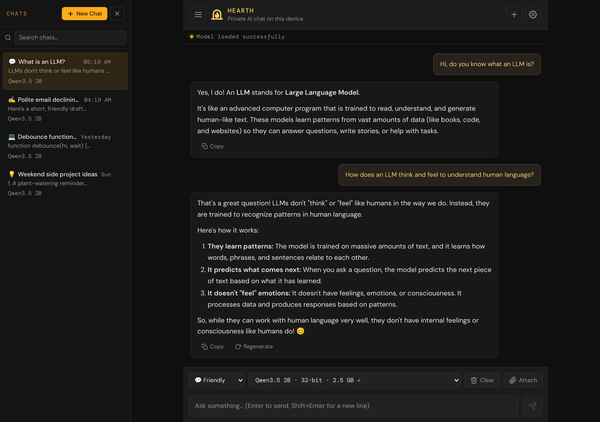
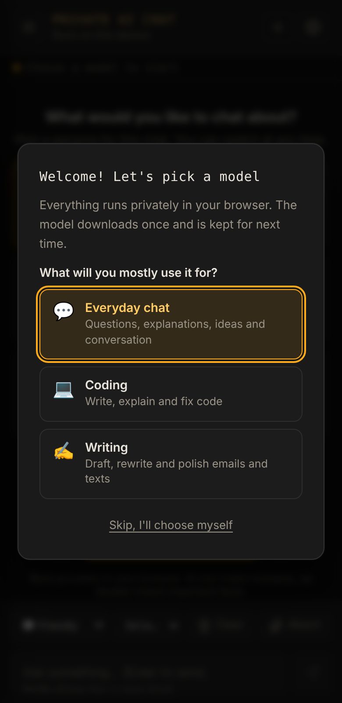

# Hearth

**English** · [Bahasa Indonesia](README.id.md)

**Private AI chat that lives in your browser.** No server. No account. Works offline.

The AI model runs on your own device, so nothing you type leaves it. Once a model is downloaded, it keeps working without an internet connection. Open source, and powered by [WebLLM](https://github.com/mlc-ai/web-llm) and WebGPU.

**[Try it → bowo-prasetyo.github.io/web-llm](https://bowo-prasetyo.github.io/web-llm/)**



## What it does

* **Private by design.** The AI model runs on your own GPU. Your messages, chats and documents are stored only in your browser and are never sent anywhere.
* **No setup.** Open the page, answer two questions, and it picks a model that suits your device. No install, no sign-up, no API key.
* **Works offline.** After the first visit the app and any model you've downloaded work without an internet connection. You can also install it as an app on desktop and phone.
* **Personas for different jobs.** Friendly, Precise, Writer, Coder and Brainstorm, or write your own instructions. Pick one per chat.
* **Ask about your documents.** Attach a PDF, text or Markdown file to a chat and ask questions about it.
* **Readable answers.** Replies are formatted with headings, lists, tables and highlighted code with a Copy button.
* **Many models.** 55 open models from 100M to 9B parameters, including Qwen3.5, Llama 3, Phi-4-mini, Gemma and Mistral. The app shows how fast each one writes on your device and suggests a smaller one when it's slow.
* **Your chats, kept.** Multiple chats with search, saved automatically, with export and import to move them to another browser.
* **In your language.** The app is available in English and Indonesian (**Settings → Language**), and the AI replies in the language you write in.



## Getting started

1. Open **https://bowo-prasetyo.github.io/web-llm/** in Chrome or Edge on a computer (recommended), or a recent Safari (macOS 14+ / iOS 17+). The browser needs [WebGPU](#requirements). Phones work too, but many can only run the smallest models (see [Known limitations](#known-limitations)).
2. Choose what you'll mostly use it for (everyday chat, coding or writing) and a size (Fast, Balanced or Smart).
3. Wait for the one-time download (from about 0.4 GB for the smallest pick to 4.8 GB for the largest), then start chatting. Next time it loads from your device.

New to the app? The **[User Manual](docs/user-manual/README.md)** ([Bahasa Indonesia](docs/user-manual/id/README.md)) walks through everything step by step, in plain language: chatting, personas, documents, choosing a model, settings, offline use and backups, and troubleshooting.

## What stays on your device, and what is downloaded

* **Stays on your device:** your messages, chats, attached documents and settings (in the browser's storage), and the AI model itself, which runs on your GPU.
* **Downloaded once:** the model files (from Hugging Face and GitHub), the app's code libraries (from public CDNs), and, for large documents, a small search model (~23 MB). Nothing you type is part of these requests.
* Clearing the site's data in your browser removes everything, including downloaded models.

## Known limitations

* **Works best on a computer.** Phones give the AI little memory: on many, models of 0.7 GB or more close the page, and only the Tiny models fit, whose answers are very limited. When a model closes the page, the app explains and suggests a smaller one, stepping down one size at a time.
* **Not yet tested on Safari (iPhone, iPad, Mac) or Firefox.** Version 1.0.0 was tested on Chrome and Edge on a Windows laptop and Chrome on Android. If something doesn't work on yours, please use **Settings → This device → Report a problem**.
* **Needs WebGPU.** Recent Chrome and Edge on desktop work best; Android Chrome and Safari (macOS 14+ / iOS 17+) work on many devices. Firefox's WebGPU support is newer and less tested, and older browsers can't run it.
* **Large downloads.** A model is a 0.2–4.9 GB download, kept by the browser, and needs more GPU memory than that while it runs (about 0.6–7.5 GB). Clearing the site's data removes it. **Private (incognito) windows** allow far too little storage for a model; the app warns before downloading when a model probably won't fit.
* **Speed depends on your GPU.** On an integrated or older GPU a 2B model may write about 1 word per second; the app shows the speed and suggests a smaller model.
* **Small models get facts wrong.** They write fluently even when they're wrong. Check anything important, and prefer a larger model for factual questions.
* **No internet access.** The model only knows what it learned in training (and the documents you attach); it can't look things up or know recent events.
* **One device at a time.** Chats stay in the browser where you made them; use Export / Import to move them.

## Name and brand

The app is called **Hearth**: the warm place at the centre of a home, where the fire is kept. Like a hearth, it stays in your home (your device) and keeps going without anything from outside. In full it is *Hearth, private AI chat that lives in your browser*, and the short promise is *No server. No account. Works offline.* See [docs/brand.md](docs/brand.md) for the icon, colours and how to write the name.

The repository and web address keep the name `web-llm`, so links, installed apps and saved chats keep working.

## Version and reporting problems

The current version is **1.0.0** (see [CHANGELOG.md](CHANGELOG.md)); the app shows its version in **Settings → This device**.

Found a problem? Use **Settings → This device → Report a problem**: it opens a GitHub issue form with your app version, browser, GPU and model filled in, which helps a lot with GPU-specific bugs. Nothing is sent until you submit the form, and please don't include private chats. You can also [open an issue](https://github.com/bowo-prasetyo/web-llm/issues/new?template=problem.yml) directly.

## All features

* Fully client-side AI chat — no backend, no data leaves the browser
* Works offline after the first visit, and installable as an app (PWA) on desktop and phone
* Multiple chat sessions with automatic save, restore, and delete
* Full-text search across all chat sessions (titles, questions, and answers)
* Conversation persistence across tab closures and mobile screen-off events
* Auto-resume of unanswered questions after tab suspension
* Duplicate send prevention on manual resend after tab resume
* 55 selectable LLM models across 15 model families (including Qwen3.5, Phi-4-mini, Gemma 3, Ministral 3 and OLMo 2), grouped by size tier
* Switch models mid-conversation without clearing chat history
* First-run model picker: choose what it's for (chat, coding, writing) and a size (Fast / Balanced / Smart); picks suit the device and avoid 16-bit models where they don't work
* Download confirmation with size estimate on first model use (from the chat toolbar and from Settings)
* Deleting or clearing a chat asks first; nothing is deleted by a single tap
* Keyboard and screen-reader friendly: dialogs and the chat list keep focus and close with Escape, every control has a name, and status changes are announced
* Download progress panel: a progress bar with percentage, amount downloaded, estimated time left and a Cancel button (cancelling goes back to the model you had)
* Models shown by readable name, precision and download size ("Qwen3.5 2B · 16-bit · 1010 MB ✓"), with ✓ for downloaded ones
* Stop generation at any time during streaming response
* Automatic model caching — confirmed models load instantly on subsequent visits
* Persistent local settings (model, temperature, top-p, penalties, context window, personas), saved as you edit them
* Light and dark themes: follows the device by default, or choose Light or Dark in Settings → Appearance
* The interface in English and Indonesian: follows the browser's language by default, or choose one in Settings → Language; new translations can be added (see [docs/translating.md](docs/translating.md))
* Configurable maximum file upload size (1–200 MB, default 50 MB)
* Export settings to a JSON file and import on another browser
* Export all chat sessions to a JSON file and import (merge) on another browser — no duplicates
* Streaming AI responses with a live word count; scroll up to reread while a reply streams, and **Jump to latest** brings you back
* Replies rendered as Markdown: headings, lists, tables, links and code blocks with syntax highlighting and a Copy button
* Copy any reply, and regenerate (or retry) the last one
* Reasoning from thinking models (Qwen3, DeepSeek-R1) shown live, then folded into a collapsible "Thought process"
* GPU-accelerated inference using WebGPU
* Friendly WebGPU error screen with troubleshooting steps when GPU is unavailable
* Quick model check after a model's first load on each device: catches GPUs whose 16-bit math is broken (q4f16 models reply with junk like "outer outer outer…") and offers the q4f32 version
* Replies that collapse into repeated words are stopped, explained, and kept out of the conversation history
* "This device" panel in Settings: WebLLM version, GPU, 16-bit support and model check results
* Web Worker isolation for a fully responsive UI during inference
* Attach documents (PDF, TXT, Markdown) to a chat: small ones are given to the model whole, large ones are searched for the parts that match each question
* Attachments belong to one chat, are saved with it (IndexedDB), and are exported, imported and deleted with it
* Automatic recovery from GPU crashes, engine errors, and WASM Tokenizer failures
* Automatic model unload after inactivity to free GPU memory
* Conversation history memory with configurable context window
* Settings page with the everyday reply settings up front and the advanced sampling settings folded away; changes save automatically
* Shows how fast the model writes on this device (for example "about 1 word/sec"), and suggests a smaller model when it is slow, noting that smaller models make more mistakes
* Honest about small models: Friendly and Precise chats on models of about 1B parameters or fewer show a hint that they often get facts wrong (hidden per model with ×), and the picker's Fast size says so too
* Six chat personas (Friendly, Precise, Writer, Coder, Brainstorm, Custom), chosen per chat and switchable mid-conversation
* Welcome screen for new chats with persona cards and starter prompts
* Responsive UI: on wide screens (1100px and up) the chat list sits beside the chat and can be hidden; narrower screens get a slide-in drawer; on phones Enter starts a new line and the Send button sends, and the message box grows as you type

## Supported Models

55 models are available, ordered from lightest to heaviest. The model
dropdown in the app groups them by size tier using `<optgroup>` labels.
**New** marks models added after the original list; all of them are
supported by the WebLLM version the app uses (0.2.84).

### Tiny: for testing; very limited answers

These models can barely hold a conversation: they repeat themselves, get most facts wrong, and sometimes recite their own instructions as an answer. TinyLlama has 1.1B parameters but dates from 2023 and answers like the tiny ones, so it's here too. They're kept for testing and very weak devices, shown last in the model menu under this label, and never suggested by the model picker.

| Model | Approx Size |
|---|---|
| SmolLM2-135M-Instruct-q0f32-MLC | ~720 MB |
| SmolLM2-360M-Instruct-q4f32_1-MLC | ~580 MB |
| SmolLM2-360M-Instruct-q0f32-MLC | ~1.7 GB |
| TinyLlama-1.1B-Chat-v1.0-q4f32_1-MLC | ~840 MB |

### Micro (0.5–0.8B)

| Model | Approx Size |
|---|---|
| Qwen3.5-0.8B-q4f16_1-MLC (new) | ~1.6 GB |
| Qwen3.5-0.8B-q4f32_1-MLC (new) | ~1.8 GB |
| Qwen2.5-0.5B-Instruct-q4f16_1-MLC | ~945 MB |
| Qwen2.5-0.5B-Instruct-q4f32_1-MLC | ~1.0 GB |
| Qwen2.5-Coder-0.5B-Instruct-q4f16_1-MLC | ~945 MB |
| Qwen3-0.6B-q4f16_1-MLC | ~1.0 GB |

### Lightweight (1–1.7B)

| Model | Approx Size |
|---|---|
| gemma3-1b-it-q4f16_1-MLC (new) | ~711 MB |
| OLMo-2-0425-1B-Instruct-q4f16_1-MLC (new) | ~1.7 GB |
| OLMo-2-0425-1B-Instruct-q4f32_1-MLC (new) | ~2.4 GB |
| Llama-3.2-1B-Instruct-q4f16_1-MLC | ~879 MB |
| Llama-3.2-1B-Instruct-q4f32_1-MLC | ~1.1 GB |
| SmolLM2-1.7B-Instruct-q4f16_1-MLC | ~1.7 GB |
| SmolLM2-1.7B-Instruct-q4f32_1-MLC | ~2.6 GB |
| Qwen3-1.7B-q4f16_1-MLC | ~1.7 GB |
| stablelm-2-zephyr-1_6b-q4f16_1-MLC | ~2.0 GB |

### Small (1.5B)

| Model | Approx Size |
|---|---|
| Qwen2.5-1.5B-Instruct-q4f16_1-MLC | ~1.6 GB |
| Qwen2.5-1.5B-Instruct-q4f32_1-MLC | ~1.8 GB |
| Qwen2.5-Coder-1.5B-Instruct-q4f16_1-MLC | ~1.6 GB |
| Qwen2.5-Math-1.5B-Instruct-q4f16_1-MLC | ~1.6 GB |

### Mid (2–4B)

| Model | Approx Size |
|---|---|
| Qwen3.5-2B-q4f16_1-MLC (new) | ~2.2 GB |
| Qwen3.5-2B-q4f32_1-MLC (new) | ~2.5 GB |
| Ministral-3-3B-Instruct-2512-BF16-q4f16_1-MLC (new) | ~2.8 GB |
| Ministral-3-3B-Instruct-2512-BF16-q4f32_1-MLC (new) | ~3.4 GB |
| Qwen3.5-4B-q4f16_1-MLC (new) | ~3.8 GB |
| Qwen3.5-4B-q4f32_1-MLC (new) | ~4.6 GB |
| gemma-2-2b-it-q4f16_1-MLC | ~1.9 GB |
| gemma-2-2b-it-q4f32_1-MLC | ~2.5 GB |
| Llama-3.2-3B-Instruct-q4f16_1-MLC | ~2.2 GB |
| Llama-3.2-3B-Instruct-q4f32_1-MLC | ~2.9 GB |
| Hermes-3-Llama-3.2-3B-q4f16_1-MLC | ~2.2 GB |
| Qwen2.5-3B-Instruct-q4f16_1-MLC | ~2.4 GB |
| Qwen2.5-3B-Instruct-q4f32_1-MLC | ~2.8 GB |
| Qwen2.5-Coder-3B-Instruct-q4f16_1-MLC | ~2.4 GB |
| Qwen3-4B-q4f16_1-MLC | ~3.1 GB |

### Upper-mid (3.8B)

| Model | Approx Size |
|---|---|
| Phi-4-mini-instruct-q4f16_1-MLC (new) | ~3.4 GB |
| Phi-4-mini-instruct-q4f32_1-MLC (new) | ~4.1 GB |
| Phi-3.5-mini-instruct-q4f16_1-MLC | ~3.6 GB |
| Phi-3.5-mini-instruct-q4f32_1-MLC | ~5.4 GB |

### Large (7–9B) — requires ≥6 GB VRAM

| Model | Approx Size |
|---|---|
| Qwen3.5-9B-q4f16_1-MLC (new) | ~6.3 GB |
| Qwen3.5-9B-q4f32_1-MLC (new) | ~7.4 GB |
| Qwen2.5-7B-Instruct-q4f16_1-MLC | ~5.0 GB |
| Qwen2.5-7B-Instruct-q4f32_1-MLC | ~5.8 GB |
| Qwen2.5-Coder-7B-Instruct-q4f16_1-MLC | ~5.0 GB |
| Qwen3-8B-q4f16_1-MLC | ~5.4 GB |
| Llama-3.1-8B-Instruct-q4f16_1-MLC | ~4.9 GB |
| Llama-3.1-8B-Instruct-q4f32_1-MLC | ~6.0 GB |
| Hermes-3-Llama-3.1-8B-q4f16_1-MLC | ~4.8 GB |
| Mistral-7B-Instruct-v0.3-q4f32_1-MLC | ~5.5 GB |
| DeepSeek-R1-Distill-Qwen-7B-q4f16_1-MLC | ~5.0 GB |
| DeepSeek-R1-Distill-Llama-8B-q4f16_1-MLC | ~4.9 GB |
| gemma-2-9b-it-q4f16_1-MLC | ~6.3 GB |

Sizes in these tables are the GPU memory each model needs (`MODEL_SIZES_MB` in `worker.js`, from WebLLM's model registry; 1 GB = 1024 MB). Downloads are smaller: the app shows the real download size (`DOWNLOAD_SIZES_MB`, the model's weight files on Hugging Face), e.g. 404 MB for Qwen3.5 0.8B, which needs about 1.6–1.9 GB of GPU memory.

**q4f16 vs q4f32.** q4f16 models are smaller and faster but need the GPU's
16-bit math. Some GPUs and browsers get that math wrong, and those models then
reply with garbage. The app checks each model once per device; if 16-bit
models fail (or the GPU doesn't support them), the model list also shows q4f32
versions of the q4f16-only models (Qwen2.5-Coder, Qwen3, Hermes-3, DeepSeek-R1,
gemma-2-9b and others) and marks q4f16 models with ⚠.
Models are cached locally in the browser after the first download.

## Choosing a Model

On first launch the app asks two questions instead of downloading anything:

1. **What will you mostly use it for?** Everyday chat, Coding, or Writing (this also sets the default persona)
2. **Which size?**

| Use | Fast | Balanced | Smart |
|---|---|---|---|
| Everyday chat | Qwen3.5 0.8B | Qwen3.5 2B | Qwen3.5 4B |
| Coding | Qwen3.5 2B | Qwen3.5 4B | Qwen3.5 9B |
| Writing | Qwen3.5 2B | Qwen3.5 4B | Qwen3.5 9B |

* Qwen3.5 is the newest model generation WebLLM 0.2.84 supports; coding and writing start at 2B, since smaller models mix up code and lose the thread of longer texts

* Fast is recommended on phones and devices reporting 4 GB of memory or less, Balanced otherwise; Smart needs a strong GPU. On phones and tablets, Fast is **Llama 3.2 1B** for every use (about 1 GB of GPU memory; Qwen3.5 0.8B needs 1.6–1.9 GB, which closes the page on many phones). Fast is quickest but more likely to get facts wrong: small models write fluently even when they are wrong
* Devices where 16-bit GPU math is unsupported or broken get the q4f32 version of each pick automatically
* Downloaded models are marked, and the model in use is labelled
* **Skip** leaves the choice to you (the model menu); nothing downloads until a model is chosen, and sending a message first opens the picker
* Open it again any time from **Settings → Help me choose a model** or the welcome screen
* If a model is already downloaded (for example after clearing settings), it is used without asking

## Recommended Models

| Use Case | Recommended Model |
|---|---|
| Lowest resource usage | Gemma 3 1B (q4f16 only) or Qwen3.5-0.8B |
| Phones | Qwen3.5-0.8B or Llama-3.2-1B |
| General chat | Qwen3.5-2B, or Qwen3.5-4B with a stronger GPU |
| Coding | Qwen3.5-4B or Qwen3.5-9B (Qwen2.5-Coder is still available) |
| Writing | Qwen3.5-4B or Ministral-3-3B-Instruct |
| Reasoning | Qwen3.5 with "Let reasoning models think first" on, or DeepSeek-R1-Distill-Qwen-7B |
| Multilingual | Qwen3.5-2B or Qwen3.5-4B |
| Instruction following | Phi-4-mini |
| Fully open (data and code) | OLMo-2-1B |
| Most capable (high VRAM) | Qwen3.5-9B |

## User Settings

Accessible via the ⚙ Settings page (tap the gear icon in the header):

### Model

* **Model selection** — choose from 55 models grouped by size tier. Each is shown by name, precision and download size, e.g. "Qwen3.5 2B · 16-bit · 1010 MB ✓" (✓ = already downloaded); the full model ID is shown under the menu. Switching models keeps the current conversation, and the new model continues it with the same history. Picking a different model applies that model's recommended reply settings.

### Replies

* **Temperature** — randomness of output (0.0–2.0); low = focused, high = creative
* **Max Tokens** — maximum length of one reply (16–2048, capped at half the context window), shown with a rough word count. Defaults (`modelDefaults()` in `app.js`) are 256 for the 135M and 360M models; 512 for 0.5–0.8B, 1–1.1B and 1.7B; 768 for 1.5–1.6B and 2B; and 1024 for 3B and up (including the Phi mini models). A reply that reaches it is marked "Cut off" with a **Continue** button
* **Context Window** — how many tokens of conversation the model can see (512–8192). It's the only setting that needs the model to reload: after a change, Settings offers **Reload model now** (otherwise it applies the next time the app starts). When a chat grows past it, the oldest turns (then document context) are left out of what the model sees
* **Let reasoning models think first** — off by default. Qwen3 and Qwen3.5 can reason step by step before answering; that sometimes helps with hard questions but is slower and uses up the reply length, so it's off unless you turn it on (the reasoning then shows as a collapsible "Thought process"). DeepSeek-R1 always reasons
* **Advanced sampling** (folded by default):
  * **Top P** — nucleus sampling threshold (0.01–1.0); filters token candidates by cumulative probability
  * **Frequency Penalty** — reduces repetition of words that already appeared (−2 to 2)
  * **Presence Penalty** — encourages the model to introduce new topics (−2 to 2)
  * **Repetition Penalty** — MLC-native multiplicative penalty on repeated tokens (1.0–2.0)
* **Reset to this model's recommended settings** — asks first; personas and custom instructions are kept

### Documents

* **Max Upload Size** — maximum file size for document uploads (1–200 MB, default 50 MB); the extracted text is also limited to 500,000 characters (~200 pages)

### Personas

A persona sets how the assistant talks. Each chat keeps its own persona:
pick one on the welcome screen of a new chat, or switch at any time from the
persona menu in the chat toolbar (it applies from your next message, and the
conversation so far is kept).

| Persona | Best for |
|---|---|
| 💬 **Friendly** (default) | Everyday help and easygoing chat |
| 🎯 **Precise** | Short, factual answers with no tangents; says "I'm not sure" rather than guessing |
| ✍️ **Writer** | Drafting, rewriting and polishing emails, messages, essays and stories |
| 💻 **Coder** | Writing, explaining and debugging code |
| 💡 **Brainstorm** | Exploring ideas and options |
| 🛠 **Custom** | Your own instructions, written in Settings |

* **Default for new chats** — choose which persona new chats start with
* **Custom persona** — fully editable instructions; changes take effect on the next message without reloading the model; **Reset to Friendly instructions** restores a starting point
* Personas only change the system prompt; temperature and the other generation settings stay as you set them
* Persona prompts are kept short on purpose: small in-browser models follow short, plain instructions much better than long rule lists. They live in `personas.js`.
* Every built-in persona is told to stay consistent with what it said earlier, and to gently correct the user instead of agreeing with something that isn't right (small models otherwise tend to go along with whatever the user says)
* Settings from earlier versions are migrated automatically: if you had edited the old system prompt, it becomes your Custom persona and stays your default; otherwise you move to Friendly

### Appearance

* **System** (default), **Light** or **Dark**. System follows the device's light/dark setting, also when it changes while the app is open; Light and Dark always apply. The choice is remembered in this browser (`localStorage`, `webllm-theme`)
* The theme is applied by a small script at the top of `index.html` before the page is drawn, so a light device never sees a dark flash. It also sets the browser's address-bar colour (`theme-color`) and the colour of native controls (`color-scheme`)
* All colours are tokens at the top of `style.css`; the light theme redefines them under `:root[data-theme="light"]`. Amber is a fill (buttons, badges) in both themes, with darker shades for amber text and outlines on light backgrounds

### Language

* **Automatic** (default) or one of the shipped languages: English and Indonesian for now. Automatic picks the first language in the browser's list that the app has, and English when none matches. Each language is listed in its own words (from `Intl.DisplayNames`)
* Switching applies at once, without a reload, including `<html lang dir>` and the tab title. The choice is remembered in this browser (`localStorage`, `webllm-language`) and read before the page is first drawn
* Dates and numbers follow the chosen language, in the browser's regional style when it's the same language (for example a decimal comma in Indonesian)
* The interface text lives in `locales/<code>.js`; [docs/translating.md](docs/translating.md) explains how to add a language

### This device

* Shows the WebLLM version, the GPU, and whether it supports 16-bit math
* Shows whether q4f16 models work here, and lists models that failed the model check (with a sample of their output)
* **Forget check results** re-runs the checks, for example after a browser or GPU driver update

### Export / Import

* **Export Settings** — download all settings as a `hearth-settings-YYYY-MM-DD.json` file
* **Import Settings** — load settings from a previously exported file; model selection is preserved to avoid an unwanted download
* **Export Chats** — download all saved sessions as a `hearth-chats-YYYY-MM-DD.json` file including full message content
* **Import Chats** — merge sessions from an exported file into the current browser; duplicate sessions are detected by ID and content fingerprint and skipped automatically

All settings are saved automatically in `localStorage` as you change them and survive page reloads; there is no Apply button. Reply settings and personas apply to the next message, a new model loads when you pick it, and a new context window asks to reload the model.

### Current chat

* **Clear Conversation** — deletes the chat that is open (asks first)

## Multi-session Chat

* On wide screens (1100px and up) the chat list is shown beside the chat. The **☰ menu button** (or **×** in the list) hides and shows it, and the app remembers your choice
* On narrower screens, tap the **☰ menu button** in the header to open the list as a drawer over the chat
* Tap **+ New Chat** to start a fresh conversation — the current session auto-saves first
* Previously saved chats are listed with auto-generated title, preview, model, and timestamp
* Tap any session to restore it — messages and model context are both recovered
* Tap the **🗑 trash icon** on any session to delete it; the app asks first (on touch screens the icon is always shown)
* Close the list with **×**, Escape, or by tapping beside it
* Chats are saved in the browser's database (IndexedDB), with no limit on the number of chats or messages beyond the browser's storage quota; nothing is deleted automatically
* Chats saved by earlier versions in `localStorage` are moved to IndexedDB on first start (the old copies are removed only after the move succeeds)
* If IndexedDB can't be used (for example in some private-browsing modes), chats fall back to `localStorage`, limited to 50 chats of 40 messages; **Settings → This device** shows where chats are saved
* Sessions survive page reloads, tab closures, and mobile screen-off events
* Unanswered questions (tab closed mid-generation) are automatically re-sent on next open

## Replies

* Assistant replies are rendered as Markdown with GitHub-style tables, lists and links
* **Code blocks** show their language and a **Copy** button; syntax colors are applied once the reply finishes streaming
* **Copy** under a reply copies its Markdown source; **Regenerate** asks again for the last reply (**Retry** after an error)
* **Thinking models** (Qwen3, DeepSeek-R1): the `<think>` reasoning is shown live while the model works, then folded into a collapsible **Thought process** section. Reasoning is left out of copies, chat previews and the history sent back to the model, which saves context
* Safety: raw HTML written by the model is shown as text, output is sanitized with DOMPurify, and links open in a new tab
* Your own messages are shown exactly as typed
* The Markdown libraries (marked, DOMPurify, highlight.js) load at pinned versions with integrity hashes; if they can't load, replies fall back to plain text

## Accessibility

* **Dialogs** (model picker, download and delete confirmations, GPU warnings) take keyboard focus, keep Tab inside them, close with **Escape** (the WebGPU error screen excepted) and give focus back to where it was. In a confirmation the safe choice (**Cancel**) has focus
* **Chat list**: while closed it is skipped by Tab; when opened, focus moves into it and stays there until it closes (Escape, **×**, or opening a chat), then returns to the menu button. Each chat is a button, and the open one is marked as current
* **Names**: icon-only buttons, the message box, the model and persona menus and the Settings sliders all have accessible names
* **Announcements**: status messages (loading, ready, errors) are read out by screen readers; download progress is announced once when it starts, not on every step
* **Text size**: nothing in the interface is smaller than 12px (the `--fs-meta` and `--fs-small` tokens in `style.css`); a browser test checks every visible text on the chat, Settings and model picker screens
* **Contrast**: every visible text meets WCAG AA contrast (4.5:1, 3:1 for large text) in both themes; a browser test checks the chat, chat list, search, Settings, the delete dialog and the model picker against the real (blended) background behind each text
* **Focus ring**: every control shows a visible amber outline when reached with the keyboard, including **Attach** and the Import buttons (their file inputs are visually hidden, not removed)
* **Confirmations** before anything is deleted: **Clear** (toolbar), **Clear Conversation** (Settings) and the sidebar's trash icon

## Session Search

* Type in the **search box** at the top of the sidebar to search all chats
* Search covers titles, all user questions, and all assistant answers — full content, not just previews
* Results are ranked by match count with highlighted excerpts showing context around each match
* The active session is always searched first; past sessions follow sorted by relevance
* Search is debounced and yields to the event loop between sessions to remain responsive on large histories

## Stop and Cancel Controls

* **Stop generation** — while the model is streaming, the Send button becomes a pulsing red Stop button; tap it to halt and keep the partial response
* **Download progress** — while a model loads, a panel above the chat shows what's happening (downloading, loading from this device, or preparing the GPU), a progress bar, the percentage, how much has been downloaded and, once it can tell, the time left. Screen readers get it as a progress bar
* **Cancel download** — the panel's **Cancel** button (shown while downloading over the network) stops the download and goes back to the model and settings you had before; the download confirmation re-appears next time you pick that model

## Scrolling and the Message Box

* While a reply streams, the chat follows it only while you're at the bottom. Scroll up to reread something and it stays put; **Jump to latest** (or **Follow the reply**) takes you back. Sending a message, opening a chat, Regenerate and Continue always go to the bottom
* With a keyboard, **Enter** sends and **Shift+Enter** starts a new line. On touch screens Enter starts a new line and the **Send** button sends. **Ctrl/Cmd+Enter** sends everywhere
* Enter that confirms an input-method composition (Chinese, Japanese, Korean…) never sends
* The message box grows with its text, and uses 16px text on phones so iOS doesn't zoom in

## Offline and Installing

After one visit while online, the app works without an internet connection:

* A service worker (`sw.js`) saves the app's own files and the pinned libraries (Vue, Vue Router, marked, DOMPurify, highlight.js, PDF.js, WebLLM, Transformers.js) in the browser
* Model weights are kept by WebLLM itself, so **any model you have downloaded keeps working offline**
* Offline, the status bar shows an **Offline** badge; picking a model that isn't downloaded yet explains that it needs a connection instead of failing
* Downloading a new model, and the first large document attached (which fetches a small search model), need a connection
* App updates still arrive: when online, the app's own files are always fetched fresh first (falling back to the saved copy after 4 seconds or when offline)
* A tab left open across an update shows **"A new version of the app is available"** with a **Reload** button: the app checks its files when it starts, every 30 minutes, and when the tab comes back into view
* **Settings → This device** shows whether the app is saved for offline use, and has an **Install app** button where the browser supports it (Chrome, Edge, Android). On iPhone/iPad use Safari's **Share → Add to Home Screen**

Service workers need `https` or `localhost`, so offline mode works on GitHub Pages and with the local server below.

## Requirements

Modern browser with WebGPU support.

Recommended browsers:

* [Google Chrome](https://www.google.com/chrome/) 121+
* [Microsoft Edge](https://www.microsoft.com/edge) latest
* [Safari](https://www.apple.com/safari/) latest (macOS 14+ / iOS 17+)

Recommended hardware:

* Modern integrated GPU minimum (for models up to ~1.5B)
* Dedicated GPU recommended for 2B+ models
* At least 4 GB RAM for small models; 8 GB+ for 3B+ models
* Stable internet connection for first model download

### WebGPU Troubleshooting

If the app shows a "WebGPU Not Available" error screen:

1. Enable **Hardware Acceleration** in your browser settings
2. On Chrome Android: visit `chrome://flags` and enable **WebGPU** or **Unsafe WebGPU**
3. Use **Chrome 113+** or **Edge** on desktop for the most reliable WebGPU support
4. Check your GPU compatibility at [webgpureport.org](https://webgpureport.org)

## Built with

The whole app runs in the browser; there is no backend and no build step.

* [WebLLM](https://github.com/mlc-ai/web-llm) 0.2.84 on WebGPU, in a Web Worker, for the language models
* [Vue 3](https://vuejs.org) and Vue Router, loaded from a CDN
* [Transformers.js](https://github.com/xenova/transformers.js) (all-MiniLM-L6-v2) to search large attached documents, and [PDF.js](https://mozilla.github.io/pdf.js/) to read PDFs
* [marked](https://marked.js.org), [DOMPurify](https://github.com/cure53/DOMPurify) and [highlight.js](https://highlightjs.org) to render replies safely
* IndexedDB for chats and attachments, and a service worker for offline use
* `i18n.js` and `locales/` for the interface's translations (the browser's `Intl` APIs, no extra library)
* [DM Sans](https://github.com/googlefonts/dm-fonts) and [DM Mono](https://github.com/googlefonts/dm-mono) fonts, served from `fonts/` (SIL Open Font License)

## Run Locally

Because WebGPU and module Workers require an HTTP origin,
run the application using a local web server:

```bash
python -m http.server 8080
```

Then open:

```
http://localhost:8080
```

With Node.js 20 or newer installed, `npm run serve` does the same with the server the tests use (`tests/support/server.js`), at http://localhost:4173. It needs no `npm ci` and sends no-cache headers, so a reload always picks up your edits.

## Testing

The app has no build step; `package.json` only holds the test tooling ([Playwright](https://playwright.dev)).

```bash
npm ci
npx playwright install chromium
npm test              # everything (about a minute)
npm run test:unit     # pure modules only, no browser
npm run test:e2e      # the app in Chromium
```

* **Unit tests** (`tests/unit/`) cover `quality.js`, `context.js`, `markdown.js`, `picker.js` (including model names and load progress), `attachments.js`, `pace.js`, `crash.js`, `storage.js`, `personas.js`, `status.js`, `i18n.js` (including a check that every translation has all the keys, placeholders and plural forms it needs), and the documentation's links (`docs.spec.js`: every link and anchor in the READMEs and the manual, translations included, points to a file and heading that exist)
* **Browser tests** (`tests/e2e/`) run the real app in Chromium: light and dark themes and their contrast, the docked chat list and text sizes, settings, download progress and cancel, readable model names, scrolling while a reply streams, the message box on desktop and phones, download and delete confirmations, keyboard focus and accessible names, chat storage (IndexedDB, migration, export/import, fallback), documents attached to chats, personas, reply rendering and safety, model health on broken 16-bit GPUs, Continue and the repeat guard (with the real `worker.js`), progress-based time limits and the writing-speed note, the model picker, offline mode, the "new version available" banner, and the language choice (Indonesian included)
* The tests need no network, GPU or model downloads: the pinned CDN libraries are served from `node_modules`, and WebLLM is replaced by a scripted mock (`tests/support/mock-webllm.js`); some UI tests use a fake worker (`tests/support/fake-worker.js`) that reads its model lists from `worker.js`
* **Documentation screenshots** (`docs/screenshot.png`, `docs/screenshot-phone.png`, and the Indonesian `docs/screenshot-id.png`, `docs/screenshot-phone-id.png`) are drawn by `npm run screenshots` (`tests/screenshots/docs.spec.js`) with the same mocks, so they can be redrawn after any UI change without a GPU. The chat in the English screenshot is a real Qwen3.5 2B conversation stored as a saved chat, so its replies are the model's own words; the Indonesian ones show the welcome screen and the model picker, which have no model replies. `npm test` leaves the images alone
* GitHub Actions runs everything on every pull request and on pushes to `main` (`.github/workflows/tests.yml`)
* When you change a pinned library version, update every place it appears together: `index.html` (Vue, Vue Router, marked, DOMPurify, highlight.js, PDF.js), `worker.js` (WebLLM and its `WEBLLM_VERSION` constant, Transformers.js), `sw.js`, `package.json`, `tests/support/fixtures.js` and the library list in `tests/e2e/offline.spec.js`. `grep -rn "<old version>" --exclude-dir=node_modules .` finds them all

## Releasing a new version

1. Update `APP_VERSION` in `version.js` and `version` in `package.json` (then `npm install --package-lock-only`)
2. Add the changes under a new heading in `CHANGELOG.md`
3. Write the release notes in `docs/release-notes/vX.Y.Z.md` (a short summary for people, not the full changelog)
4. Merge to `main` (GitHub Pages deploys it), then tag the merge commit `vX.Y.Z` and publish a GitHub Release with those notes

The tests check that the three version numbers match.

## Deploy to GitHub Pages

1. Create a GitHub repository
2. Upload all project files (`index.html`, `app.js`, `worker.js`, `sw.js`, `manifest.webmanifest`, `personas.js`, `markdown.js`, `quality.js`, `context.js`, `picker.js`, `chatstore.js`, `attachments.js`, `pace.js`, `version.js`, `crash.js`, `storage.js`, `status.js`, `i18n.js`, `style.css`) and the `icons/`, `fonts/` and `locales/` folders
3. Push to the `main` branch
4. Go to **Settings → Pages**
5. Set **Source** to `Deploy from branch`, branch `main`, folder `/root`
6. Save

Your live URL will be:

```
https://YOUR_USERNAME.github.io/YOUR_REPOSITORY/
```

## Attaching Documents

Tap **Attach** in the toolbar to add a PDF, TXT or Markdown file to the chat on screen. It shows as a chip above the message box (name, size, and status while it's being read or prepared); **×** removes it from the chat.

* **Attachments belong to one chat.** Other chats don't see them. They're saved with the chat (IndexedDB), and deleted, exported and imported with it. A chat that so far only has a document is kept (titled 📎 with the file name)
* **Small documents go in whole.** If everything attached fits in the model's context budget (about three quarters of what's left after the reply and the question), the full text is given to the model with each question. No extra download, works offline
* **Large documents are searched.** Documents over 2,000 characters are split into overlapping, sentence-aware chunks (~800 characters) and embedded in the background when attached (Transformers.js `all-MiniLM-L6-v2`, ~23 MB, downloaded once). Each question then gets the chunks that match it (similarity at least 0.2 and at least half the best match), best first, up to the budget
* **General requests** such as "summarize this", which match no part in particular, get the beginning of each document instead
* Document text goes into the current request only; it's never stored in the conversation history or replayed on later turns
* Limits: the file size set in Settings (default 50 MB, up to 200 MB) and 500,000 characters of text (~200 pages). Scanned PDFs without a text layer can't be read

No attached file ever leaves the browser.

**Earlier versions** kept one document index shared by all chats. It is no longer used: the app shows a note listing those files, with a button to remove the old index. Attach the files you need to a chat instead.

## Storage

| Storage | Used For |
|---|---|
| IndexedDB (`webllm-chats`) | Chats: the chat list, each chat's messages, and documents attached to chats (text, and chunks with embeddings for large ones) |
| `localStorage` | Settings, cached-model list, model check results, measured writing speed per model, chat-list shown/hidden, theme and language (and chats, only if IndexedDB is unavailable) |
| OPFS | GPU stability flag (and the unused shared document index of earlier versions, until removed) |
| Browser cache / IndexedDB | WebLLM model weights |
| Cache Storage (`webllm-shell-v1`, `webllm-libs-v1`) | The app's files and pinned libraries, for offline use |

Cached data may include AI model weights (potentially several GB), attached documents, user settings, and chat history.

## Architecture

| File | Purpose |
|---|---|
| `app.js` | Vue 3 UI — routing, session management, settings, worker bridge |
| `worker.js` | AI inference worker — WebLLM engine, attached documents, streaming |
| `attachments.js` | Splitting attached documents into chunks and choosing what goes in front of the model |
| `index.html` | HTML entry point, CDN imports |
| `chatstore.js` | Chat storage in IndexedDB, migration from localStorage, and the localStorage fallback |
| `picker.js` | Model picker catalog, device-based recommendation, readable model names and load-progress parsing |
| `quality.js` | Junk-output detection for the model check and the collapsed-reply guard |
| `storage.js` | Storage checks before downloads, the plain-language "storage full" message, and asking the browser to keep downloaded models |
| `crash.js` | Notices a page that was closed by running out of memory, and suggests a lighter model |
| `pace.js` | Progress-based reply time limits, writing-speed measurement, and the smaller model suggested when one is slow |
| `context.js` | Fits the conversation into the model's context window |
| `markdown.js` | Reply rendering (Markdown, code blocks, `<think>` handling), shared by the UI and the worker |
| `personas.js` | Built-in chat personas (prompt, icon, starter prompts), shared by the UI and the worker |
| `status.js` | The status codes the worker sends, and the text the page shows for each |
| `i18n.js` | Translations: looking messages up by key, plurals, number and date formats, and choosing the language |
| `locales/` | The interface text per language (`en.js`, `id.js`); see [docs/translating.md](docs/translating.md) |
| `sw.js` | Service worker: offline copies of the app and its libraries |
| `manifest.webmanifest`, `icons/` | Installable app (PWA) metadata and icons |
| `style.css` | UI styling (amber design system, light and dark themes) |

### Component overview

```
app.js
├── Home component      — chat view, sidebar, search, model select, toolbar
├── Settings component  — all generation sliders, personas, export/import
└── Shared state        — reactive refs shared between both pages

worker.js
├── initialize()        — device profile detection, model loading, model check
├── generate()          — attached documents, context fitting, streamed reply
├── continueReply()     — finishes a cut-off reply when the user presses Continue
├── streamReply()       — streaming with Stop, stall limit, junk and repeat guards, speed
├── setAttachments()    — the chat's documents; large ones chunked and embedded in the background
└── onmessage handler   — message routing (init, set-config, generate, set-attachments, …)
```

## AI Pipeline

```
User Prompt
    ↓
Attached Documents (whole if they fit · otherwise matching chunks, similarity ≥ 0.2)
    ↓
Context Injection (current turn only — not stored in conversation history)
    ↓
Persona System Prompt + History Assembly (system message always pinned)
    ↓
WebLLM Streaming Generation (temperature · top-p · frequency/presence/repetition penalty)
    ↓
Guards: stop on junk words, cut repeated sentences
    ↓
Streaming Response → UI
```

## Safety and Stability Features

| Feature | Description |
|---|---|
| WebGPU unavailable | Catches incompatible GPU errors, shows friendly troubleshooting screen with retry |
| Tokenizer crash recovery | Detects WASM `Tokenizer*` errors, resets engine for clean next request |
| Generation timeout | A reply is cut off only when it stops making progress: no first words within 3 minutes, or no new text for 1 minute (plus a 20-minute safety cap). A slow but steady reply always finishes. Keeps the partial reply, or explains why there is no reply |
| Model check | After a model's first load on a device, a short reply is checked for junk; q4f16 models that fail (or need 16-bit support the GPU lacks) get a q4f32 replacement offer |
| Collapsed-reply guard | A reply that turns into a few repeated words is stopped, replaced by an explanation with Retry, and left out of the model's memory |
| Context fitting | Before each reply, the oldest turns and then document context are dropped so the prompt fits the context window |
| GPU crashes | When WebLLM loses the GPU for good (after one automatic reload), the model is never switched silently: what the reply had written is kept with "Cut off: the GPU stopped working", the model is marked like a page crash, and the same dialog offers a lighter model, **Try again** or **Choose another model**. A second GPU crash on the same visit stops with the troubleshooting screen |
| Out-of-memory page crashes | A phone that runs out of memory kills the page, so nothing can be caught. The app notes in localStorage when it starts loading a model or answering, and removes the note when that ends or the page is hidden or closed. A note found when the page opens means it crashed: that model isn't loaded again automatically (no crash loop); a dialog explains and offers a model needing at most 85% of the memory (the best of Llama 3.2 1B, Gemma 3 1B, Qwen2.5 0.5B and SmolLM2 360M that fits; same precision first, then 32-bit), so repeated crashes step down one size at a time, **Try again** or **Choose another model**; the menu and picker mark the model until it loads and answers successfully |
| Lost GPU recovery | When the browser takes the GPU away (phones do this in the background or under memory pressure), WebLLM disposes the model; the next message reloads it from the device and retries once, and a second failure shows a clear error with Retry |
| Streaming stall detection | Warns in the status bar when no output arrives for 45–90 seconds; a reply stuck for a minute is interrupted in the engine |
| Stop generation | User can halt any stream mid-response; partial answer is preserved and saved |
| Cancel download | User can abort a model fetch; the previous model and its settings come back, and the cached-model list is cleaned up so confirmation re-appears |
| Cut-off replies | A reply that hits Max Tokens or stops making progress ends cleanly with a note and a **Continue** button; nothing is stitched together automatically |
| Repeated-sentence guard | A reply that starts repeating the same sentence is cut back to just before the repeats, with a note |
| Continue seam cleanup | Text the model repeats from the end of the reply is removed, and a space is added where the two parts meet |
| Model swap guard | Waits for active generation to complete before unloading the engine |
| Auto-unload | Releases GPU memory after 30 minutes of inactivity |
| Conservative GPU defaults | Low-end device profile applies smaller token budgets |
| System prompt pinning | System message is always preserved when history is trimmed |
| Document isolation | Attached documents go into the current request only (never stored in SESSION_HISTORY), and only in their own chat |
| File size guard | Files over the configured limit are rejected before parsing |
| Indexing before answering | A question waits for a just-attached large document to finish indexing, so it's searched rather than cut |
| Worker error detection | `worker.onerror` surfaces parse/import failures in the status bar |
| Status without text | The worker sends status codes, not sentences; the page chooses the words, so changing or translating the text never breaks model loading |

## Session and Persistence Features

| Feature | Description |
|---|---|
| Multi-session | Saved conversations (IndexedDB, no fixed limit) with auto-generated title, preview, model, persona, and timestamp |
| Auto-save | Every user message and assistant response is persisted immediately |
| Tab-resume restore | On page reload or mobile resume, the last session is restored automatically |
| Unanswered question resume | If the tab closed mid-generation, the question is automatically re-sent on next open |
| Duplicate prevention | Manual resend of the same question is deduplicated |
| Full-content search | Search titles, questions, and answers across all saved messages with highlighted excerpts |
| Mid-conversation model switch | Switching models continues the current conversation: the chat history is handed to the new model |
| Pinned dependencies | WebLLM (0.2.84; 0.2.86 produced garbage output), Vue, Vue Router, marked, DOMPurify, highlight.js, PDF.js (4.4.168) and Transformers.js (2.17.2) load at fixed versions (the Markdown libraries with integrity hashes), so an upstream release can't change the app unexpectedly |
| Safe reply rendering | Model output is rendered as Markdown with raw HTML escaped and the result sanitized by DOMPurify |
| Legacy migration | Existing single-session data is migrated to the multi-session format on first run |
| Settings export / import | Transfer all settings to another browser via a JSON file |
| Session export / import | Transfer all chat sessions to another browser; merges without duplicating |
| Deduplication on import | Sessions matched by ID or content fingerprint (first+last user message) are skipped |
| Download confirmation | First-time model downloads show a size estimate and require explicit confirmation |
| Cancel re-confirmation | Cancelled models are removed from cache so confirmation correctly re-appears |
| Cache tracking | Successfully loaded models skip confirmation on all subsequent uses |

## Notes

* First launch may take several minutes depending on model size and internet speed
* Browser storage usage can become large — several GB for bigger models
* Large models may fail on low-memory or integrated-GPU devices
* 3B+ models work best on dedicated GPUs with 4+ GB VRAM
* 7B+ models require 6+ GB VRAM and may not run on most mobile devices
* WebGPU support is still evolving — Chrome and Edge are most reliable
* Switching models mid-conversation is supported; the new model keeps the conversation and its recommended generation defaults are applied
* Safari WebGPU support is available from macOS 14 / iOS 17 but may be less stable
* The search model for large attached documents (~23 MB) is downloaded on first use
* Imported sessions are merged non-destructively — existing sessions are never overwritten

## License

The app is released under the [MIT License](LICENSE). The DM Sans and DM Mono fonts are under the SIL Open Font License (`fonts/OFL-*.txt`). Open-source libraries and models remain subject to their respective licenses.

## Assisted By

* [Claude AI](https://claude.ai)
* [ChatGPT](https://chatgpt.com)
