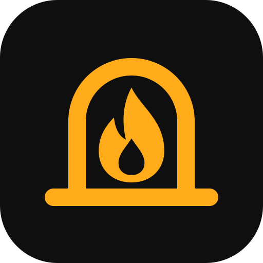

# Hearth brand guide

A short guide for anyone writing about Hearth or changing how it looks.

## The idea

A hearth is the warm place at the centre of a home, where the fire is kept. Hearth, the app, works the same way: the AI lives in your home (your browser, on your device), it's yours once it's downloaded, and it keeps going without anything from outside.

The app's personality is **a trustworthy companion that lives with you**: warm, plain-spoken and honest about what it can't do. It is not a powerful cloud AI tool.

## Words

| Part | Text | Where it's used |
|---|---|---|
| **Name** | Hearth | Everywhere. One word with a capital H. Never "HearthAI", "Hearth Chat" or "HEARTH" in running text (the uppercase style in the header and Settings is only a typeface treatment). |
| **Descriptor** | Private AI chat | After the name when people need to know what it is: page title "Hearth · Private AI chat", the header ("Private AI chat on this device"). |
| **Promise** | Private AI chat that lives in your browser. | The one-line description: README, manifest, page description. |
| **Proof line** | No server. No account. Works offline. | Show *why* it's private rather than only saying so: the welcome screen, README, store-style descriptions. |
| **Credit** | Powered by WebLLM | The README and the bottom of Settings, with a link to [WebLLM](https://github.com/mlc-ai/web-llm). WebLLM is the engine's name (by MLC), not part of the app's name. |

Write the way the app talks: short sentences, plain words, no hype. Don't promise more than is true. Say "nothing you type leaves your device", not "military-grade privacy".

## Icon

A flame inside an arched hearth with a base, in amber on a near-black rounded square.

* Source: [`icons/hearth.svg`](../icons/hearth.svg). The PNGs (favicon, app icons, the maskable Android icon and the Apple touch icon) are drawn from the same geometry by [`icons/build-icons.cjs`](../icons/build-icons.cjs): run `npm run icons` after changing it.
* The header draws the same mark inline in the amber text colour, so it follows the light and dark themes.
* The favicon leaves out the flame's dark core and draws the mark larger, so it stays clear at 16–32 px.
* Keep clear space around the mark of at least the width of the arch's stroke. Don't recolour the flame on its own, add effects, or put the mark on a busy background.

## Colours

| Token | Dark theme | Light theme | Use |
|---|---|---|---|
| Amber (`--amber`) | `#ffab1a` | `#e89a12` | The mark, primary buttons, highlights |
| Amber text (`--amber-text`) | `#ffcc66` | `#8a5200` | The name in the header and Settings, amber text |
| Background (`--bg`) | `#0f0f0f` | `#f6f4ef` | Page background; the icon's tile is always the dark one |

All colours are tokens at the top of [`style.css`](../style.css).

## Type

* **DM Mono** (500, uppercase, wide letter spacing) for the name in the header and at the bottom of Settings.
* **DM Sans** for everything else.

Both are served with the app (`fonts/`, SIL Open Font License).
