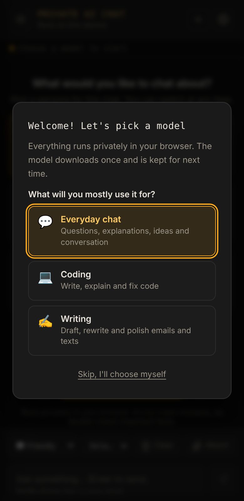
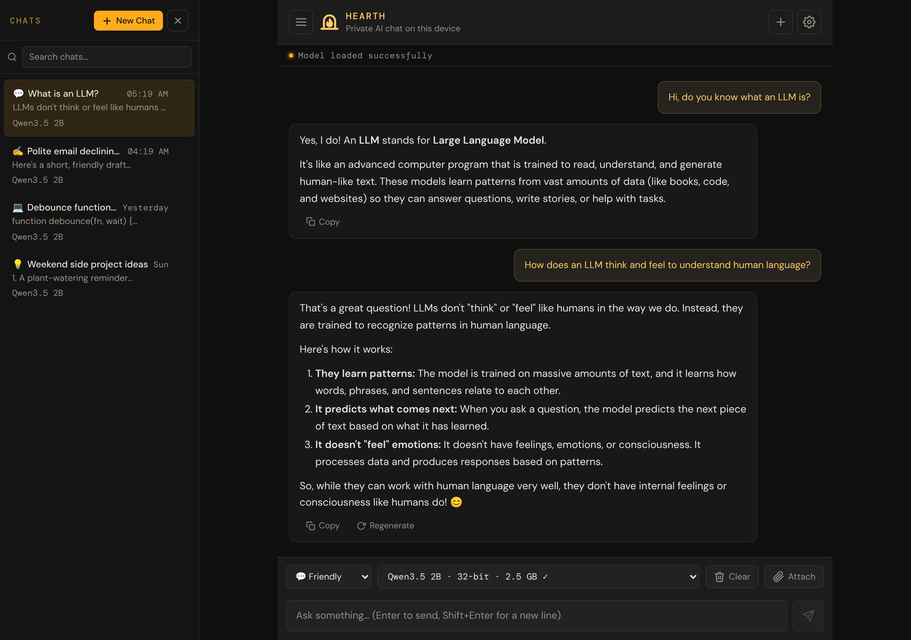

# 1. Getting started

[← Manual home](README.md) · [Next: Chatting →](02-chatting.md)

This chapter gets you from "never used it" to "first answer on screen". It takes about five minutes, plus the time for a one-time download.

## What you need

| You need | Details |
|---|---|
| **A supported browser** | Google Chrome (version 121 or newer) or Microsoft Edge on a computer, or Safari on macOS 14 / iOS 17 or newer. Chrome on Android also works on many phones. |
| **WebGPU** | A browser feature that lets web pages use your graphics chip. The browsers above have it. If yours doesn't, the app tells you and shows how to fix it (see [Troubleshooting](09-troubleshooting.md#webgpu-not-available)). |
| **Free storage space** | At least 2–3 GB for a small model; up to about 8 GB for the largest. |
| **An internet connection (first time only)** | To download the app and the AI model. A Wi‑Fi connection is best because the download is large. |
| **A reasonably modern device** | Any recent laptop or desktop works for small models. A dedicated graphics card helps with bigger, smarter models. **A computer gives the best results:** phones have little memory for the AI, and many can only run the Tiny models, whose answers are very limited. |

> **Note:** You don't need an account, a password, or an API key. There is nothing to sign up for.

## Step 1: Open the app

Go to **[bowo-prasetyo.github.io/web-llm](https://bowo-prasetyo.github.io/web-llm/)**.

The first time, a window titled **Welcome! Let's pick a model** appears.

> **What's a model?** The *model* is the AI "brain" that writes the replies. Small models are fast and light; large models give better answers but need a stronger device and a bigger download.

## Step 2: Answer two questions

The app chooses a model that suits your device based on two simple questions.

**Question 1 — What will you mostly use it for?**

| Choice | Good for |
|---|---|
| 💬 **Everyday chat** | Questions, explanations, ideas and conversation |
| 💻 **Coding** | Writing, explaining and fixing code |
| ✍️ **Writing** | Drafting, rewriting and polishing emails and texts |

Your choice also sets the starting *persona* (the assistant's style). You can change it later.

**Question 2 — Pick a size**

| Size | What to expect |
|---|---|
| **Fast** | Quick replies and the smallest download, but more likely to get facts wrong. On phones this is Llama 3.2 1B (about 1 GB). |
| **Balanced** | Noticeably better answers. Best for most laptops. |
| **Smart** | Best answers, large download. Needs a strong graphics card. |

One option is labelled **Recommended** for your device. If you're unsure, pick that one. Each option shows the model's name and its download size.

Tap **Download & start**.

> **Tip:** Not sure? Choose **Fast** first. You can always switch to a bigger model later without losing your chats.

> **Want to choose yourself?** Tap **Skip, I'll choose myself** on the first screen. Nothing is downloaded until you pick a model from the model menu.

## Step 3: Wait for the one-time download

A progress panel appears at the top of the chat. It shows:

* what is happening (downloading, loading from this device, or preparing the GPU),
* a progress bar and percentage,
* how much has been downloaded, and, once it can estimate, the time left.

Downloads range from about **1.6 GB** (smallest recommended pick) to **7.4 GB** (largest). On a typical home connection that's a few minutes to half an hour.

> **Important:** Keep the tab open until the download finishes. If you change your mind, tap **Cancel** in the panel. The app goes back to how it was before.

When the panel disappears and the status bar says the model is ready, you're set. **Next time you open the app, the model loads from your device in seconds, with no download.**

## Step 4: Say hello

The welcome screen asks **What would you like to chat about?**

1. *(Optional)* Tap a persona card, such as **Friendly** or **Precise**.
2. Type a question in the message box at the bottom, for example: *"Explain how rainbows form, in simple words."*
   Or tap one of the suggested starter prompts.
3. Press **Enter** (on a keyboard) or tap the **Send** button (the paper-plane icon).

The reply appears word by word. That's it, you're chatting!

## A quick tour of the screen

| Area | What it does |
|---|---|
| **Header** (top) | **☰** opens or hides the chat list. **+** starts a new chat. **⚙** opens Settings. |
| **Status bar** | Short messages, such as "loading" or "ready". Shows an **Offline** badge when you have no internet. |
| **Chat list** (left on wide screens; slides in on phones) | All your saved chats, with a search box. |
| **Conversation** (middle) | Your messages and the assistant's replies. |
| **Toolbar** (above the message box) | Persona menu, model menu, **Clear**, and **Attach**. |
| **Message box** (bottom) | Where you type. The **Send** button sits to its right. |

## What's next?

* Learn the everyday controls in [Chatting with the assistant](02-chatting.md).
* Want the app on your home screen or dock? See [Installing the app](08-offline-and-backup.md#install-the-app).

[← Manual home](README.md) · [Next: Chatting →](02-chatting.md)
