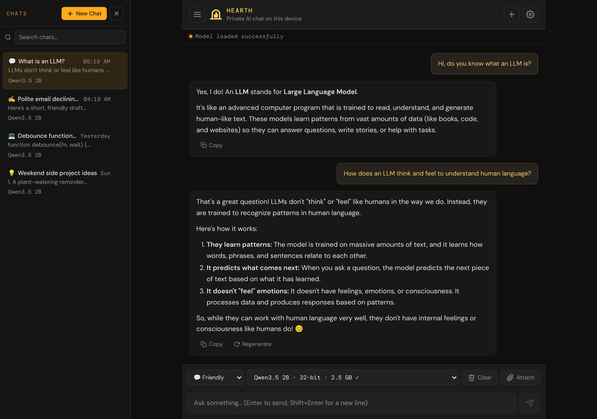

# Hearth — User Manual

**English** · [Bahasa Indonesia](id/README.md)

Welcome! This manual explains how to use **Hearth**, a private AI chat that lives in your web browser. You don't need an account, you don't need to install anything, and nothing you type is sent to a server.

**Open the app:** [bowo-prasetyo.github.io/web-llm](https://bowo-prasetyo.github.io/web-llm/)

## Who this manual is for

Anyone who wants to use the app: no technical knowledge is needed. Words that may be new to you (like *model* or *token*) are explained the first time they appear, and again in the [Glossary](10-faq-and-glossary.md#glossary).

If you want to change the app's code, see the project [README](../../README.md) instead.

## Start here

New to the app? Read these two first. Together they take about five minutes.

1. [Getting started](01-getting-started.md): what you need, and your first chat in three steps.
2. [Chatting with the assistant](02-chatting.md): sending messages, stopping, copying, and redoing replies.

## Everything else

| Chapter | Read it when you want to… |
|---|---|
| [3. Managing your chats](03-managing-chats.md) | Start new chats, find old ones, search, or delete them |
| [4. Personas](04-personas.md) | Change *how* the assistant talks: friendly, precise, writer, coder, brainstorm, or your own |
| [5. Asking about your documents](05-documents.md) | Attach a PDF, text or Markdown file and ask questions about it |
| [6. Choosing a model](06-models.md) | Pick a faster or smarter AI model, or understand the model list |
| [7. Settings](07-settings.md) | Adjust reply length, creativity, and other options |
| [8. Offline use, installing, and moving your data](08-offline-and-backup.md) | Use the app without internet, add it to your home screen, or back up your chats |
| [9. Troubleshooting](09-troubleshooting.md) | Fix a problem: the app won't start, replies are slow or garbled, a download failed |
| [10. FAQ and glossary](10-faq-and-glossary.md) | Get quick answers and look up unfamiliar terms |
| [Quick reference card](quick-reference.md) | See every button and keyboard shortcut on one page |

## The app in 30 seconds

* **Private.** The AI runs on your own device's graphics chip (GPU). Your messages, chats and files stay in your browser.
* **One download, then it's yours.** The first time, the app downloads an AI model (about 0.4 GB or more). After that it starts from your device, even offline.
* **Choose a style.** Personas make the assistant chattier, shorter, better at writing, or better at code.
* **Bring your documents.** Attach a file to a chat and ask questions about it.
* **Keep your chats.** Every chat is saved automatically. Search them, export them, and import them on another device.

## Conventions used in this manual

* **Bold text** is something you see on screen: a button, a menu, or a heading. For example: tap **Send**.
* **Settings → Personas** means "open Settings, then go to the Personas section".
* "Tap" means tap on a touch screen *or* click with a mouse.
* > **Tip:** boxes give a helpful shortcut or recommendation.
* > **Note:** boxes point out something to be aware of.
* > **Important:** boxes warn you before something that can't be undone.

## A word of caution

The AI can make mistakes. It may sound confident and still be wrong. Double-check anything important, such as medical, legal, financial or safety information, with a trusted source.
