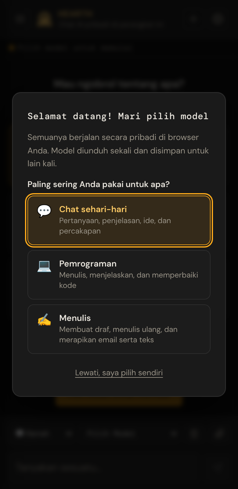
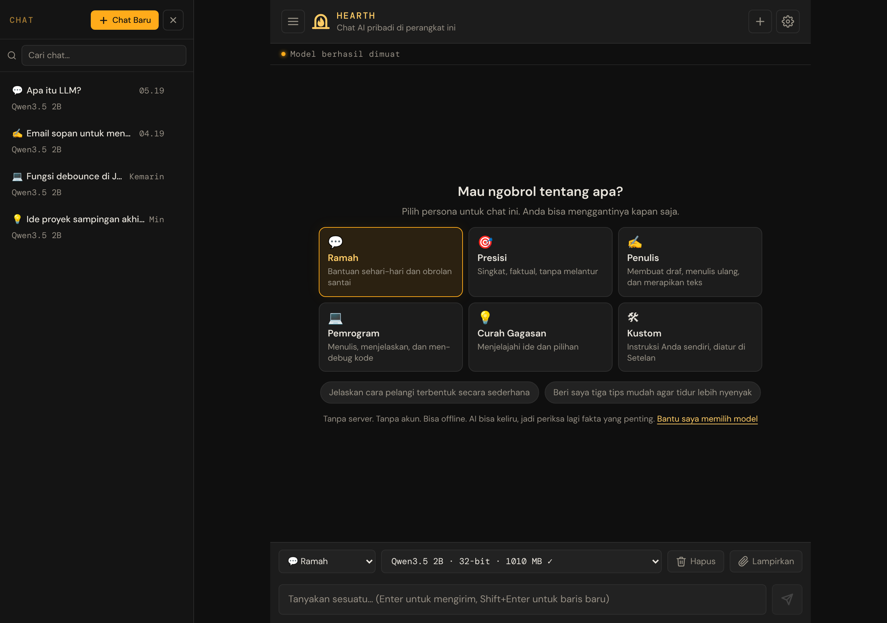

# 1. Memulai

[← Beranda panduan](README.md) · [Berikutnya: Mengobrol →](02-chatting.md)

Bab ini membawa Anda dari "belum pernah memakai" sampai "jawaban pertama muncul di layar". Waktunya sekitar lima menit, ditambah waktu untuk unduhan sekali saja.

## Yang Anda perlukan

| Anda perlu | Detail |
|---|---|
| **Browser yang didukung** | Google Chrome (versi 121 atau lebih baru) atau Microsoft Edge di komputer, atau Safari di macOS 14 / iOS 17 atau lebih baru. Chrome di Android juga berfungsi di banyak ponsel. |
| **WebGPU** | Fitur browser yang memungkinkan halaman web memakai chip grafis Anda. Browser di atas memilikinya. Jika browser Anda tidak punya, aplikasi akan memberi tahu dan menunjukkan cara mengatasinya (lihat [Pemecahan masalah](09-troubleshooting.md#webgpu-tidak-tersedia)). |
| **Ruang penyimpanan kosong** | Minimal 2–3 GB untuk model kecil; sampai sekitar 8 GB untuk yang terbesar. |
| **Koneksi internet (hanya pertama kali)** | Untuk mengunduh aplikasi dan model AI. Wi‑Fi paling baik karena unduhannya besar. |
| **Perangkat yang cukup modern** | Laptop atau komputer meja yang baru mana pun cukup untuk model kecil. Kartu grafis tersendiri membantu untuk model yang lebih besar dan lebih pintar. **Komputer memberi hasil terbaik:** ponsel hanya punya sedikit memori untuk AI, dan banyak ponsel hanya mampu menjalankan model Sangat kecil, yang jawabannya sangat terbatas. |

> **Catatan:** Anda tidak perlu akun, kata sandi, atau kunci API. Tidak ada yang perlu didaftarkan.

## Langkah 1: Buka aplikasinya

Buka **[bowo-prasetyo.github.io/web-llm](https://bowo-prasetyo.github.io/web-llm/)**.

Pada kunjungan pertama, muncul jendela berjudul **Selamat datang! Mari pilih model**.

> **Apa itu model?** *Model* adalah "otak" AI yang menulis balasan. Model kecil cepat dan ringan; model besar memberi jawaban yang lebih baik tetapi memerlukan perangkat yang lebih kuat dan unduhan yang lebih besar.

> **Bahasa:** Jika browser Anda memakai bahasa Indonesia, aplikasi otomatis tampil dalam bahasa Indonesia. Anda bisa menggantinya kapan saja di **Setelan → Bahasa**.

## Langkah 2: Jawab dua pertanyaan

Aplikasi memilih model yang cocok untuk perangkat Anda berdasarkan dua pertanyaan sederhana.

**Pertanyaan 1 — Paling sering Anda pakai untuk apa?**

| Pilihan | Cocok untuk |
|---|---|
| 💬 **Chat sehari-hari** | Pertanyaan, penjelasan, ide, dan percakapan |
| 💻 **Pemrograman** | Menulis, menjelaskan, dan memperbaiki kode |
| ✍️ **Menulis** | Membuat draf, menulis ulang, dan merapikan email serta teks |

Pilihan Anda juga menentukan *persona* awal (gaya bicara asisten). Anda bisa menggantinya nanti.

**Pertanyaan 2 — Pilih ukuran**

| Ukuran | Yang bisa Anda harapkan |
|---|---|
| **Cepat** | Balasan cepat dan unduhan terkecil, tetapi lebih sering salah soal fakta. Di ponsel ini adalah Llama 3.2 1B (unduhan sekitar 0,7 GB). |
| **Seimbang** | Jawaban yang jelas lebih baik. Paling cocok untuk kebanyakan laptop. |
| **Pintar** | Jawaban terbaik, unduhan besar. Perlu kartu grafis yang kuat. |

Satu pilihan diberi label **Disarankan** untuk perangkat Anda. Jika ragu, pilih yang itu. Setiap pilihan menampilkan nama model dan ukuran unduhannya.

Ketuk **Unduh & mulai**.

> **Tips:** Masih ragu? Pilih **Cepat** dulu. Anda selalu bisa beralih ke model yang lebih besar nanti tanpa kehilangan chat.

> **Ingin memilih sendiri?** Ketuk **Lewati, saya pilih sendiri** di layar pertama. Tidak ada yang diunduh sampai Anda memilih model dari menu model.

## Langkah 3: Tunggu unduhan pertama

Panel kemajuan muncul di bagian atas chat. Panel ini menampilkan:

* apa yang sedang terjadi (mengunduh, memuat dari perangkat ini, atau menyiapkan GPU),
* bilah kemajuan dan persentasenya,
* berapa banyak yang sudah diunduh, dan, setelah bisa diperkirakan, sisa waktunya.

Ukuran unduhan berkisar dari sekitar **0,4 GB** (pilihan terkecil yang disarankan) sampai **4,8 GB** (yang terbesar). Dengan koneksi rumah biasa, itu beberapa menit sampai setengah jam.

> **Penting:** Biarkan tab tetap terbuka sampai unduhan selesai. Jika Anda berubah pikiran, ketuk **Batal** di panel. Aplikasi kembali seperti sebelumnya.

Saat panel hilang dan bilah status mengatakan model sudah siap, Anda siap memakai. **Lain kali Anda membuka aplikasi, model dimuat dari perangkat Anda dalam hitungan detik, tanpa unduhan.**

## Langkah 4: Ucapkan halo

Layar pembuka bertanya **Mau ngobrol tentang apa?**

1. *(Opsional)* Ketuk kartu persona, misalnya **Ramah** atau **Presisi**.
2. Ketik pertanyaan di kotak pesan di bagian bawah, misalnya: *"Jelaskan bagaimana pelangi terbentuk, dengan kata-kata sederhana."*
   Atau ketuk salah satu contoh pertanyaan yang disarankan.
3. Tekan **Enter** (di keyboard) atau ketuk tombol **Kirim** (ikon pesawat kertas).

Balasan muncul kata demi kata. Selesai, Anda sudah mengobrol!

## Tur singkat layar

| Area | Fungsinya |
|---|---|
| **Kepala halaman** (atas) | **☰** membuka atau menyembunyikan daftar chat. **+** memulai chat baru. **⚙** membuka Setelan. |
| **Bilah status** | Pesan singkat, seperti "memuat" atau "siap". Menampilkan lencana **Offline** saat Anda tidak tersambung ke internet. |
| **Daftar chat** (di kiri pada layar lebar; bergeser masuk di ponsel) | Semua chat tersimpan Anda, dengan kotak pencarian. |
| **Percakapan** (tengah) | Pesan Anda dan balasan asisten. |
| **Bilah alat** (di atas kotak pesan) | Menu persona, menu model, **Hapus**, dan **Lampirkan**. Di ponsel, **Hapus** dan **Lampirkan** hanya menampilkan ikonnya. |
| **Kotak pesan** (bawah) | Tempat Anda mengetik. Tombol **Kirim** ada di sebelah kanannya. |

## Selanjutnya

* Pelajari kontrol sehari-hari di [Mengobrol dengan asisten](02-chatting.md).
* Ingin aplikasi ini ada di layar utama atau dock Anda? Lihat [Memasang aplikasi](08-offline-and-backup.md#memasang-aplikasi).

[← Beranda panduan](README.md) · [Berikutnya: Mengobrol →](02-chatting.md)
