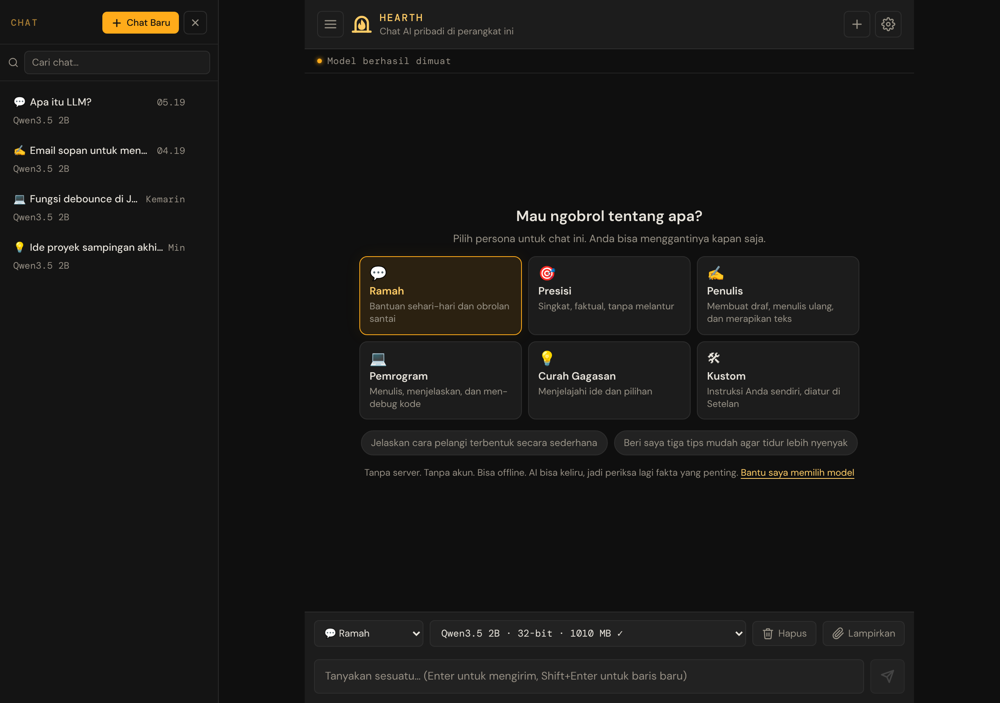

# Hearth — Panduan Pengguna

[English](../README.md) · **Bahasa Indonesia** · [日本語](../ja/README.md)

Selamat datang! Panduan ini menjelaskan cara memakai **Hearth**, chat AI pribadi yang tinggal di browser web Anda. Anda tidak perlu akun, tidak perlu memasang apa pun, dan tidak ada yang Anda ketik yang dikirim ke server.

**Buka aplikasinya:** [bowo-prasetyo.github.io/web-llm](https://bowo-prasetyo.github.io/web-llm/)

## Untuk siapa panduan ini

Untuk siapa saja yang ingin memakai aplikasi ini: tidak perlu pengetahuan teknis. Kata-kata yang mungkin baru bagi Anda (seperti *model* atau *token*) dijelaskan saat pertama kali muncul, dan juga di [Glosarium](10-faq-and-glossary.md#glosarium).

Jika Anda ingin mengubah kode aplikasi, bacalah [README](../../../README.id.md) proyek ini.

> **Catatan:** Panduan ini adalah terjemahan dari [versi bahasa Inggris](../README.md). Jika ada perbedaan, versi bahasa Inggris yang berlaku.

## Mulai dari sini

Baru memakai aplikasi ini? Bacalah dua bab ini dulu. Keduanya memakan waktu sekitar lima menit.

1. [Memulai](01-getting-started.md): apa yang Anda perlukan, dan chat pertama Anda dalam tiga langkah.
2. [Mengobrol dengan asisten](02-chatting.md): mengirim pesan, menghentikan, menyalin, dan mengulang balasan.

## Bab lainnya

| Bab | Bacalah saat Anda ingin… |
|---|---|
| [3. Mengelola chat](03-managing-chats.md) | Memulai chat baru, menemukan chat lama, mencari, atau menghapusnya |
| [4. Persona](04-personas.md) | Mengubah *cara* asisten berbicara: ramah, presisi, penulis, pemrogram, curah gagasan, atau milik Anda sendiri |
| [5. Bertanya tentang dokumen Anda](05-documents.md) | Melampirkan file PDF, teks, atau Markdown dan bertanya tentang isinya |
| [6. Memilih model](06-models.md) | Memilih model AI yang lebih cepat atau lebih pintar, atau memahami daftar model |
| [7. Setelan](07-settings.md) | Mengatur panjang balasan, kreativitas, bahasa, dan pilihan lainnya |
| [8. Memakai secara offline, memasang aplikasi, dan memindahkan data](08-offline-and-backup.md) | Memakai aplikasi tanpa internet, menambahkannya ke layar utama, atau mencadangkan chat |
| [9. Pemecahan masalah](09-troubleshooting.md) | Mengatasi masalah: aplikasi tidak mau mulai, balasan lambat atau kacau, unduhan gagal |
| [10. Tanya jawab dan glosarium](10-faq-and-glossary.md) | Mendapat jawaban cepat dan mencari arti istilah yang asing |
| [Kartu referensi cepat](quick-reference.md) | Melihat semua tombol dan pintasan keyboard dalam satu halaman |

## Aplikasi ini dalam 30 detik

* **Pribadi.** AI berjalan di chip grafis (GPU) perangkat Anda sendiri. Pesan, chat, dan file Anda tetap di browser Anda.
* **Unduh sekali, lalu jadi milik Anda.** Pertama kali, aplikasi mengunduh model AI (sekitar 0,4 GB atau lebih). Setelah itu aplikasi dimulai dari perangkat Anda, bahkan saat offline.
* **Pilih gaya.** Persona membuat asisten lebih suka mengobrol, lebih singkat, lebih pandai menulis, atau lebih pandai soal kode.
* **Bawa dokumen Anda.** Lampirkan file ke sebuah chat dan bertanyalah tentang isinya.
* **Simpan chat Anda.** Setiap chat disimpan otomatis. Cari, ekspor, dan impor chat di perangkat lain.
* **Dalam bahasa Anda.** Aplikasi tersedia dalam bahasa Inggris, bahasa Indonesia, dan bahasa Jepang (**Setelan → Bahasa**). AI membalas dalam bahasa yang Anda pakai saat menulis.

## Konvensi dalam panduan ini

* **Teks tebal** adalah sesuatu yang Anda lihat di layar: tombol, menu, atau judul. Contoh: ketuk **Kirim**.
* **Setelan → Persona** berarti "buka Setelan, lalu ke bagian Persona".
* "Ketuk" berarti mengetuk layar sentuh *atau* mengeklik dengan mouse.
* > **Tips:** kotak ini memberi jalan pintas atau saran yang berguna.
* > **Catatan:** kotak ini menunjukkan hal yang perlu Anda perhatikan.
* > **Penting:** kotak ini memperingatkan Anda sebelum sesuatu yang tidak bisa dibatalkan.

## Sedikit peringatan

AI bisa keliru. AI bisa terdengar yakin padahal salah. Periksa lagi hal yang penting, seperti informasi medis, hukum, keuangan, atau keselamatan, dengan sumber tepercaya.
