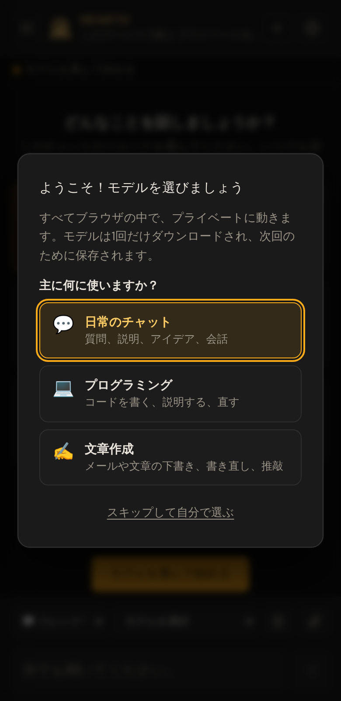
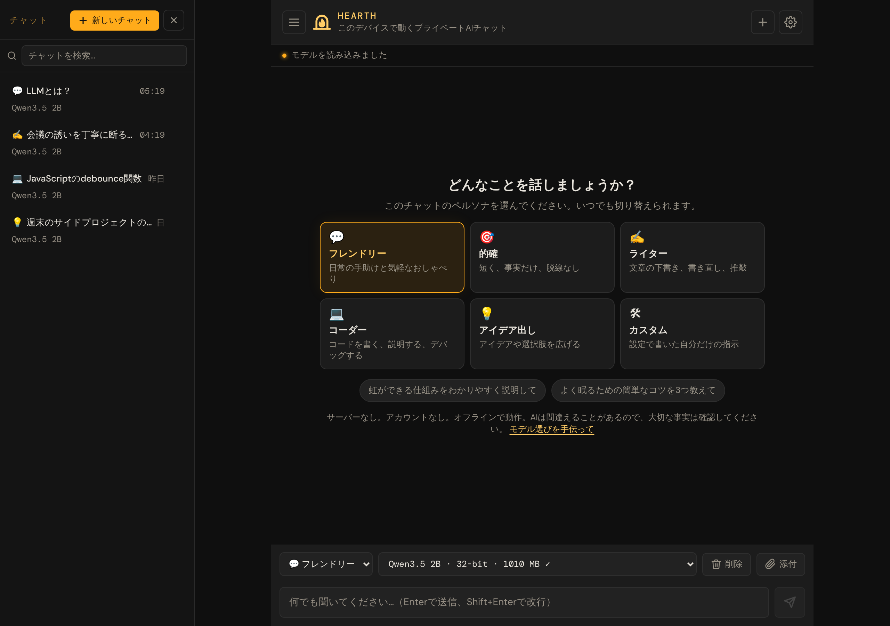

# 1. はじめに

[← マニュアルのトップ](README.md) · [次へ: チャットする →](02-chatting.md)

この章では、「まだ使ったことがない」状態から「最初の回答が画面に表示される」ところまでを説明します。所要時間は約5分と、1回だけのダウンロードの時間です。

## 必要なもの

| 必要なもの | 詳細 |
|---|---|
| **対応ブラウザ** | パソコンのGoogle Chrome（バージョン121以降）またはMicrosoft Edge、またはmacOS 14 / iOS 17以降のSafari。多くのスマートフォンでAndroid版Chromeも動きます。 |
| **WebGPU** | Webページがグラフィックスチップを使えるようにするブラウザの機能です。上記のブラウザには搭載されています。お使いのブラウザにない場合は、アプリがその旨と対処方法を表示します（[トラブルシューティング](09-troubleshooting.md#webgpuを利用できません)を参照）。 |
| **ストレージの空き容量** | 小さいモデルで2〜3 GB以上、最大のモデルで約8 GBまで。 |
| **インターネット接続（初回のみ）** | アプリとAIモデルをダウンロードするためです。ダウンロードが大きいため、Wi‑Fiがおすすめです。 |
| **ある程度新しいデバイス** | 小さいモデルなら、最近のノートPCやデスクトップPCで動きます。より大きく賢いモデルには、専用のグラフィックスカードがあると有利です。**最も良い結果が得られるのはパソコンです:** スマートフォンはAIに使えるメモリが少なく、多くの機種では回答がごく限定的な極小モデルしか動きません。 |

> **メモ:** アカウント、パスワード、APIキーは不要です。登録するものは何もありません。

## ステップ1: アプリを開く

**[bowo-prasetyo.github.io/web-llm](https://bowo-prasetyo.github.io/web-llm/)** を開きます。

初回は **ようこそ！モデルを選びましょう** というウィンドウが表示されます。

> **モデルとは？** *モデル*は返信を書くAIの「頭脳」です。小さいモデルは速くて軽く、大きいモデルは回答の質が高い代わりに、より高性能なデバイスと大きなダウンロードが必要です。

> **言語:** ブラウザの言語が日本語なら、アプリは自動的に日本語で表示されます。**設定 → 言語** でいつでも変更できます。

## ステップ2: 2つの質問に答える

2つの簡単な質問への答えをもとに、アプリがお使いのデバイスに合ったモデルを選びます。

**質問1 — 主に何に使いますか？**

| 選択肢 | 向いている用途 |
|---|---|
| 💬 **日常のチャット** | 質問、説明、アイデア、会話 |
| 💻 **プログラミング** | コードを書く、説明する、直す |
| ✍️ **文章作成** | メールや文章の下書き、書き直し、推敲 |

この選択で最初の*ペルソナ*（アシスタントの話し方）も決まります。あとから変更できます。

**質問2 — サイズを選ぶ**

| サイズ | 特徴 |
|---|---|
| **高速** | 返信が速く、ダウンロードも最小ですが、事実を間違えやすくなります。スマートフォンではLlama 3.2 1B（約0.7 GBのダウンロード）です。 |
| **バランス** | 回答の質がはっきり上がります。ほとんどのノートPCに最適です。 |
| **高性能** | 最も良い回答。ダウンロードは大きく、強力なグラフィックスカードが必要です。 |

お使いのデバイスに合う選択肢には **おすすめ** と表示されます。迷ったらそれを選んでください。各選択肢にはモデル名とダウンロードサイズが表示されます。

**ダウンロードして開始** をタップします。

> **ヒント:** 迷ったら、まず **高速** を選びましょう。チャットを失うことなく、あとからいつでも大きいモデルに切り替えられます。

> **自分で選びたい場合:** 最初の画面で **スキップして自分で選ぶ** をタップします。モデルメニューからモデルを選ぶまで、何もダウンロードされません。

## ステップ3: 1回だけのダウンロードを待つ

チャットの上部に進行状況のパネルが表示されます。パネルには次の内容が表示されます。

* 現在の処理（ダウンロード中、このデバイスから読み込み中、GPU用に準備中）
* 進行状況バーとパーセンテージ
* ダウンロード済みの量と、推定できるようになったら残り時間

ダウンロードの大きさは、約 **0.4 GB**（おすすめの中で最小）から **4.8 GB**（最大）です。一般的な家庭の回線で、数分から30分ほどかかります。

> **重要:** ダウンロードが終わるまでタブを開いたままにしてください。途中でやめたい場合は、パネルの **キャンセル** をタップします。アプリは元の状態に戻ります。

パネルが消え、ステータスバーにモデルの準備ができたと表示されたら完了です。**次回アプリを開くと、ダウンロードなしで数秒でデバイスからモデルが読み込まれます。**

## ステップ4: 話しかけてみる

ウェルカム画面に **どんなことを話しましょうか？** と表示されます。

1. *（省略可）* **フレンドリー** や **的確** などのペルソナカードをタップします。
2. 下部のメッセージ欄に質問を入力します。例: *「虹ができる仕組みをわかりやすく説明して」*
   または、表示されている質問の例をタップします。
3. **Enter**（キーボード）を押すか、**送信** ボタン（紙飛行機のアイコン）をタップします。

返信が少しずつ表示されます。これでチャットの始まりです！

## 画面の見かた

| 場所 | 役割 |
|---|---|
| **ヘッダー**（上部） | **☰** でチャット一覧を開閉します。**+** で新しいチャットを始めます。**⚙** で設定を開きます。 |
| **ステータスバー** | 「読み込み中」「準備完了」などの短いメッセージ。インターネットに接続していないときは **オフライン** と表示されます。 |
| **チャット一覧**（広い画面では左側、スマートフォンではスライドして表示） | 保存されたすべてのチャットと検索欄。 |
| **会話**（中央） | あなたのメッセージとアシスタントの返信。 |
| **ツールバー**（メッセージ欄の上） | ペルソナメニュー、モデルメニュー、**削除**、**添付**。スマートフォンでは **削除** と **添付** はアイコンだけが表示されます。 |
| **メッセージ欄**（下部） | ここに入力します。右側に **送信** ボタンがあります。 |

## 次に読む

* 毎日使う操作は[アシスタントとチャットする](02-chatting.md)で説明しています。
* アプリをホーム画面やDockに置きたい場合は、[アプリをインストールする](08-offline-and-backup.md#アプリをインストールする)をご覧ください。

[← マニュアルのトップ](README.md) · [次へ: チャットする →](02-chatting.md)
