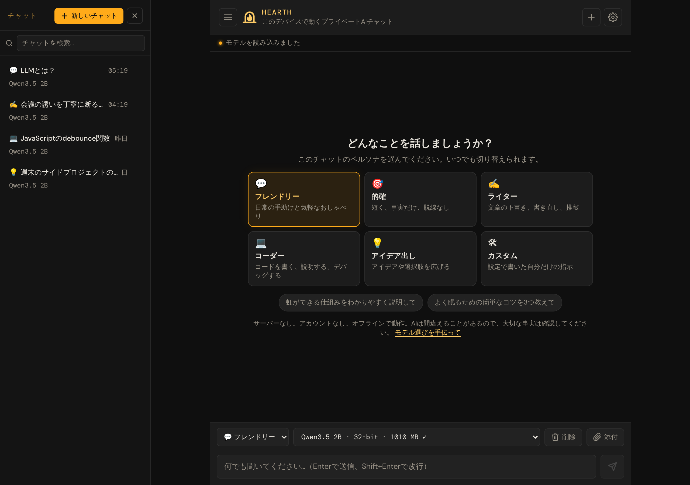

# Hearth — ユーザーマニュアル

[English](../README.md) · [Bahasa Indonesia](../id/README.md) · **日本語**

ようこそ！このマニュアルでは、Webブラウザの中で動くプライベートAIチャット **Hearth** の使い方を説明します。アカウントは不要で、何もインストールする必要はなく、入力した内容がサーバーに送られることもありません。

**アプリを開く:** [bowo-prasetyo.github.io/web-llm](https://bowo-prasetyo.github.io/web-llm/)

## このマニュアルの対象

アプリを使いたいすべての方が対象です。技術的な知識は必要ありません。なじみのない言葉（*モデル*や*トークン*など）は、最初に出てきたときと[用語集](10-faq-and-glossary.md#用語集)で説明しています。

アプリのコードを変更したい場合は、プロジェクトの[README](../../../README.ja.md)をご覧ください。

> **メモ:** このマニュアルは[英語版](../README.md)の翻訳です。内容が異なる場合は英語版が優先されます。

## まずはここから

初めての方は、まずこの2つの章を読んでください。合わせて5分ほどで読めます。

1. [はじめに](01-getting-started.md): 必要なものと、3ステップで始める最初のチャット。
2. [アシスタントとチャットする](02-chatting.md): メッセージの送信、停止、コピー、返信のやり直し。

## その他の章

| 章 | こんなときに読む… |
|---|---|
| [3. チャットの管理](03-managing-chats.md) | 新しいチャットを始める、過去のチャットを探す、検索する、削除する |
| [4. ペルソナ](04-personas.md) | アシスタントの*話し方*を変える: フレンドリー、的確、ライター、コーダー、アイデア出し、または自分だけの指示 |
| [5. ドキュメントについて質問する](05-documents.md) | PDF、テキスト、Markdownファイルを添付して内容について質問する |
| [6. モデルを選ぶ](06-models.md) | より速い、またはより賢いAIモデルを選ぶ、モデル一覧の見方を知る |
| [7. 設定](07-settings.md) | 返信の長さ、創造性、言語などを調整する |
| [8. オフラインでの利用、インストール、データの移行](08-offline-and-backup.md) | インターネットなしで使う、ホーム画面に追加する、チャットをバックアップする |
| [9. トラブルシューティング](09-troubleshooting.md) | 問題を解決する: アプリが起動しない、返信が遅い・文字化けする、ダウンロードに失敗した |
| [10. よくある質問と用語集](10-faq-and-glossary.md) | すぐに答えを知りたい、知らない用語を調べたい |
| [クイックリファレンス](quick-reference.md) | すべてのボタンとキーボードショートカットを1ページで確認する |

## 30秒でわかるHearth

* **プライベート。** AIはお使いのデバイスのグラフィックスチップ（GPU）で動きます。メッセージ、チャット、ファイルはブラウザの中にとどまります。
* **ダウンロードは1回だけ。** 最初にAIモデル（約0.4 GB以上）をダウンロードします。その後はオフラインでも、デバイスから起動します。
* **スタイルを選べる。** ペルソナで、アシスタントをもっとおしゃべりに、もっと簡潔に、文章作成やコードに強くできます。
* **ドキュメントを使える。** チャットにファイルを添付して、その内容について質問できます。
* **チャットが残る。** すべてのチャットは自動で保存されます。検索、エクスポート、別のデバイスへのインポートができます。
* **あなたの言語で。** アプリは英語、インドネシア語、日本語で使えます（**設定 → 言語**）。AIはあなたが書いた言語で返信します。

## このマニュアルの表記

* **太字**は画面に表示されるもの（ボタン、メニュー、見出し）です。例: **送信**をタップします。
* **設定 → ペルソナ**は「設定を開き、ペルソナの項目に進む」という意味です。
* 「タップ」はタッチ画面でのタップ、*または*マウスでのクリックを意味します。
* > **ヒント:** 役に立つ近道やおすすめです。
* > **メモ:** 知っておくとよいことです。
* > **重要:** 元に戻せない操作の前の注意です。

## ご注意

AIは間違えることがあります。自信がありそうに見えても間違っている場合があります。医療、法律、お金、安全に関わる情報など、大切なことは信頼できる情報源で必ず確認してください。
